<p align="center">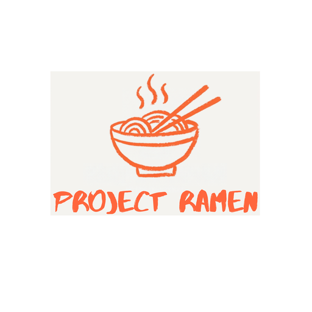</p>

<p align="center">Build your MCP tools, apps and skills in Python, deploy them across zones on <b>GKE, EKS and AKS</b>.<br>
MCP 2026-07-28 over Streamable HTTP and gRPC, canary deploys gated by golden cases, evals and skill scans,<br>
guardrails, client policies enforced at every sign-in, telemetry per group and user — managed from one console.</p>

<p align="center">
<a href="https://github.com/bkraad47/ramen/releases"></a>
<a href="https://github.com/bkraad47/ramen/actions/workflows/ci.yml"></a>
<a href="https://bkraad47.github.io/ramen/"></a>
<a href="https://hub.docker.com/r/bkraad47/ramen-worker"></a>
<a href="https://pypi.org/project/ramen-mcp-bridge/"></a>
<a href="LICENSE"></a>
<a href="https://modelcontextprotocol.io"></a>
<br>
<a href="https://registry.modelcontextprotocol.io/v0/servers?search=io.github.bkraad47/ramen"></a>
<a href="https://bkraad47.github.io/ramen/get-started/"></a>
<a href="https://bkraad47.github.io/ramen/how-it-works/"></a>
<a href="https://github.com/bkraad47/ramen/stargazers"></a>
<a href="https://github.com/bkraad47/ramen/discussions"></a>
</p>

<p align="center"><a href="https://glama.ai/mcp/servers/bkraad47/ramen"></a></p>

**Docs: https://bkraad47.github.io/ramen/** · [Get started](https://bkraad47.github.io/ramen/get-started/) · [Deploy your first group](https://bkraad47.github.io/ramen/first-group/) · [MCP features](https://bkraad47.github.io/ramen/wiki/mcp-features/) · [Roles](https://bkraad47.github.io/ramen/roles/) · [Threat model](https://bkraad47.github.io/ramen/threat-model/) · [Contracts](docs/CONTRACTS.md) · [Releases](https://github.com/bkraad47/ramen/releases)

## What it is

Ramen is a self-hosted, multizone MCP server for teams. Each team (a **group**) keeps a git repo of tools,
resources, prompts, MCP Apps and skills in plain Python; Ramen deploys it as a fleet of MCP workers behind a cloud
load balancer, canary first, gated by the repo's golden cases, a promptfoo eval suite and an NVIDIA SkillSpector scan.
People sign in with a role per group (a Ramen password, Entra ID or Google Workspace), agents use a group key, and
every call — whichever client sends it — must carry the group's current policy versions: telemetry, evals, scans, LLM
configs and guardrails. Each worker pairs a **Rust MCP node** (transport, auth, gates, limits) with a **Python 3.12
runtime** (your code, in its own process); a FastAPI **console** runs everything else. It is a platform for *your*
tools, not a gateway in front of someone else's.

## Key features

- **MCP 2026-07-28** next to 2025-06-18 on the same endpoint, per request: stateless requests, standard headers,
  `server/discover`, subscriptions, progress, completion; the official conformance suite runs in CI against checked-in
  baselines ([MCP features](https://bkraad47.github.io/ramen/wiki/mcp-features/)).
- **Tasks** for long-running tools, and **multi round-trip requests** (elicitation, sampling, roots) for tools that
  ask before they act.
- **MCP Apps** — `mcp/apps/<name>/index.html` served as `ui://<group>/<name>`, previewed in a sandbox on the group
  page — and **Skills over MCP** — `mcp/skills/<name>/SKILL.md` served by `skills/list` and `skill://`.
- **Streamable HTTP and gRPC** on one port through one set of guards, and the stdio
  [bridge](https://pypi.org/project/ramen-mcp-bridge/) for clients that only speak stdio.
- **Guardrails** in the worker before the call and after the result: NeMo rails, static or **LLM-backed**
  (self-check, jailbreak, topical, hallucination, fact-checking), or your own `policy.py`; fail-closed.
- **promptfoo evals** from `mcp/evals/`, run against the canary on every deploy; report or gate per group, runs shared
  in the optional promptfoo UI.
- **NVIDIA SkillSpector scans** of the repo's skills and of what the zone serves, on every deploy, with a report page.
- **Telemetry by group and user**: OpenTelemetry from nodes and the console, one Arize Phoenix project per group,
  `ramen.user` on every span; clients' own telemetry through the console's OTLP ingest.
- **LLM configs enforced at every sign-in**: `mcp/llm-config/` fragments for any client, accepted per person and
  version on every sign-in path, written by the bridge, gated by the workers.
- **LLM judge proxy**: rails, evals and scans call providers through the console (Anthropic, OpenAI, Azure OpenAI,
  Vertex AI, Bedrock, Azure AI Foundry, any OpenAI-compatible server), with per-group allowed models; provider keys
  never leave the console.
- **Per-group image builds** on deploy from `requirements.txt`, each group pushing only to its own repository, images
  pinned by digest.
- **Throttling with Redis** per address and per token, shared across zones; **autoscaling** by Ramen on load and
  latency (no HPA); **sleeping workers** that scale an idle zone to 0 and wake on the first call.
- **Satellite clusters** for zones in other regions, driven by the one console.
- **TLS on every hop** inside an install, with Ramen's own per-install CA (no cert-manager, no mesh); plaintext is
  refused on cloud installs, and the local stack runs TLS too.
- **GCP, AWS and Azure** from Terraform and Helm (CloudFormation too on AWS), each optional engine — Phoenix,
  promptfoo, SkillSpector — one switch.

## Roles

| Role | Scope | May |
|---|---|---|
| **Super admin** | everything | users, groups, Config (identity providers, roles, org LLM providers, telemetry, regions, satellite clusters), API keys, backups, audit, worker sizes, plus all of the below |
| **Group admin** | one group | environments and zones wholly within their groups, deploys, worker counts, sleep, IP rules, throttles, secrets, MCP keys, tool access, the Evals / Scans / Guardrails cards, the group's own LLM providers, members below admin |
| **Viewer** | one group | read the group page, deploy jobs and logs, packages, apps and skills, scan reports, app previews; not secret values |
| **MCP user** | one group | sign in an MCP client and accept the group's LLM configs; nothing else in the console |
| **Custom role** (e.g. `analyst`) | one group | what its base (Group admin, Viewer or MCP user) may, optionally OAuth-only, and its own kind in per-tool access |
| **Group key** (`rmk_`) | one group's workers | call tools for agents and automation; refused by the console |

Every member may connect a client and call the tools that **tool access** lets their role (or a key) list and call,
per environment. `devops` API keys (`rmn_`) drive the console API with a role and groups no wider than their
creator's. Details: [Roles](https://bkraad47.github.io/ramen/roles/).

## Architecture

- **Console** (`console/`, FastAPI + HTMX): the UI and `/api/v1`, the OAuth 2.1 authorization server, deploys,
  builds, evals and scans, the autoscaler, the OTLP ingest and the LLM judge proxy. State in Firestore, DynamoDB or
  Table Storage; secrets in the cloud's secret manager.
- **Node** (`node-rs/`, Rust): one port for Streamable HTTP and gRPC; bearer auth, IP rules, throttle, in-flight cap,
  tool access, the policy gates, the access log and spans.
- **Runtime** (`runtime-py/`, Python 3.12): a child process of the node that loads the group's repo from the bucket,
  renders `env.yaml` from its secrets, runs guardrails and the tool.
- **Environments → zones → workers.** An environment is a name with a git ref, shared by the groups it lists; a zone
  names its environments and runs, for each group that yields, a namespace `ramen-<group>-<zone>` with its own cloud
  identity, route and `worker` + `worker-canary` Deployments. The load balancer routes on the `ramen-group` and
  `ramen-zone` headers, so one client config reaches any zone.
- **Home and satellite clusters.** The home cluster runs the console, the optional engines and the Jobs; satellites
  are worker-only clusters in other regions, joined to the home network.

More: [Architecture](https://bkraad47.github.io/ramen/architecture/) ·
[IAM and network on GCP](https://bkraad47.github.io/ramen/wiki/iam-network-gcp/),
[AWS](https://bkraad47.github.io/ramen/wiki/iam-network-aws/),
[Azure](https://bkraad47.github.io/ramen/wiki/iam-network-azure/).

## How enforcement works

1. **Policy.** A group's settings and repo produce up to five policies, each with a version: telemetry (Config page,
   plus the group's consent switch), evals (`mcp/evals/`), scans (SkillSpector), LLM configs (`mcp/llm-config/`) and
   guardrails (`mcp/guardrails.yaml`). Group admins make each **Required** on the group page; LLM configs are required
   whenever the repo has them.
2. **Sign-in hands it out.** Every sign-in path — OAuth (Claude Code, the bridge), password or magic link, a group key
   minted by an admin — answers the same policy bundle. LLM configs must be **accepted** per person and version (the
   configs page or the OAuth consent page) before a token or key is issued
   ([Connect a client with OAuth](https://bkraad47.github.io/ramen/wiki/connect-oauth/)).
3. **Workers check every call.** `tools/call`, `prompts/get` and `resources/read` without the current version are
   refused, on both transports and both protocol eras: `-32024` / `-32025` telemetry, `-32026` evals, `-32027` scans,
   `-32028` configs, `-32029` guardrails (HTTP 428 on 2026-07-28). A changed policy is pushed to the running workers
   without a deploy, so the next call needs the new version.
4. **The bridge keeps clients in line** (bridge 1.0.0, the bridge for Ramen 1.0.0). It holds the bundle, carries every version, writes the accepted client
   configs and Ramen's OTel settings into Claude Code, Cursor, VS Code, Codex and any other target the repo names,
   signs in again once on a stale version, runs `policy check` from a Claude Code `SessionStart` hook (exit 3 when a
   file was removed), scans local skills with SkillSpector and, with its `nemo` extra, runs the guardrails locally too.

## Quick start (local)

Needs Docker with compose v2, `uv`, `git` and `make`.

```sh
git clone https://github.com/bkraad47/ramen && cd ramen
make up                               # Firestore emulator + console https://localhost:8443 + one worker on :8080
make up ENGINES=phoenix,promptfoo     # optional: the same plus Arize Phoenix (:6006) and promptfoo (:3000)
make demo                             # zone, group `demo` from the demo repo, a key, a canary deploy, a tools/call
#   PASS: demo_calculator_tool(2,3,add) -> 5
make down                             # stop everything, engines included, and remove volumes
```

Sign in at https://localhost:8443 as `admin@ramen.local` with the generated password
(`grep RAMEN_ADMIN_PASSWORD deploy/local/.env`). Nothing in the stack is a static secret. Compose has no Job
runner, so evals, scans and image builds run on the clouds, not locally.

## Deploy to the cloud

Each is `terraform apply` → `helm upgrade --install` with the values Terraform prints → add a zone and a group → Deploy.
About 35 minutes on GCP, most of it waiting for the cluster and the managed certificate. The optional engines are three Terraform variables, all `none` by default, passed to the chart by
the `engines_set` output (Azure's `helm_set` includes it):

```hcl
# deploy/terraform/<cloud>/terraform.tfvars
otel_collector      = "phoenix"        # none | jaeger | phoenix
evals_engine        = "promptfoo"      # none | promptfoo
skillspector_engine = "skillspector"   # none | skillspector
```

| Cloud | What Terraform and Helm build | Guide |
|---|---|---|
| **GCP** | GKE Autopilot, Firestore, GCS, Secret Manager, Artifact Registry, global HTTPS load balancer (GKE Gateway) with a Google-managed certificate, Cloud Armor | [Deploy on GCP](https://bkraad47.github.io/ramen/wiki/deploy-gcp/) · [IAM and network](https://bkraad47.github.io/ramen/wiki/iam-network-gcp/) |
| **AWS** | EKS, DynamoDB, S3, Secrets Manager, ECR, ALB, WAF (Terraform or CloudFormation) | [Deploy on AWS](https://bkraad47.github.io/ramen/wiki/deploy-aws/) · [IAM and network](https://bkraad47.github.io/ramen/wiki/iam-network-aws/) |
| **Azure** | AKS, Table and Blob Storage, Key Vault, ACR, Azure Managed Redis, Envoy Gateway with Let's Encrypt | [Deploy on Azure](https://bkraad47.github.io/ramen/wiki/deploy-azure/) · [IAM and network](https://bkraad47.github.io/ramen/wiki/iam-network-azure/) |
| **kind** | a local cluster for the Kubernetes paths; engines via `RAMEN_OTEL_COLLECTOR`, `RAMEN_EVALS_ENGINE`, `RAMEN_SKILLSPECTOR_ENGINE` | `deploy/kind/up.sh` |

The edge is HTTPS on 443 only, on a free `sslip.io` hostname with a publicly trusted certificate (self-signed on
AWS). Then follow [Deploy your first group](https://bkraad47.github.io/ramen/first-group/).

## Screenshots

| Group page: each zone with its last deploy's evals and scan badges | Evals, Scans and Guardrails policy cards |
|---|---|
| 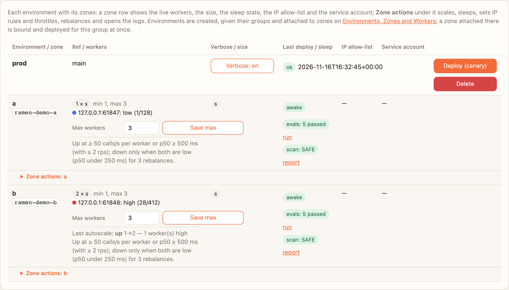 | 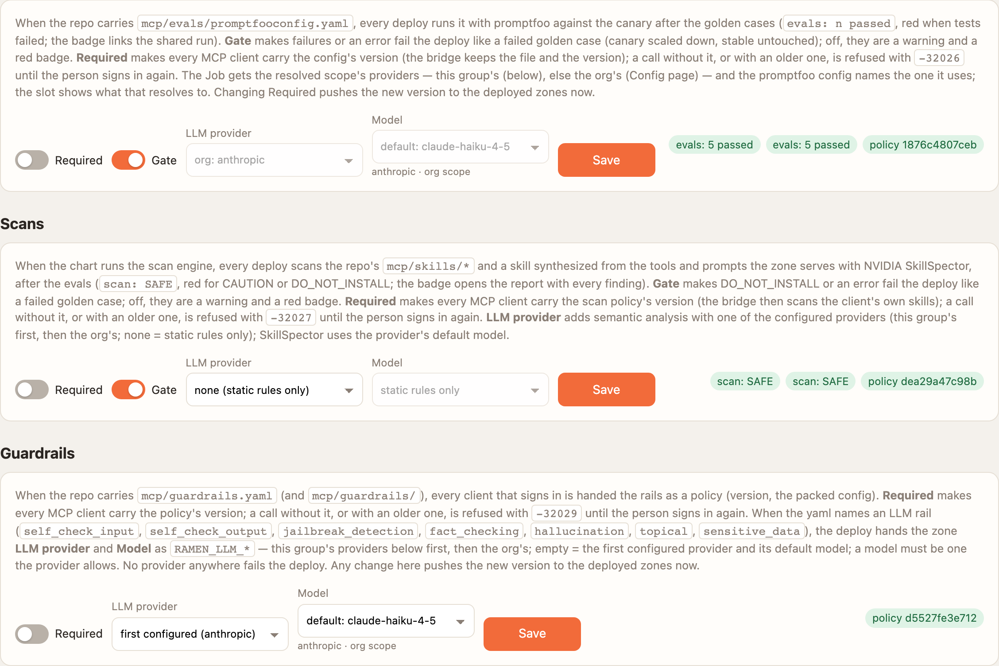 |

| SkillSpector scan report | LLM configs every member accepts |
|---|---|
| 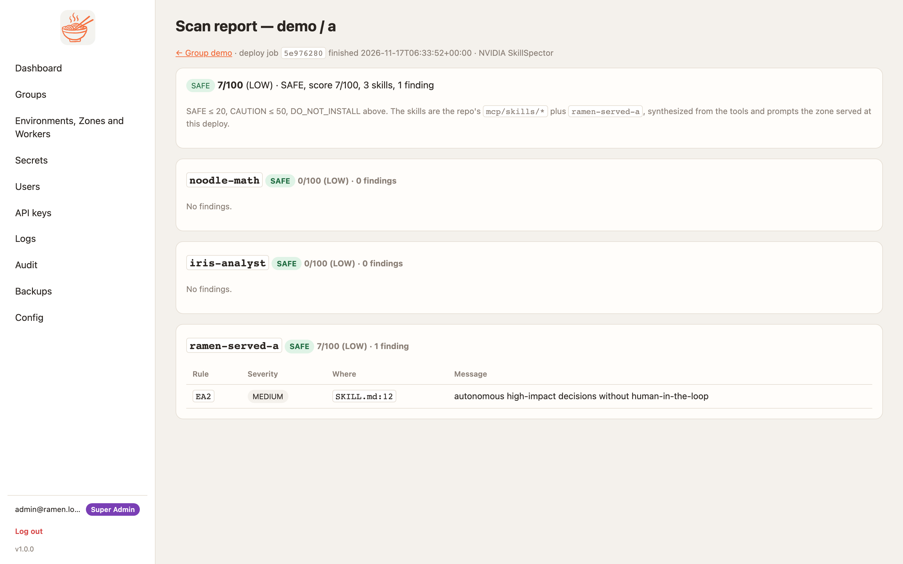 | 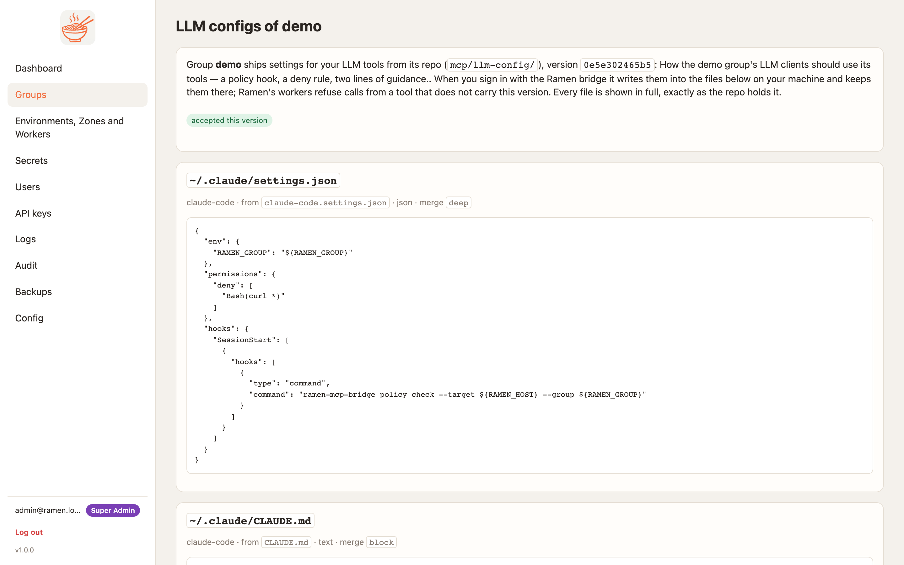 |

| Arize Phoenix, project `demo` (live GKE run) | promptfoo, the demo's evals (live GKE run) |
|---|---|
| 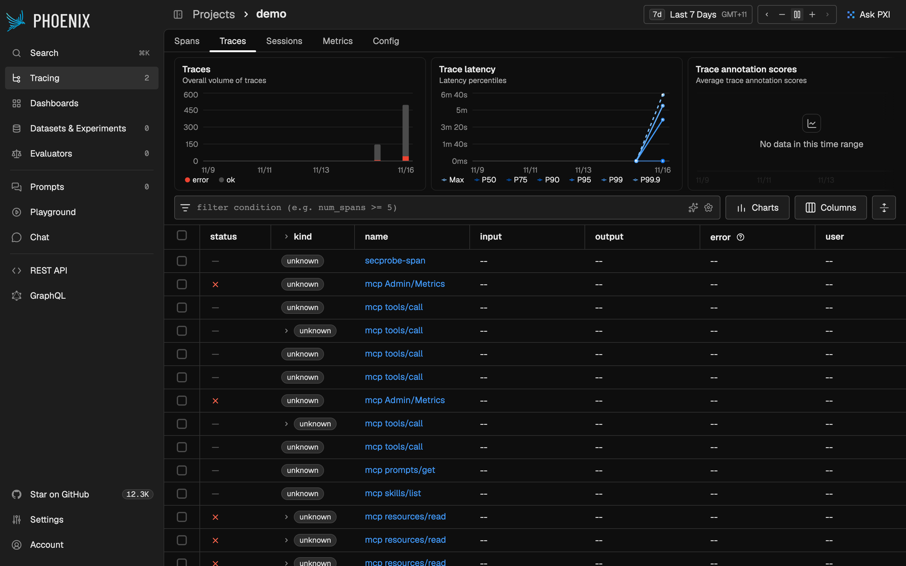 | 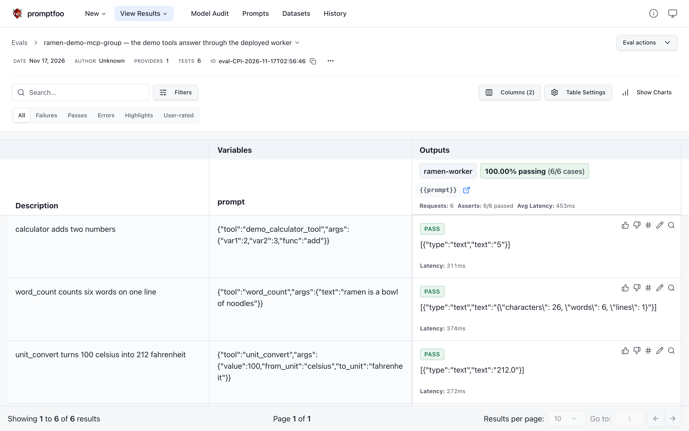 |

| An MCP App previewed in a sandbox | LLM providers, keys never shown |
|---|---|
| 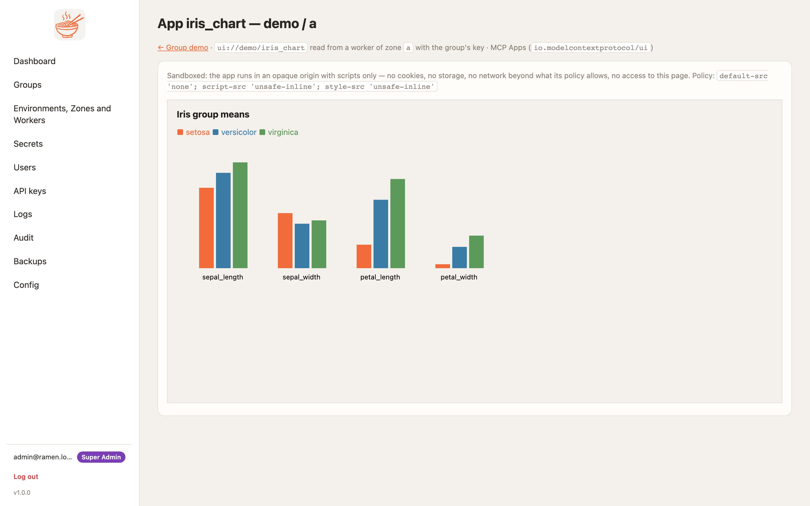 | 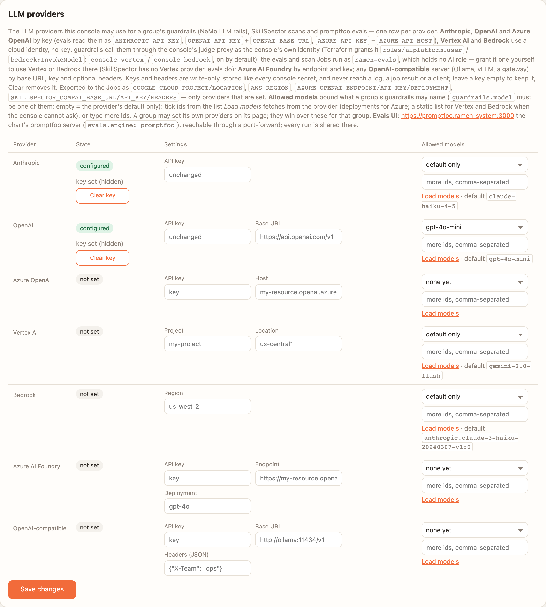 |

| Environments, Zones and Workers | A deploy job |
|---|---|
| 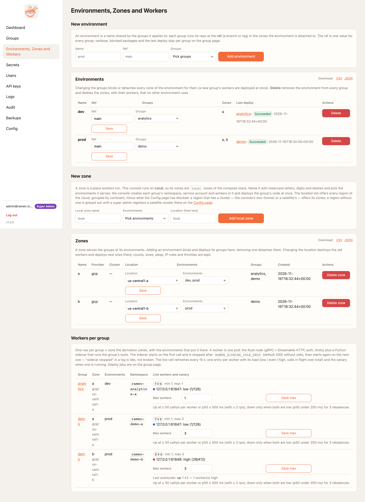 | 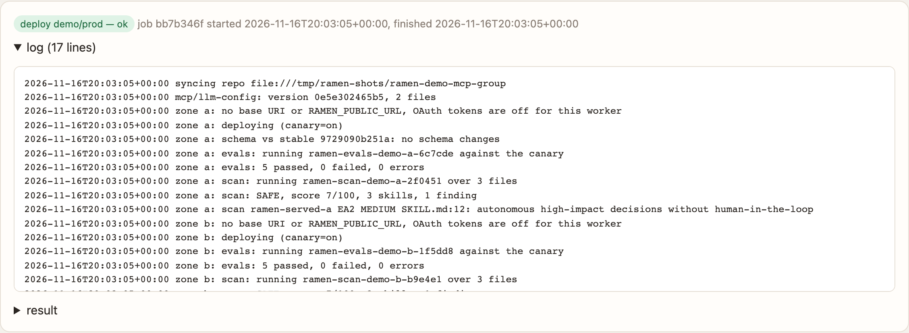 |

Console screenshots come from `make shots` (a throwaway local console with fictional data and canned evals and scan
Jobs); the Phoenix and promptfoo ones from the live GKE run.

## The honest limits

- **An LLM that never calls Ramen's workers and never reads the files the bridge writes cannot be forced** to report
  telemetry or keep the group's configs. Enforcement is the worker gate on every Ramen call plus the client files.
- **A Required policy shuts out clients that do not carry versions.** A plain HTTP client config (Claude Code with a
  key header, `curl`) is refused on gated calls until it sends the `_meta` versions; the bridge does it for you. A
  group whose repo has `mcp/llm-config/` always requires its configs version.
- **LLM rails reduce prompt injection; they do not eliminate it.** Use deterministic rails for what must hold.
- **NetworkPolicies need an enforcing CNI.** GKE Autopilot enforces them; since 1.0.0c Terraform turns on the VPC
  CNI's policy agent on EKS (enforcement seen live on 1.0.0b35) and Calico on AKS (not yet checked live)
  ([threat model](https://bkraad47.github.io/ramen/threat-model/#findings-and-their-status), S6b).
- **The optional engines are for trying things out**: Phoenix, Jaeger and promptfoo have no edge route and one
  install-wide sign-in (Secret `ramen-engines`) — whoever holds it sees every group's traces and evals runs.
- **A compromised console is a compromised platform**; on Azure it could grant itself write on the platform image
  repository (pin platform images by digest; on GCP its repository rights are fenced by a resource tag, on AWS by
  repository name). Run one console replica.
- **Load.** One worker of the smallest size (250m CPU) served about 30–45 calls/s of a guarded trivial tool in the
  1.0.0b34–b36 runs, and the p95 bound of 1.5 s missed on EKS's small nodes and on the 8→64-client ramp. The 1.0.0
  per-call fixes (schema checks compiled once, NeMo's unused flows dropped, Colang expressions parsed once) take a
  worker at 250m from about 30 to about 70 calls/s locally (p95 2.1 → 0.8 s at 32 clients), and the autoscaler asks
  for another worker at a p50 of 250 ms instead of 500; the cloud tables are re-measured for 1.0.0
  ([Autoscaling → Load tests](https://bkraad47.github.io/ramen/wiki/autoscaling/#load-tests)).
- **Local compose** runs no evals, scans or image builds, and its workers cannot reach the judge proxy, so LLM rails
  are a cloud feature there.

## Write your own group repo

Start from [ramen-demo-mcp-group](https://github.com/bkraad47/ramen-demo-mcp-group): `mcp/tools/<name>/<name>.py` +
`<name>.json`, `resources/`, `prompts/`, `apps/`, `skills/`, `tests.yaml`, `guardrails.yaml`, `evals/`, `llm-config/`,
`env.yaml`, `requirements.txt`. Every feature with the demo's code: [MCP features](https://bkraad47.github.io/ramen/wiki/mcp-features/) ·
the file contract and local testing: [The MCP repo](https://bkraad47.github.io/ramen/wiki/mcp-repo/).

## Repository

| Dir | What |
|---|---|
| [`console/`](console/) | FastAPI + Jinja2 + HTMX console and `/api/v1` |
| [`node-rs/`](node-rs/) | Rust MCP node (`ramen.v1.Mcp`, `ramen.v1.Admin`, health; auth, gates, sidecar supervisor) |
| [`runtime-py/`](runtime-py/) | Python 3.12 runtime (packages, apps, skills, MRTR, tasks, guardrails) |
| [`proto/`](proto/) | `ramen/v1/mcp.proto`, `admin.proto` |
| [`deploy/`](deploy/) | compose, kind, Helm charts (console, worker, satellite), Terraform (GCP, AWS, Azure and satellites), CloudFormation, the SkillSpector image |
| [`glama/`](glama/), [`mcpb/`](mcpb/) | the directory image and the MCPB bundle for Claude Desktop; both pin the bridge |
| [`skills/`](skills/) | [Agent Skills](https://agentskills.io) for any coding agent: deploy on GCP, AWS and Azure, rotate keys, backup and restore, scale, test, iterate |
| [`tests/`](tests/) | conformance, e2e, kind, cloud and load suites |
| [`docs/`](docs/) | the site's sources; [`docs/CONTRACTS.md`](docs/CONTRACTS.md) is binding for every component |

Changes: [CHANGELOG.md](CHANGELOG.md) · Versions: [tracker](https://bkraad47.github.io/ramen/versions/) · Which versions go together: [Releases](https://bkraad47.github.io/ramen/release/)

## Develop

```sh
make up BUILD=1      # the compose stack from source instead of the published images
make test            # runtime-py and console (pytest, 90% coverage gate) plus node-rs (fmt, clippy, test)
make test-harness    # tests/: conformance + e2e (skips without a running stack)
make shots           # regenerate the console screenshots in docs/img
uv run --project docs --group docs mkdocs serve   # docs at http://127.0.0.1:8000
```

## Contributing

See [CONTRIBUTING.md](CONTRIBUTING.md) — use it, fork it, change it, with attribution; renaming it as a new commercial product of your own is not acceptable.

## License
BSD-3-Clause © 2026 Raad. See [LICENSE](LICENSE).
