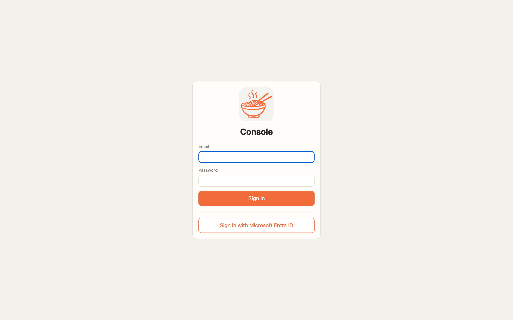
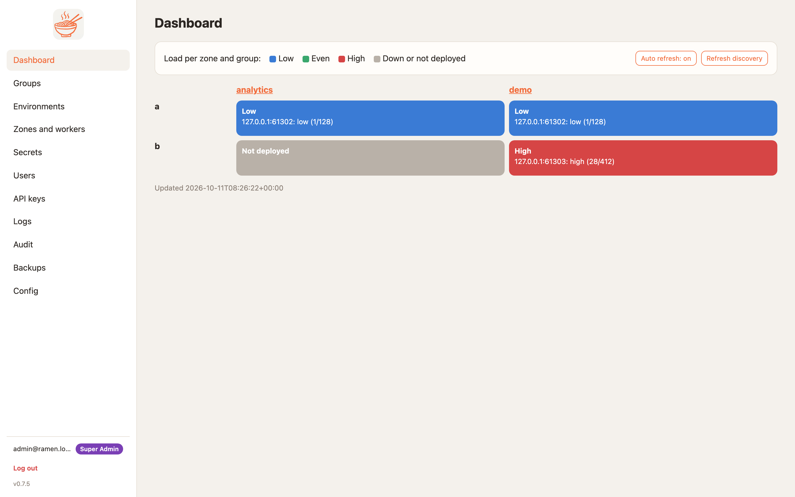
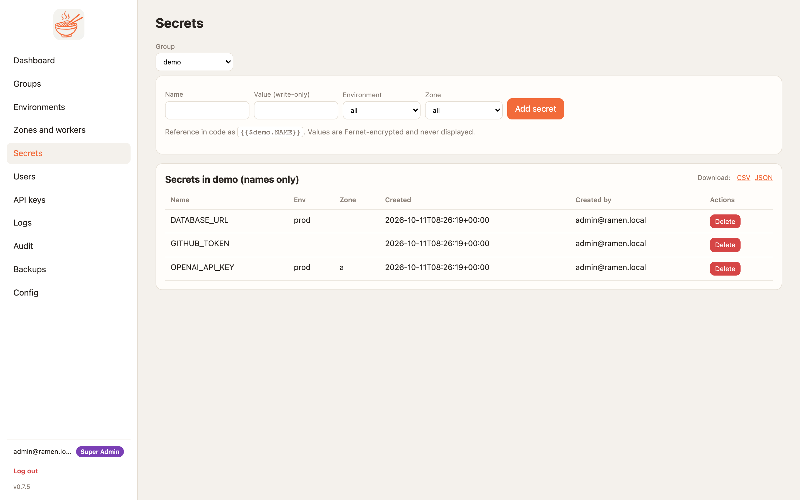
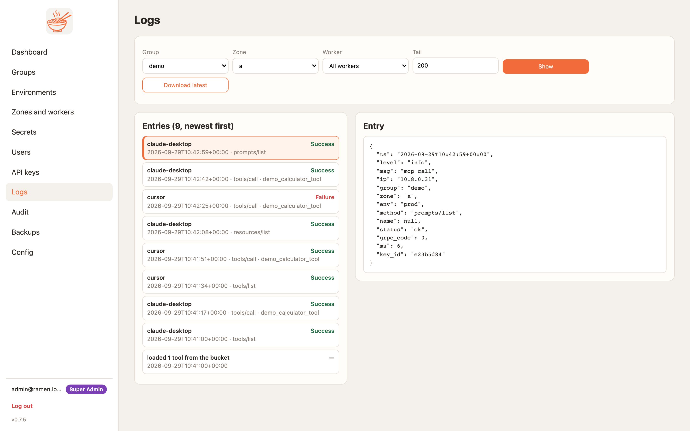
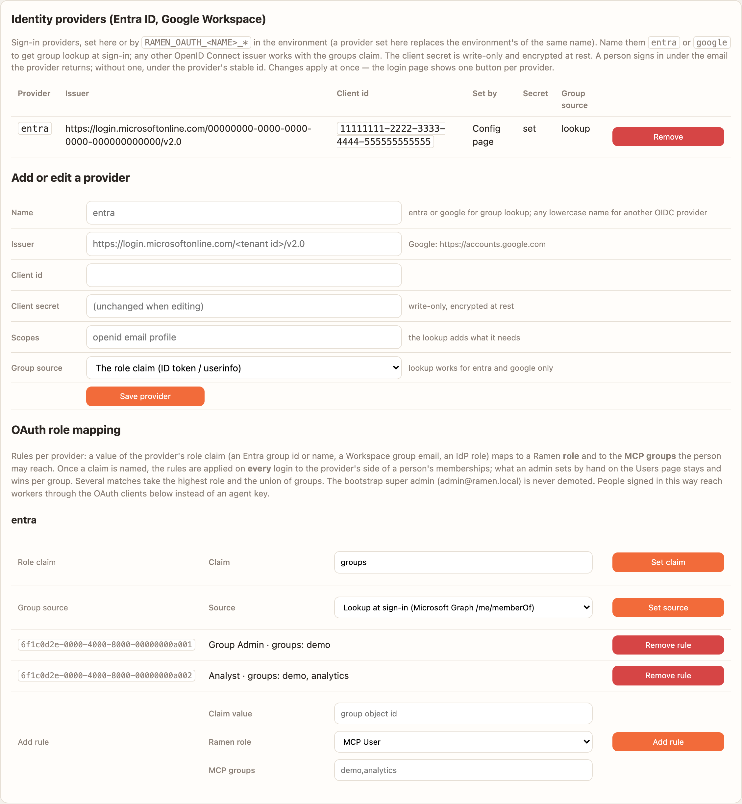
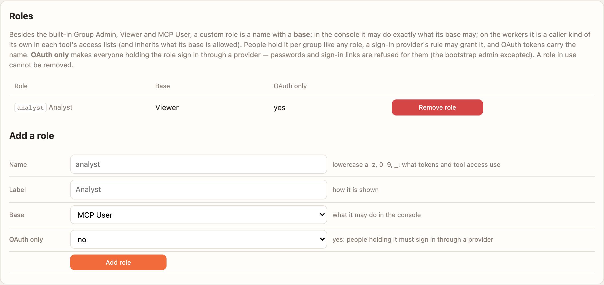

<p align="center"></p>

<p align="center">Build your MCP tools in Python, deploy them across zones on <b>GKE, EKS and AKS</b>.<br>
Rust MCP node + Python 3.12 runtime workers, Streamable HTTP at the edge and gRPC inside, guardrails per tool,<br>
Entra ID and Google Workspace sign-in, autoscaling — managed from one FastAPI console.</p>

<p align="center">
<a href="https://github.com/bkraad47/ramen/releases"></a>
<a href="https://github.com/bkraad47/ramen/actions/workflows/ci.yml"></a>
<a href="https://bkraad47.github.io/ramen/"></a>
<a href="https://hub.docker.com/r/bkraad47/ramen-worker"></a>
<a href="https://pypi.org/project/ramen-mcp-bridge/"></a>
<a href="LICENSE"></a>
<a href="https://modelcontextprotocol.io"></a>
</p>

<p align="center"><a href="https://glama.ai/mcp/servers/bkraad47/ramen"></a></p>

**Docs: https://bkraad47.github.io/ramen/** · [Get started](https://bkraad47.github.io/ramen/get-started/) · [How it works](https://bkraad47.github.io/ramen/how-it-works/) · [The MCP repo](https://bkraad47.github.io/ramen/wiki/mcp-repo/) · [Connect a client with OAuth](https://bkraad47.github.io/ramen/wiki/connect-oauth/) · [Deploy on GCP](https://bkraad47.github.io/ramen/wiki/deploy-gcp/) · [AWS](https://bkraad47.github.io/ramen/wiki/deploy-aws/) · [Azure](https://bkraad47.github.io/ramen/wiki/deploy-azure/) · [Contracts](docs/CONTRACTS.md) · [Releases](https://github.com/bkraad47/ramen/releases)

> **Streamable HTTP is the front door.** Every worker serves `POST /mcp` — a URL and a bearer header, nothing to
> install — next to the gRPC service it has had since 0.3.1, on the same port, through the same guards. The stdio
> bridge stays for clients that only speak stdio.

**Status.** Current release **0.8.0** (packaging and docs; the product is 0.7.5). 0.7.5 passed the same 33 checks
live on **GKE, EKS and AKS**; what each run covered, and what is tested only:
[Transport → What is verified](https://bkraad47.github.io/ramen/wiki/transport/#what-is-verified-and-what-is-not).

**Build and deploy your own MCP tools across zones.** Ramen turns a **git repo of tools, resources and prompts**
into a fleet of MCP workers behind a cloud load balancer, and keeps who-can-call-what, secrets, guardrails, canary
gates and the audit trail in one console. It is a platform for *your* tools, not a gateway in front of someone else's.
Each worker pairs a **Rust MCP node** (Streamable HTTP and gRPC on one port, bearer auth, IP allow-lists, health,
logs) with a **Python 3.12 runtime** that pip-installs and runs your code: user code never runs in the process that
holds the keys. The shape, the data model and why each piece is where it is:
[How it works](https://bkraad47.github.io/ramen/how-it-works/).

- **Git → bucket → worker.** Deploy syncs the repo to a bucket; workers load by content hash. No git creds on pods.
- **Canary by default, gated.** Roll a canary, smoke-test `tools/list`, diff its tool schemas against stable
  (breaking changes stop unless you say `breaking: true`), run the repo's golden cases, then roll stable. Failure
  leaves stable untouched.
- **Multi-zone from day one.** Group → Environment → Zone → Worker; the load balancer routes on `ramen-group` /
  `ramen-zone`, so one client config works for every zone.
- **Guardrails inside the worker.** Opt a tool into a check before the call and after the result, run in the Python
  runtime next to it: [NVIDIA NeMo Guardrails](https://github.com/NVIDIA/NeMo-Guardrails) rails (deterministic or
  LLM-backed, your model and key) or a `policy.py` of your own. A blocked call is a readable tool error and the access
  log names the rail. Fail-closed by default.
- **Your identity provider decides, your admins override.** Add Microsoft Entra ID, Google Workspace or any OIDC
  provider on the Config page, on any cloud; read a person's groups from Graph or Cloud Identity at sign-in, map them
  to roles per group, and keep what admins set by hand.
- **Roles per group, and roles you define.** Group Admin, Viewer, MCP User or a custom role on one of those bases
  (`analyst` on Viewer), usable in memberships, provider rules and per-tool access; a role can be **OAuth only**.
  Decide per environment who may see and who may call each tool; a drift signal flags a caller repeating one call.
- **Autoscaling by Ramen.** Each zone runs between 1 worker and a max that admins set; the console scales up fast
  under load and back down when quiet, the same on all three clouds, with no HPA and every step in the audit log.
- **Three clouds.** Terraform and Helm for GKE, EKS and AKS, with the same console and guards on each
  ([Deploy to the cloud](#deploy-to-the-cloud)).
- **Enterprise controls.** `rmk_` MCP keys and `rmn_` API keys stored as salted hashes, IP rules per zone at the node
  and at the cloud edge, secrets that are never displayed, Redis throttles, an audit line for every action.
- **One Deployment per zone, not one per tool.** A worker loads *every* tool of the group, so thirty tools run on
  one Deployment per zone (two pods with a canary) behind one load balancer; autoscaling adds pods for load, not for
  tool count.

> **Start here** · the demo group repo **[ramen-demo-mcp-group](https://github.com/bkraad47/ramen-demo-mcp-group)**
> (point a group at it and press Deploy) · the stdio bridge **[ramen-mcp-bridge on PyPI](https://pypi.org/project/ramen-mcp-bridge/)**
> (`uvx ramen-mcp-bridge@latest`) · the images **[bkraad47/ramen-worker](https://hub.docker.com/r/bkraad47/ramen-worker)**
> and **[bkraad47/ramen-console](https://hub.docker.com/r/bkraad47/ramen-console)** on Docker Hub and GHCR.

## Quickstart (local, 5 commands)

Needs Docker with compose v2, `uv`, `git` and `make`. `make up` pulls the release's two images from Docker Hub,
about a minute; `make up BUILD=1` builds them from source instead (three to five minutes).

```sh
git clone https://github.com/bkraad47/ramen && cd ramen
make up       # Firestore emulator + console https://localhost:8443 + one worker (localhost:8080: Streamable HTTP + gRPC)
make demo     # zone, group `demo` from the demo repo, an rmk_ key, a canary deploy, then a tools/call
#   PASS: demo_calculator_tool(2,3,add) -> 5      <- the success line
open https://localhost:8443    # self-signed cert; admin@ramen.local + the generated password: grep ADMIN_PASSWORD deploy/local/.env
make down     # stop and remove volumes
```

`make demo` is safe to re-run: an existing zone, group or environment answers "exists" and a fresh key is
generated each time. Nothing in the stack is a static secret: `make up` generates the admin password, Fernet key,
MCP key, admin key and session secret into `deploy/local/.env` (git-ignored), and `scripts/check_secrets.py` fails CI
if a literal one ever returns.

## Connect a client

A worker is a URL (`/mcp`) and two routing headers, `ramen-group` and `ramen-zone`. The credential decides whose
name a call runs under:

- **A group key** (`rmk_`) in `Authorization: Bearer`, for agents and automation. Any HTTP-capable client.
- **A person's sign-in** through the console (OAuth 2.1, with a Ramen password, Entra ID or Google): Claude Code
  over HTTP, or any stdio client through the bridge.

Every form, with the pages you will see:
[Get started → Connect a client](https://bkraad47.github.io/ramen/get-started/#3-connect-a-client) ·
[Connect with OAuth](https://bkraad47.github.io/ramen/wiki/connect-oauth/) ·
[Transport → Connecting](https://bkraad47.github.io/ramen/wiki/transport/#connecting). In a cloud, the group page's
**How MCP users sign in** card prints the exact commands for your install.

## Screenshots

| Login | Dashboard, load per zone and group |
|---|---|
|  |  |

| Group: environments, deploy jobs, zones/workers, MCP keys | Deploy job with streamed log |
|---|---|
|  |  |

| Secrets (names only, values never shown) | Logs (one JSON line per MCP call, downloadable) |
|---|---|
|  |  |

| Identity providers: Entra ID with group lookup and role rules | Custom roles, one OAuth-only |
|---|---|
|  |  |

| Zone actions: count, max, last autoscale decision | Zones and workers with the max per group |
|---|---|
|  |  |

## Transport and security, in short

Workers speak **Streamable HTTP** (`POST /mcp`, MCP spec 2025-06-18) and **gRPC** (`ramen.v1.Mcp/Call`) on one port
through one implementation of every guard, so a check is on both transports or on neither. TLS ends at the load
balancer. The node checks the credential, the source range at the provider's `x-forwarded-for` hop, blocked names
and the size and in-flight caps. The runtime reaches the bucket as the zone's own cloud identity, and guardrails run
between the runtime and your tool. Hop by hop, with what protects each and what is verified:
[Transport](https://bkraad47.github.io/ramen/wiki/transport/). Boundaries and non-goals:
[Threat model](https://bkraad47.github.io/ramen/threat-model/).

## Deploy to the cloud

| Target | What Terraform and Helm build | Guide |
|---|---|---|
| **GCP** | GKE Autopilot, Firestore, GCS, Secret Manager, global HTTPS LB (GKE Gateway, header-routed gRPC **and** Streamable HTTP), Cloud Armor | [docs](https://bkraad47.github.io/ramen/wiki/deploy-gcp/) · [`deploy/README.md`](deploy/README.md) |
| **AWS** | EKS, DynamoDB, S3, Secrets Manager, ALB (gRPC and HTTP/1.1 target groups), WAF (Terraform or CloudFormation) | [docs](https://bkraad47.github.io/ramen/wiki/deploy-aws/) |
| **Azure** | AKS (workload identity), Table Storage, Blob Storage, Key Vault, Envoy Gateway with a Let's Encrypt certificate | [docs](https://bkraad47.github.io/ramen/wiki/deploy-azure/) |
| **Local** | docker compose: Firestore emulator, console, one worker; CI e2e on every push | [`deploy/local/README.md`](deploy/local/README.md) |

Bring-up is the same on each: `terraform apply` → `helm upgrade --install` (the release's public images, or
`make push` to your own registry) → add a zone and a group in the console → Deploy. About 25 minutes, mostly waiting
for the cluster and the load balancer. The edge gets a publicly trusted certificate on a free `sslip.io` hostname
(Let's Encrypt on AKS), so clients use `https://<public_hostname>/mcp` and the bridge points at
`<public_hostname>:443 --tls` with nothing to import. What each cloud run covered:
[Transport → What is verified](https://bkraad47.github.io/ramen/wiki/transport/#what-is-verified-and-what-is-not).

## Write your own tools

A group repo is any git repo with `mcp/tools/<name>/<name>.py` + `<name>.json` (and `resources/`, `prompts/`,
`requirements.txt`). Secrets are referenced as `{{$group.NAME}}` or exported through `mcp/env.yaml`; nothing about
the transport leaks into tool code. Declare `output` and the worker publishes it as `outputSchema` and validates every
result; add `mcp/tests.yaml` and your cases gate every deploy; add `mcp/guardrails.yaml` and NeMo rails or a
`policy.py` check the arguments before a tool runs and its result before it leaves the worker. Start from
[ramen-demo-mcp-group](https://github.com/bkraad47/ramen-demo-mcp-group); the contract, local development and heavy
dependencies: [The MCP repo](https://bkraad47.github.io/ramen/wiki/mcp-repo/) ·
[Guardrails](https://bkraad47.github.io/ramen/wiki/guardrails/).

## Repository

| Dir | What |
|---|---|
| [`console/`](console/) | FastAPI + Jinja2 + HTMX manager UI and `/api/v1`; gRPC client to workers |
| [`node-rs/`](node-rs/) | Rust MCP server node (tonic: `ramen.v1.Mcp`, `ramen.v1.Admin`, `grpc.health.v1.Health`; auth, CIDRs, sidecar supervisor) |
| [`runtime-py/`](runtime-py/) | Python 3.12 runtime (loads protos, pip installs, runs calls, resolves secrets, runs guardrails) |
| [`proto/`](proto/) | `ramen/v1/mcp.proto`, `admin.proto` — the transport contract, single source for Rust and Python stubs |
| [`deploy/`](deploy/) | compose, Helm charts, Terraform (GCP, AWS, Azure), CloudFormation |
| [`glama/`](glama/), [`mcpb/`](mcpb/) | the self-contained directory image and the Smithery bundle; both pin the bridge |
| [`skills/`](skills/) | Cloud-ops agent skills: deploy-gcp, deploy-aws, rotate-keys, backup-restore, scale-zone |
| [`tests/`](tests/) | Black-box conformance (gRPC + bridge), e2e and cloud suites |
| [`docs/`](docs/) | This site's sources; [`docs/CONTRACTS.md`](docs/CONTRACTS.md) is binding for every component (§11 = transport) |

Architecture: [ARCHITECTURE.md](ARCHITECTURE.md) · Changes: [CHANGELOG.md](CHANGELOG.md) · Versions: [tracker](https://bkraad47.github.io/ramen/versions/) · Which versions go together: [Releases](https://bkraad47.github.io/ramen/release/)

## Develop

```sh
make up BUILD=1      # the compose stack from source instead of the published images
make test            # runtime-py and console (pytest, 90% coverage gate) plus node-rs (fmt, clippy, test)
make test-harness    # tests/: conformance + e2e (skips without a running stack)
make proto           # regenerate Python stubs from proto/ (Rust stubs build via tonic-build)
make demo-worker     # node + runtime locally without Docker
uv run --project docs --group docs mkdocs serve   # docs at http://127.0.0.1:8000
```

## Contributing

See [CONTRIBUTING.md](CONTRIBUTING.md) — use it, fork it, change it, with attribution; renaming it as a new commercial product of your own is not acceptable.

## License
BSD-3-Clause © 2026 Raad. See [LICENSE](LICENSE).
