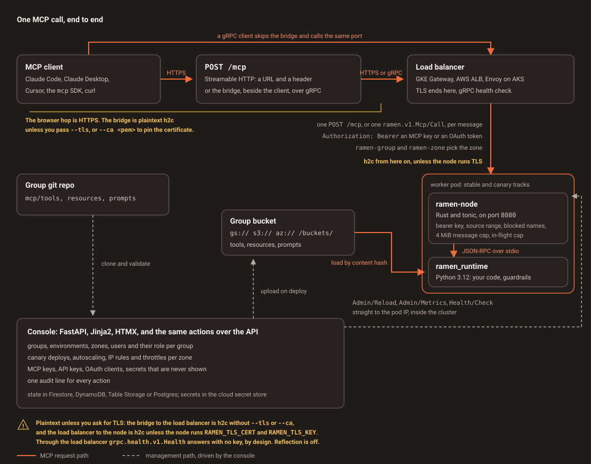

# Architecture (current: v0.7.5)

Hierarchy: **Group → Environment → Zone → Worker** (decision D5). Transport: **Streamable HTTP at the edge, gRPC inside** (D31; gRPC since D19).

<figure class="ramen-diagram" markdown>

<figcaption>A client posts to /mcp (or a stdio client goes through ramen-mcp-bridge over gRPC); the load balancer (GKE Gateway, AWS ALB or Envoy Gateway on AKS) routes on the ramen-group and ramen-zone headers to the zone's worker pod; the Rust node checks the credential and source range and hands the message to the Python runtime, which loads the group's code from the bucket and runs the group's guardrails around the tool. The console keeps state in Firestore, DynamoDB, Table Storage or Postgres, drives the cloud adapter, scales the workers and calls nodes directly on their pod IP.</figcaption>
</figure>

Store: Firestore, DynamoDB, Azure Table Storage or Postgres. Cloud adapter: `local`, `gcp`, `aws` or `azure`
(namespaces, Deployments, routes, NEG or target groups, Cloud Armor, WAF or Envoy `SecurityPolicy`, per-zone cloud
identity). Secrets backend: the store, Secret Manager, Secrets Manager or Key Vault. Since 0.7.5 the console also
**scales the workers** of every group × zone between 1 and an admin's max (no HPA).
The console reaches workers over gRPC on the pod IP (`Admin/Reload`, `Admin/Metrics`, `Health/Check`), never
through the load balancer.

## Components
| Dir | What | Tech | Contract |
|---|---|---|---|
| `console/` | Manager UI + `/api/v1`; roles per group (D41) and custom roles (D48), the OAuth 2.1 authorization server (D34), identity providers on the Config page with group lookup (D47, D50), IdP role mapping (D38), scoped service-account policy (D40), autoscaling (`autoscale.py`, D55); gRPC client to workers (`ramen_console.grpcclient`) | FastAPI, Jinja2, HTMX (no JS build, no `unsafe-eval`), argon2, itsdangerous, Fernet, grpcio | [§4, §4a, §9, §11, §16.3](../CONTRACTS.md) |
| `node-rs/` | MCP server node: `ramen.v1.Mcp/Call`, `ramen.v1.Admin`, `grpc.health.v1.Health` on one h2c/TLS port; bearer auth, CIDR allow-lists, blocked names, in-flight limit, access log, sidecar supervisor | Rust 1.98, tonic, tokio | [§11](../CONTRACTS.md) |
| `runtime-py/` | Loads `mcp/` packages from the bucket (`gs://`, `s3://`, `az://`), validates protos, pip-installs requirements, renders `mcp/env.yaml` from secrets (0.6.0), runs `mcp/guardrails.yaml` pre/post hooks (NeMo or `policy.py`, D46), executes calls, resolves and redacts secrets | Python 3.12 (pinned, D45), jsonschema, optional NeMo Guardrails | [§1, §2, §11](../CONTRACTS.md) |
| [`ramen-mcp-bridge`](https://github.com/bkraad47/ramen-mcp-bridge) (own repo, PyPI) | Stdio MCP server forwarding to `Mcp/Call` over gRPC with a group key or, since 0.2.0, the person's own OAuth token (PKCE + loopback callback against the console); 0.3.0 keeps tokens in memory or the OS keychain and relays a needed sign-in as error `-32001` (D52) | Python, grpcio | [§11, §16.3](../CONTRACTS.md) |
| `proto/ramen/v1/` | `mcp.proto`, `admin.proto` — single source for Rust (tonic-build) and Python (grpcio-tools) stubs | protobuf 3 | [§11](../CONTRACTS.md) |
| `deploy/local` | docker compose: Firestore emulator + console + one worker (gRPC h2c on 8080) | | [§5, §11](../CONTRACTS.md) |
| `deploy/terraform/gcp`, `deploy/helm/*` | GKE Autopilot, Firestore, GCS, Artifact Registry, static IP, GSA + Workload Identity (custom role, resource-level IAM), GKE Gateway with header routes + gRPC health | Terraform, Helm 4 | [§7, §11](../CONTRACTS.md) |
| `deploy/terraform/aws`, `deploy/cloudformation` | EKS, DynamoDB, S3, Secrets Manager, ECR, IRSA, ALB controller (gRPC target groups, HTTP1 for `/mcp` and OAuth metadata since 0.6.1), Fluent Bit (exercised on the real account, not at volume) | Terraform, CloudFormation | [§8, §11](../CONTRACTS.md) |
| `deploy/terraform/azure`, `deploy/helm/*` (`provider=azure`) | AKS (free tier, workload identity), ACR, Blob + Table Storage, Key Vault, static IP, Envoy Gateway + cert-manager (Let's Encrypt), managed identities (D54) | Terraform, Helm | [§21.6](../CONTRACTS.md) |
| `tests/` | Black-box conformance + e2e + cloud suites over gRPC, plus the bridge via the official `mcp` stdio client | pytest, grpcio, `mcp` | [§11](../CONTRACTS.md) |
| `skills/` | Cloud-ops agent skills (deploy, rotate, backup, scale) | agentskills `SKILL.md` | [§10](../CONTRACTS.md) |

## Data model
| Collection | Key fields | Notes |
|---|---|---|
| `users` | email, `idp_memberships` and `manual_memberships` (`{group: role}`, a built-in or custom role; effective `memberships` = IdP overlaid by manual), `super_admin` / `idp_super`, `provider` | `role` and `groups` are derived summaries; password hash Fernet-encrypted |
| `groups` | name, repo_url, ref, mcp_auth, sa_restrictions | one bucket prefix per group |
| `environments` | group, name, ref, zones[], verbose, blocked[], last_deploy | zone list drives namespaces |
| `zones` | name, provider (`local` / `gcp` / `aws` / `azure`), region (cloud zone) | super admin only |
| `workers` | group, zone, count, max_count, size (`s`/`m`/`l`), allowed_sizes, cidrs, service_account, autoscale_state, last_autoscale | live pods come from the adapter |
| `secrets` | group, name, env?, zone?, kind (`secret` / `mcp_key`), value or ref | value never returned |
| `api_keys` | name, role, groups, hash | `rmn_<id>_<secret>`, shown once |
| `audit` / `activity` | ts, user, ip, action, target, ok, tags | every mutation; permission requests live in `activity` |
| `config`, `backups` | auth toggles, `oauth_providers` (secret encrypted), `roles`, role maps, `scheduler`, `hashing` (token salt, encrypted), SA rules; backup metadata | backups exclude secrets |

## Request paths
- **MCP call**: client (`POST /mcp` over Streamable HTTP, a gRPC client, or the stdio bridge) → LB matches
  `ramen-group` + `ramen-zone` headers → node checks CIDR, Origin (HTTP), then the `rmk_` key or an OAuth token
  (constant-time) → per-tool access → runtime (spawned on demand) → guardrail pre → tool → output schema →
  guardrail post → JSON-RPC result in the reply body. Transport failures are
  gRPC statuses (`UNAUTHENTICATED`, `PERMISSION_DENIED`, `RESOURCE_EXHAUSTED`) or their HTTP twins (401, 403,
  429); protocol failures stay JSON-RPC errors. One log line per call (`ts, ip, transport, group, method, name,
  status, grpc_code, ms, key_id`); `RAMEN_VERBOSE=1` logs bodies.
- **Deploy**: console job → clone repo (token via git header) → upload bucket → write zone Secret/env file
  (`RAMEN_MCP_KEYS`, `RAMEN_SECRET_*`, `RAMEN_BLOCKED`, `RAMEN_ALLOWED_CIDRS`) → canary restart → `Health/Check`
  `SERVING` → `Admin/Reload` → `tools/list` smoke → stable restart. See [Deploying](../wiki/groups-zones.md#deploying).
- **Rebalance and autoscale**: the button or the Config page's scheduler (every group × zone each interval) →
  `Admin/Metrics` from every pod (`inflight`, `max_inflight`, `total`) → `autoscale.decide` (up proportionally after
  30 s, down by one after 120 s and three quiet rounds, within 1..max) → the stable Deployment's replicas, plus the
  load-balancer leg (GCP capacity scaler, AWS weights) → audit `workers.autoscale`. See
  [Autoscaling](../wiki/autoscaling.md).
- **IP rules**: console → cloud API (Cloud Armor / WAF / Envoy `SecurityPolicy`) + node env → worker roll.

## Decisions

Only the decisions that still shape the code are listed. The gaps are ids that were superseded, or that never
left the private workspace.

| ID | Decision |
|---|---|
| D2 | State DB: Firestore on GCP, DynamoDB on AWS, one repository interface. No Postgres. *(partly superseded by D37)* |
| D3 | Worker pod = Rust node + Python runtime sidecar, 1:1, spawned on demand, idle-terminated. |
| D4 | *(superseded by D19)* Transport: JSON-RPC 2.0 over HTTP (MCP Streamable HTTP), 0.1.0–0.3.0. |
| D5 | Hierarchy Group → Environment → Zone → Worker. |
| D6 | One zone first; every layer multi-zone capable. |
| D9 | Semver from 0.1.0; tags `v*` build releases with zips. |
| D11 | Console: FastAPI + Jinja2 + HTMX, server-rendered. |
| D14 | Bucket dir = group repo root; no MCP keys = deny all; node config precedence file < env < deploy file. |
| D17 | *(superseded by D36)* Console on GCP: static IP + self-signed cert on the global HTTPS LB; managed cert later. |
| D18 | v0.3.0 scope: AWS (untested at the time; applied to a real account from 0.5.6), OAuth polish, SA policy engine, tool blocking, email auth, docs, launch. |
| D19 | v0.3.1: MCP transport is JSON-RPC 2.0 over gRPC (`ramen.v1.Mcp/Call`); HTTP MCP endpoint removed; `ramen-mcp-bridge` (stdio) serves standard clients; full security parity on gRPC; LB routes on `ramen-group`/`ramen-zone` metadata; carried security mediums fixed; logo v2. |
| D21 | v0.4.0: API keys carry an enforced client type — an `agent` key is accepted only by workers over gRPC, a `devops` key only by the console API. |
| D22 | v0.4.0: the autoscale and rebalance stress test runs on a local kind cluster first, then once on a throwaway GKE project. |
| D23 | v0.4.0: independent-client evidence is a real MCP client driven against the bridge, plus an editor configuration the user captures. |
| D31 | v0.5.0: Streamable HTTP at the edge, gRPC inside — every worker serves `POST /mcp` on the gRPC port through the same guards; the bridge is the stdio-only compatibility path. |
| D32 | v0.5.0: the HTTP handler lives in the node on the same port; never a separate edge service. |
| D33 | v0.5.0: sessions are stateless signed ids (HMAC over nonce, expiry and the credential; per-group secret handed to every zone). |
| D34 | v0.5.0: the console is the OAuth 2.1 authorization server — PKCE S256, pre-registered clients, no dynamic registration. |
| D35 | v0.5.1: cloud runs get their permissions from a rule the human adds; the agent never writes its own permission file. |
| D36 | v0.5.5: the GCP console gets a Google-managed certificate on a free `sslip.io` hostname derived from the static IP (supersedes D17); no domain to buy, no CA to export. |
| D37 | v0.5.5: Postgres is an optional third `RAMEN_STORE` for self-hosted deployments; Firestore and DynamoDB stay the cloud defaults (partly supersedes D2). |
| D38 | v0.5.93: IdP role mapping is authoritative on every login, keyed by claim value, never by person; no match means no membership. |
| D39 | v0.5.93: a fourth role, `mcp_user`, who only signs in to approve MCP clients for their groups' zones; no console, no API. |
| D40 | v0.5.93: a service-account permission carries a scope; empty or `*` means the group's own prefix and secrets, named resources bind on those alone. |
| D41 | v0.5.95: roles are held per group (`user.memberships`); one person may be a Group Admin of one group and an MCP User of another. |
| D45 | v0.7.5: the worker's Python runtime is pinned to 3.12 (NeMo Guardrails does not run on 3.14); the console stays on 3.14. |
| D46 | v0.7.5: guardrails are Ramen's own per-tool pre/post hooks in the runtime (`mcp/guardrails.yaml`, engines `nemo` and `policy`, fail-closed). |
| D47 | v0.7.5: identity federation — group source `claim` or `lookup` (Graph, Cloud Identity) per provider; memberships from the IdP and from admins, the admin's entry wins. |
| D48 | v0.7.5: custom roles with a base, usable as memberships, mapping targets and tool-access kinds; `oauth_only` refuses password sign-in. |
| D50 | v0.7.5: identity providers are managed on the Config page; environment variables are a second source. |
| D51 | v0.7.5: no `email_verified` requirement — the provider's email is the account, else its stable id. |
| D52 | bridge 0.3.0: tokens in memory by default, keychain or a file on request, 30-minute idle expiry, sign-in URL as error `-32001`. |
| D53 | v0.7.5: a browser consent to a loopback redirect gets a self-navigating page instead of a `303`. |
| D54 | v0.7.5: AKS is a third deploy target (Envoy Gateway + Let's Encrypt, Table Storage, Key Vault, Blob, managed identities). |
| D55 | v0.7.5: Ramen scales workers, not the cloud — min 1, a max set by super and group admins, no HPA, every action audited. |

## Version history
[v0.1.0](v0.1.0.md) local core → [v0.2.0](v0.2.0.md) GCP → [v0.3.0](v0.3.0.md) AWS, auth & policy, docs →
[v0.3.1](v0.3.1.md) gRPC transport → [v0.4.0](v0.4.0.md) console polish, docs, and proof → 0.5.x Streamable HTTP
at the edge, OAuth, the GKE and AWS runs, per-group roles → [v0.6.0](v0.6.0.md) real zone teardown, HTTPS only,
`env.yaml` → 0.7.x golden cases and the schema gate, per-tool access → 0.7.5 guardrails, identity federation,
custom roles, AKS, autoscaling by Ramen. This page describes 0.7.5; the [changelog](https://github.com/bkraad47/ramen/blob/main/CHANGELOG.md) has each
release and [Versions](../versions.md) tracks them. A drawing of one call end to end, and what protects every hop, is in
[Transport and what secures each hop](../wiki/transport.md).
