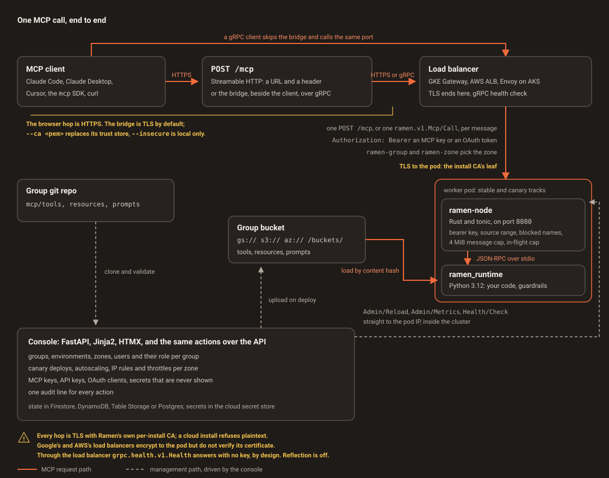

# Architecture (current: v1.0.0)

Ramen is three pieces — a **console** (FastAPI), a **node** (Rust) and a **runtime** (Python) — plus a stdio
**bridge** for clients that need one. One console drives one home Kubernetes cluster and, optionally, satellite
clusters in other regions. The binding detail of every interface is in the [contracts](../CONTRACTS.md); this page is
the map.

<figure class="ramen-diagram" markdown>

<figcaption>A client posts to /mcp (or a stdio client goes through ramen-mcp-bridge over gRPC); the load balancer (GKE Gateway, AWS ALB or Envoy Gateway on AKS) routes on the ramen-group and ramen-zone headers to the zone's worker pod; the Rust node checks the credential, source range and policy versions and hands the message to the Python runtime, which loads the group's code from the bucket and runs its guardrails around the tool. The console keeps state in Firestore, DynamoDB or Table Storage, drives the cloud adapter, scales the workers and calls nodes directly on their pod IP.</figcaption>
</figure>

## Groups, environments, zones and workers

| Thing | What it is | Where it lives |
|---|---|---|
| **Group** | a tenant: one git repo, one bucket prefix, its secrets, keys, members and policy settings | the console store; `<bucket>/<group>/` |
| **Environment** | a name shared by the groups it lists, with one git ref (e.g. `prod` on `main` for `demo` and `analytics`) | one record per group × environment (`environments/<group>:<name>`): deploy state, blocked names, tool access |
| **Zone** | a place workers run: a name, a provider and a cloud zone (`us-central1-a`, `us-east-1a`, `eastus-1`), plus the environments it serves | the console store; a zone's groups are **derived** from its environments |
| **Worker record** | one per group × zone pair the derivation yields: count, max, size, sleep, IP rules, throttle, service account | `workers/<group>:<zone>` |
| **Worker** | one pod in namespace `ramen-<group>-<zone>`: the Rust node and, on demand, the Python runtime | Deployments `worker` and `worker-canary` |

A pair appears when a zone gains an environment, an environment gains a group, or a zone is created: Ramen binds it
(namespace, the zone's own cloud identity, Service, route, NetworkPolicies) and canary-deploys it at once. A pair that
disappears is detached and torn down. A region change keeps the zone's name and settings and re-creates its workers
in the new place; across clusters it is a detach plus an attach. Super admins edit everything on the **Environments,
Zones and Workers** page; a group admin edits what is wholly within their groups ([Roles](../roles.md)).

## How a worker works

- **The node** (`node-rs/`, tonic + tokio) owns port 8080: Streamable HTTP `POST /mcp` and gRPC
  `ramen.v1.Mcp/Call`, `ramen.v1.Admin` and `grpc.health.v1.Health`, behind one implementation of every guard —
  source range at the load balancer's forwarded hop, Origin, the bearer (MCP key or OAuth token, checked locally
  against the deploy's key hashes and the console's signing key), throttle (Redis), in-flight cap, blocked names, tool
  access, telemetry consent and the policy-version gates (`-32024`…`-32029`). It speaks MCP 2026-07-28 and 2025-06-18
  on the same endpoint, chosen per request, and writes one access-log line and one span per call.
- **The runtime** (`runtime-py/`, Python 3.12) is a child process the node spawns on demand and talks to over
  JSON-RPC on stdin/stdout — no port. It loads the group's `mcp/` tree from the bucket by content hash, renders
  `mcp/env.yaml` from the group's secrets, installs `requirements.txt` unless the image already baked them, runs
  guardrails before and after each tool (NeMo or `policy.py`; LLM rails through the console's judge proxy), and runs
  up to `RAMEN_RUNTIME_CONCURRENCY` (4) calls at once on a thread pool. A crash costs one restart, never the process
  that holds the keys.
- **Two tracks.** A deploy restarts `worker-canary` first, gates it, then rolls `worker`. On AWS the two tracks
  share the zone through weighted target groups.
- **Autoscaling by Ramen.** The console reads every pod's `Admin/Metrics` (in-flight, rate, p50/p95 latency) and sets
  the `worker` replicas between 1 and the zone's max: up on load or when p50 passes `RAMEN_AUTOSCALE_P50_MS` (500 ms),
  down only after three quiet rounds. No HPA ([Autoscaling](../wiki/autoscaling.md)).
- **Sleeping.** An idle zone (per `sleep_after_secs`) scales to 0 behind one small activator pod that answers health,
  checks credentials like a worker and wakes the zone on the first authenticated call
  ([Sleeping workers](../wiki/sleeping-workers.md)).
- **Tasks and shared state** (task store, consent, throttle counters) live in Redis — the chart's, a managed one, or
  a group's own; without it task tools answer synchronously ([Tasks](../wiki/tasks.md)).

## Home and satellite clusters

The **home** cluster runs the console, the optional engines and the image-build, evals and scan Jobs, plus any zone in
its region. A **satellite** is a worker-only cluster in another region of the same cloud (Terraform
`deploy/terraform/<cloud>-satellite`, chart `deploy/helm/ramen-satellite`), registered on Config → Clusters (**Add satellite**).
The console drives it with its own cloud identity (GKE API + Google token, EKS presigned token, AKS user credentials),
binds its ClusterRoles there, and reaches satellite workers by pod IP over a joined network (same VPC + firewall on
GCP, VPC peering on AWS, VNet peering + NSG on Azure). Clients call a satellite zone at its own edge host; tokens,
keys and the store stay the home console's. Images are pulled from the home registry; builds stay home. A zone can
only be placed in a region that has a cluster ([Where a zone can be](../wiki/groups-zones.md#where-a-zone-can-be)).

## Paths

- **An MCP call.** Client → edge (TLS, IP rules) → route on `ramen-group` + `ramen-zone` → node guards and gates →
  runtime → guardrail pre → tool → output schema → guardrail post → reply. The node exports the call span (with
  `ramen.user`, `ramen.group`, the client's reported events as child spans) to the configured collector; one Phoenix
  project per group.
- **A deploy.** Clone the ref → validate (`mcp/llm-config/`, evals providers, `env.yaml` names, `requirements.txt`) →
  sync to the bucket → build the group's image when its requirements changed → write each zone's deploy Secret (key
  hashes, admin key, per-deploy evals key and judge token, policy versions) → canary → `Admin/Reload` → smoke
  `tools/list` → schema compatibility gate → golden cases → evals Job → scan Job → stable. Any gate that fails leaves
  stable serving. Jobs are kept in the store ([Groups, zones and regions → Deploying](../wiki/groups-zones.md#deploying)).
- **A policy change** (telemetry settings, a group's Required switches, a new configs version) rewrites the deploy
  Secrets of the affected zones and reloads and restarts their workers without a deploy (the org's telemetry save
  reaches every group; a group's setting only that group).
- **The image build.** A Job `ramen-build-<hash>` in `ramen-system` running kaniko as `ramen-build-<group>`, which may
  push only to the group's repository; the deploy pins the result by digest ([Worker images](../wiki/worker-images.md)).
- **Evals and scans.** Jobs in `ramen-system` running as `ramen-evals` (logging only): promptfoo against the canary
  with the per-deploy evals key, then NVIDIA SkillSpector over the repo's skills and a skill synthesized from what
  the canary serves. Results land on the job record and the group page; runs are shared with the chart's promptfoo
  server when it runs ([Evals](../wiki/evals.md), [SkillSpector](../wiki/skillspector.md)).
- **LLM judge proxy.** Workers call `<console>/llm/v1/chat/completions` in-cluster with their zone's judge token; the
  bridge with the person's token. The console resolves the group's provider (group, then org), checks the model
  against `allowed_models`, adds the key, rate-limits per group and audits. Provider keys never leave the console
  ([Configuration → The LLM judge proxy](../wiki/configuration.md#the-llm-judge-proxy-100c-d85)).
- **TLS.** Every in-cluster hop (edge → worker and console, console → worker, worker → console, Redis, collectors,
  promptfoo) is TLS with leaves from the console's per-install CA (each zone's leaf names its zone, `<group>.<zone>.worker.ramen.internal`, D92);
  `RAMEN_REQUIRE_TLS=1` refuses plaintext on cloud installs ([Transport](../wiki/transport.md), CONTRACTS §39).
- **Client policy.** Every sign-in path (OAuth, password, magic link, a group key) answers the same policy: telemetry,
  evals, scan, configs and guardrails versions. The bridge keeps them as a bundle, writes the accepted client files and
  carries every version on every call; the workers refuse calls without them ([Threat model → Gates](../threat-model.md#gates-on-every-call)).

## Components

| Dir | What | Tech |
|---|---|---|
| `console/` | Manager UI and `/api/v1`; OAuth 2.1 authorization server; identity providers; roles; deploy, build, evals and scan orchestration; autoscaler; OTLP ingest `/otlp/v1/*`; LLM judge proxy `/llm/v1`; cloud adapters `local`, `gcp`, `aws`, `azure` | FastAPI, Jinja2, HTMX, grpcio |
| `node-rs/` | the MCP node: transport, auth, limits, gates, access log, OTel export, the sidecar supervisor, the activator mode | Rust, tonic, tokio |
| `runtime-py/` | loads packages, apps and skills; runs calls, tasks, MRTR rounds, guardrails | Python 3.12, jsonschema, NeMo Guardrails |
| [`ramen-mcp-bridge`](https://github.com/bkraad47/ramen-mcp-bridge) (own repo) | stdio MCP server forwarding over gRPC; OAuth sign-in; policy bundle, client config files, `policy check/remove`, local SkillSpector scan and rails, `skills install` | Python |
| `proto/ramen/v1/` | `mcp.proto`, `admin.proto` | protobuf |
| `deploy/helm/ramen`, `ramen-worker`, `ramen-satellite` | console chart (with the optional Phoenix/Jaeger, promptfoo, Redis, NetworkPolicies), the worker template the console renders, the satellite chart | Helm |
| `deploy/terraform/{gcp,aws,azure}[-satellite]`, `deploy/cloudformation` | clusters, store, bucket, registry, the console's and Jobs' identities, edge addresses | Terraform, CloudFormation |
| `deploy/docker/skillspector` | Ramen's image of NVIDIA SkillSpector (pinned 2.13.4) | Docker |
| `tests/` | conformance, e2e, kind, cloud and load suites | pytest |

State store: Firestore (GCP), DynamoDB (AWS), Table Storage (Azure), or Postgres / the Firestore emulator where you host
it. Secrets: Secret Manager, Secrets Manager, Key Vault, or Fernet in the store locally.

## Data model

| Collection | Key fields |
|---|---|
| `users` | email, memberships per group (from an identity provider and from admins), `super_admin`, `accepted_configs` per group and version |
| `groups` | repo, ref, `evals`, `skillspector`, `guardrails`, `build_image`, `require_telemetry_consent`, own LLM providers (vaulted) |
| `environments` | `<group>:<name>`: ref, zones, verbose, blocked names, tool access, last deploy (results per zone) |
| `zones` | name, provider, region, environments, derived groups, cluster |
| `workers` | `<group>:<zone>`: count, max, size, sleep, CIDRs, throttle, service account, autoscale state |
| `jobs` | deploy jobs with log, result and SkillSpector reports; the last 50 per target |
| `secrets`, `api_keys` | values or vault refs never returned; `rmk_` / `rmn_` keys as salted hashes |
| `audit`, `config`, `backups` | every action; auth, providers, telemetry, regions and clusters, LLM providers; backup metadata |

## Decisions

Only decisions that still shape the code are listed; the full record is in the private workspace.

| ID | Decision |
|---|---|
| D3 | Worker pod = Rust node + Python runtime sidecar, spawned on demand, idle-terminated. |
| D5 | Hierarchy Group → Environment → Zone → Worker. |
| D11 | Console: FastAPI + Jinja2 + HTMX, server-rendered. |
| D14 | Bucket dir = group repo root; no MCP keys = deny all. |
| D19, D31, D32 | gRPC inside since 0.3.1; Streamable HTTP at the edge since 0.5.0, in the node, on the same port. |
| D33, D34 | Stateless signed sessions; the console is the OAuth 2.1 authorization server (PKCE S256, pre-registered clients). |
| D36 | Google-managed certificate on a free `sslip.io` hostname (Let's Encrypt on AKS). |
| D38, D41, D47, D48 | IdP role mapping per claim; roles held per group; identity federation with group lookup; custom roles on a base. |
| D39 | A fourth role, `mcp_user`, who only signs in to approve MCP clients. |
| D45, D46 | Runtime pinned to Python 3.12; guardrails are per-tool pre/post hooks in the runtime, fail-closed. |
| D54 | AKS is a third deploy target. |
| D55, D83 | Ramen scales workers, not the cloud; it scales on p50 latency too, with worker CPU limits kept at 250m and up to 4 concurrent calls per runtime. |
| D57, D58 | Sleeping zones behind an activator; worker images built on deploy in-cluster. |
| D59 | The node is dual-era: MCP 2026-07-28 next to 2025-06-18, per request. |
| D62, D63 | Telemetry through Ramen: a report on every gated call; the bridge implements the client side. |
| D64, D65, D66 | Environments across groups, zones attached to environments, derived pairs deployed on bind; edit rule; region changes keep the zone. |
| D67 | The chart's try-out collector is a choice: none, Jaeger or Phoenix. |
| D71 | Satellite clusters: zones in other regions, one console. |
| D72–D74 | promptfoo evals, NVIDIA SkillSpector scans and LLM configs from the group repo, each a client policy enforced on every sign-in path and by the worker gates. |
| D76 | Ramen's own calls (golden cases, the evals Job) are exempt from the client-policy gates. |
| D77, D81 | MCP Apps and Skills over MCP in the runtime; LLM rails in NeMo with providers scoped to the group or the org; guardrails as a client policy. |
| D79, D85 | Hardening after the security passes: Job identity, provider allowlist, NetworkPolicies, Redis auth; the LLM judge proxy, per-group image builds, visible Redis status, injection-hardened judge prompts. |
| D86 | TLS on every hop with Ramen's own per-install CA; plaintext refused on cloud installs; the bridge (1.0.0) defaults to TLS. |

## Version history

[v0.1.0](v0.1.0.md) local core → [v0.2.0](v0.2.0.md) GCP → [v0.3.0](v0.3.0.md) AWS, auth & policy →
[v0.3.1](v0.3.1.md) gRPC transport → [v0.4.0](v0.4.0.md) console polish → 0.5.x Streamable HTTP and OAuth →
[v0.6.0](v0.6.0.md) zone teardown, HTTPS only → 0.7.x golden cases, guardrails, identity federation, AKS, autoscaling →
0.8.0 security review, published images → 1.0.0 MCP 2026-07-28, sleeping workers, builds on deploy, telemetry,
environments across groups, satellites, evals, scans, LLM configs, apps, skills, LLM rails. The
[changelog](https://github.com/bkraad47/ramen/blob/main/CHANGELOG.md) has each release.
