# Deploy your first group

From an empty console to a client calling a tool, with every page you will see. It works the same on the local
stack and on GCP, AWS or Azure; only the addresses and zone locations change. You need a running install:
`make up` locally ([Get started](get-started.md)) or one of [GCP](wiki/deploy-gcp.md), [AWS](wiki/deploy-aws.md),
[Azure](wiki/deploy-azure.md). The group repo is the demo,
[ramen-demo-mcp-group](https://github.com/bkraad47/ramen-demo-mcp-group): tools, a resource, prompts, an MCP App, two
skills, golden cases, guardrails, evals and LLM configs ([what each one is](wiki/mcp-features.md)).

The screenshots come from `make shots`, a throwaway console seeded with fictional data whose evals and scan Jobs are
canned; `phoenix-demo.png` and `promptfoo-run.png` are from the live GKE run.

## 1. Sign in

Open the console's address and sign in as `admin@ramen.local` with the password you generated
(`grep RAMEN_ADMIN_PASSWORD deploy/local/.env` locally).

<figure markdown>
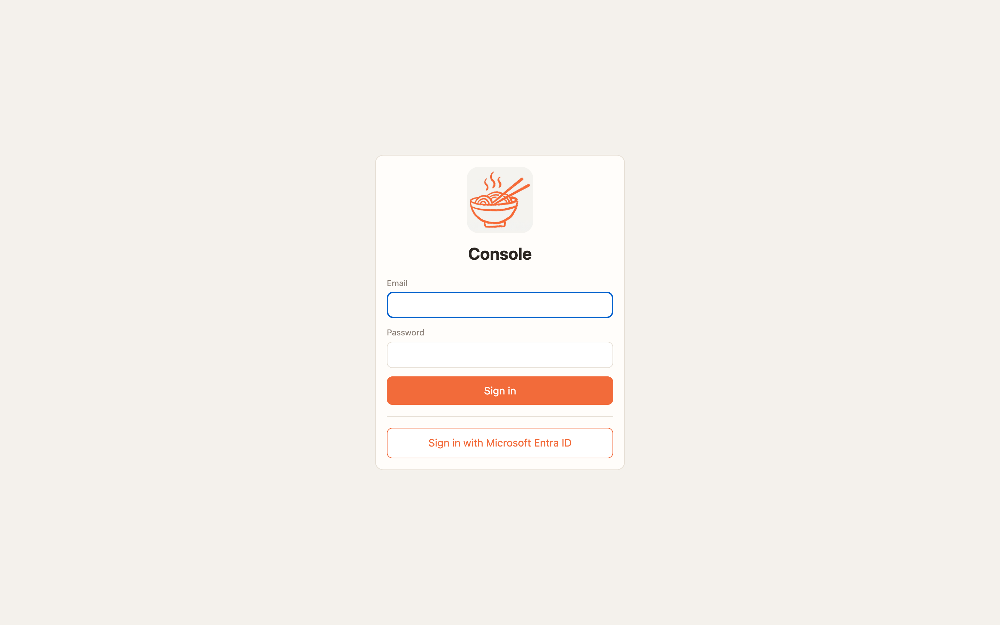{ .ramen-shot width=720 }
</figure>

## 2. Optional: the engines and an LLM provider (super admin)

Three engines are optional at install (Terraform `otel_collector`, `evals_engine`, `skillspector_engine`; compose
`make up ENGINES=phoenix,promptfoo`). With them on, the Config page names them:

<figure markdown>
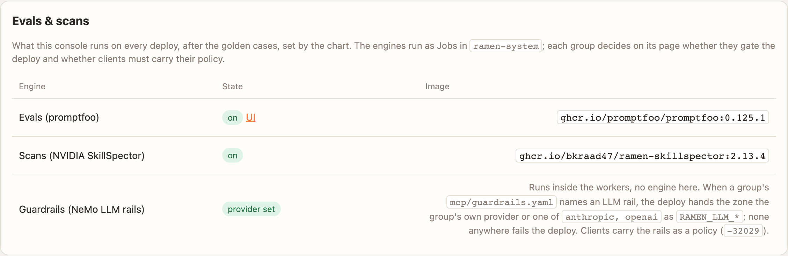{ .ramen-shot }
<figcaption>Config → Evals & scans: the promptfoo image and UI, the SkillSpector image.</figcaption>
</figure>

Point **Config → Telemetry** at the chart's collector (`https://phoenix.ramen-system.svc.cluster.local:4318` with
`otel.collector=phoenix`). Every group becomes one Phoenix project and every span names the user:

<figure markdown>
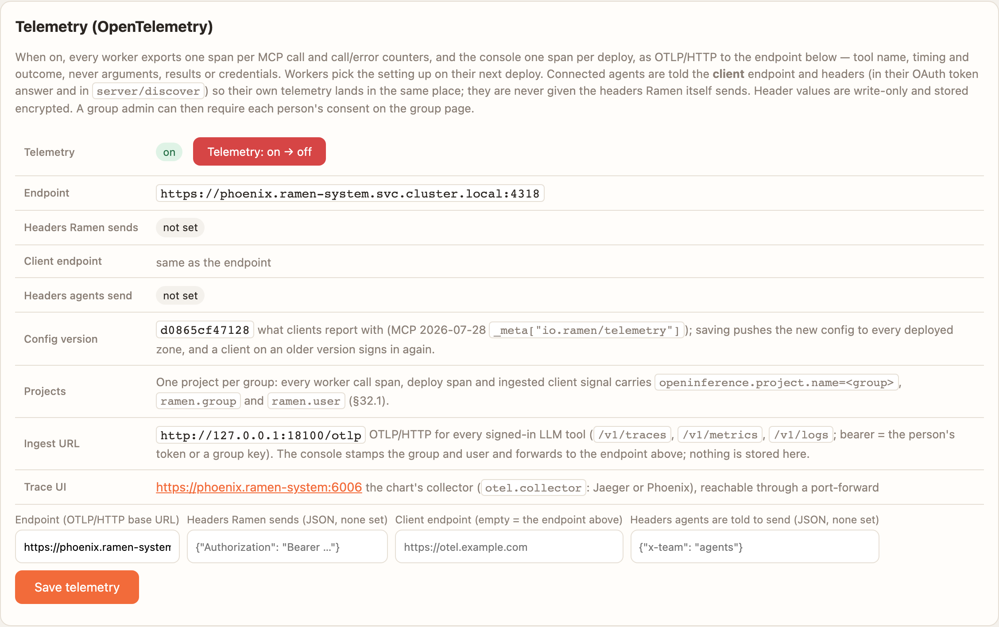{ .ramen-shot }
<figcaption>Config → Telemetry: the endpoint, the config version clients must hold, the OTLP ingest URL for client telemetry.</figcaption>
</figure>

LLM rails, LLM-graded evals and SkillSpector's semantic analysis need a provider. Add a key on **Config → LLM
providers** and tick the models groups may use; keys are write-only and never leave the console (workers and the
bridge call its judge proxy). The demo's own evals and static rails need none.

<figure markdown>
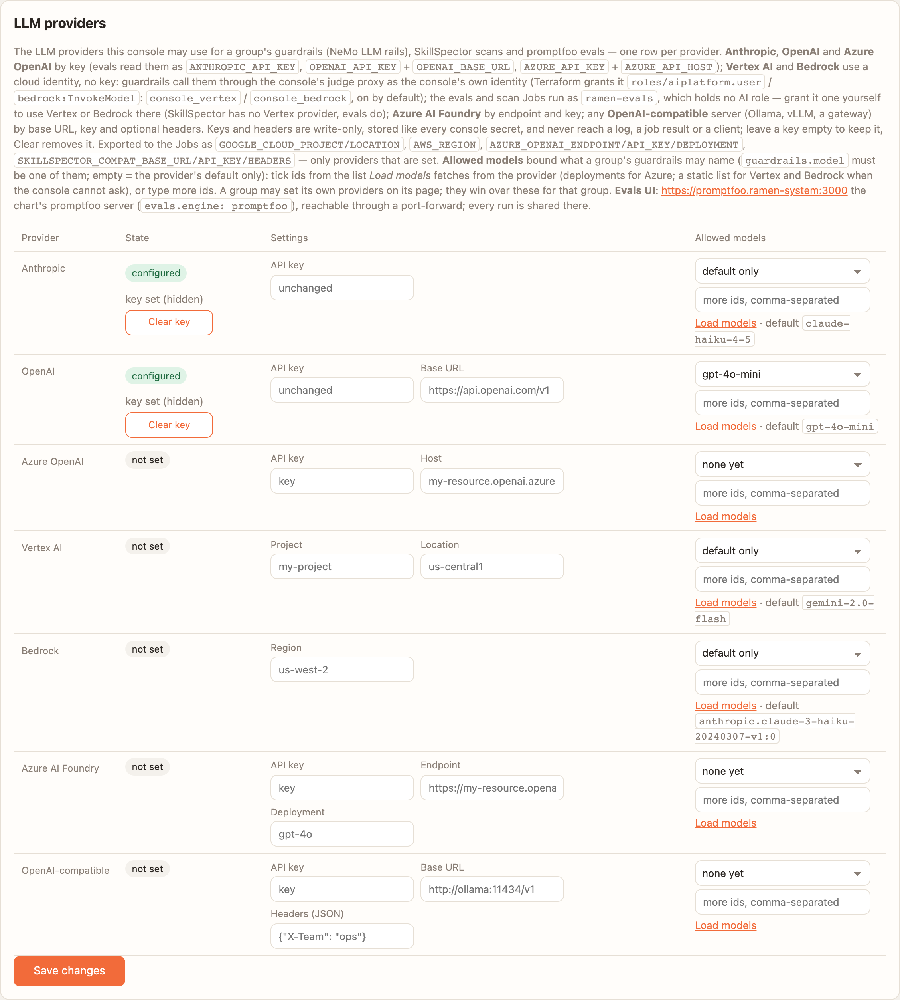{ .ramen-shot }
<figcaption>Config → LLM providers: one row per provider, set or not set, allowed models from the provider's live list.</figcaption>
</figure>

## 3. Create the group

**Groups → Create group**: name `demo`, repo `https://github.com/bkraad47/ramen-demo-mcp-group`, ref `main`. A private
repo needs a secret named `GITHUB_TOKEN` on the group. The group page is empty until something is deployed.

## 4. An environment and a zone

On **Environments, Zones and Workers**:

1. **New environment**: name `prod`, ref `main`, tick group `demo`.
2. **New zone**: name `a`, tick environment `prod`, pick a location — locally free text, on a cloud a zone of a region
   that has a cluster (the home region, or a [satellite](wiki/groups-zones.md#where-a-zone-can-be)).

Saving the zone binds it to the group and starts the first canary deploy at once: a namespace `ramen-demo-a`, the
zone's own cloud identity, a route matching the headers `ramen-group: demo` and `ramen-zone: a`.

<figure markdown>
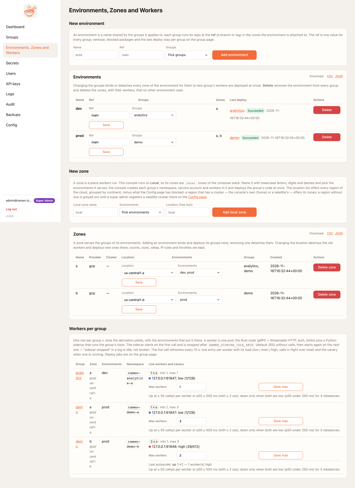{ .ramen-shot }
<figcaption>Environments name their groups, zones name their environments, a worker record per group × zone.</figcaption>
</figure>

## 5. Watch the deploy

The job is on the group page. Its log reads: sync the repo to the bucket, (on a cloud with the builder) build the
group's image from `mcp/requirements.txt`, canary, reload, smoke, golden cases, evals, scan, stable. A failure at
any step before stable leaves the old version serving.

<figure markdown>
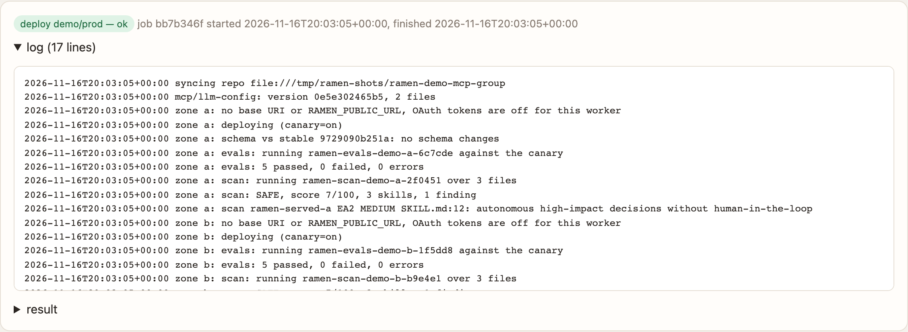{ .ramen-shot }
</figure>

Each zone row then carries the deploy's results: `evals: 6 passed` (linked to the run page in the console) and
`scan: SAFE` (linked to the report).

<figure markdown>
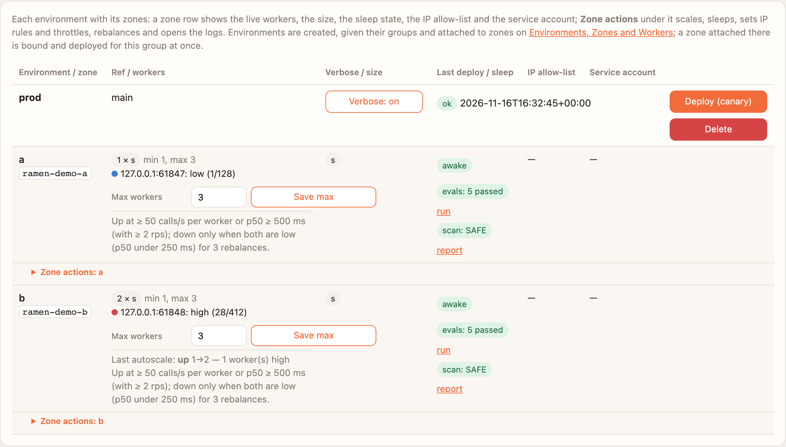{ .ramen-shot }
<figcaption>Group page → Environments: per zone, the workers, the autoscale bounds, and the last deploy's evals and scan badges.</figcaption>
</figure>

<figure markdown>
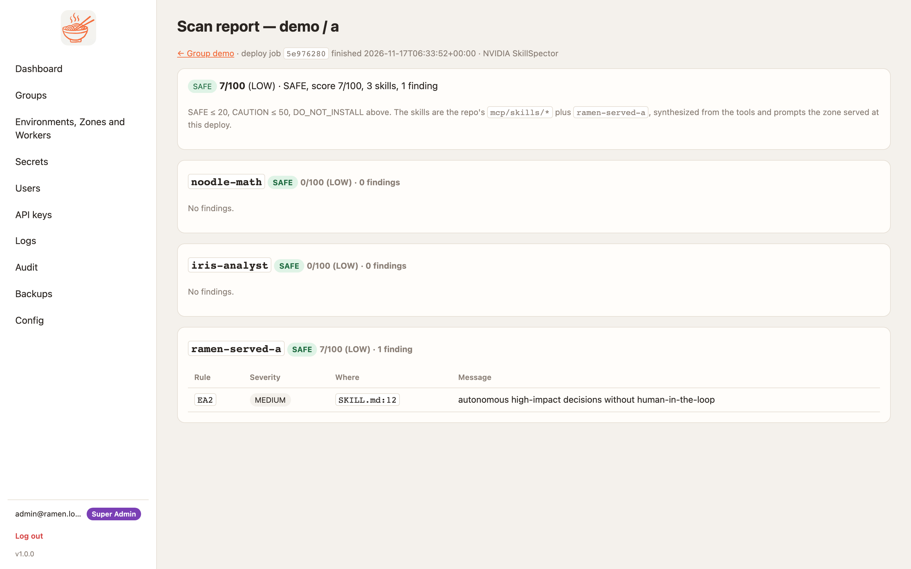{ .ramen-shot }
<figcaption>The scan report: NVIDIA SkillSpector per skill — the repo's <code>mcp/skills/*</code> and the skill synthesized from what the zone serves.</figcaption>
</figure>

### View the run in promptfoo

The evals badge opens the run in the console: every case with what it sent, what came back and why it failed. With
`evals.engine: promptfoo`, the same run is also in the chart's promptfoo server, which has its own UI (it shows every
group's runs, so it is never routed through the edge). Open it through a port-forward to its TLS front, which asks
for user `admin` and the install's engines password (a super admin with cluster access reads it):

```bash
kubectl -n ramen-system port-forward deploy/promptfoo 3443:3443
# then https://localhost:3443/eval/<run>  — <run> is the promptfoo id the console's run page names
kubectl -n ramen-system get secret ramen-engines -o jsonpath='{.data.password}' | base64 -d; echo
```

promptfoo serves HTTPS signed by the install CA, like Phoenix: accept the browser's warning once, or trust the CA
([Trust the install CA and enforce HTTPS](wiki/trust-ca.md)). Its plaintext port never leaves the pod.

<figure markdown>
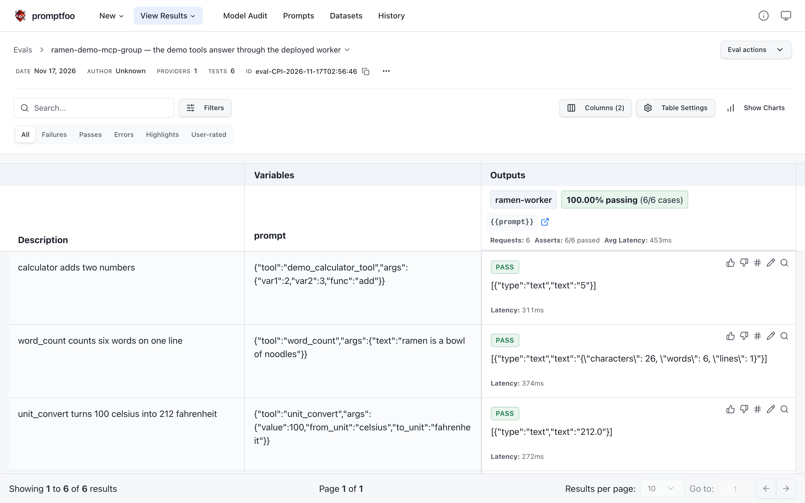{ .ramen-shot }
<figcaption>The demo's evals run in the chart's promptfoo UI: six cases, all passing (live GKE run, through the HTTPS port-forward).</figcaption>
</figure>

## 6. Decide what the group enforces

The Evals, Scans and Guardrails cards (group admins) set, per policy, **Gate** (a failure stops the deploy) and
**Required** (every client must carry the policy's version, or the worker refuses its calls with `-32026`, `-32027`,
`-32029`), and the LLM provider and model the policy uses. A change pushes the new version to the deployed zones
without a deploy.

<figure markdown>
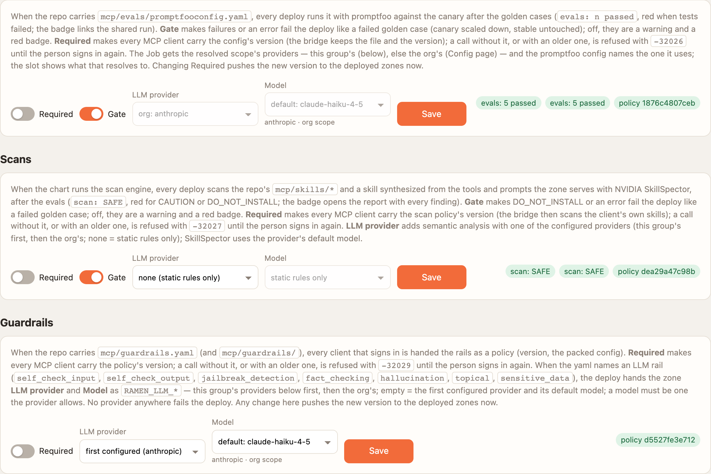{ .ramen-shot }
<figcaption>Evals, Scans and Guardrails: Required, Gate, provider, model, the last runs and the policy version.</figcaption>
</figure>

The Packages card lists what each zone serves, its apps and skills (with each skill's scan verdict); **Preview** opens
an app in a sandbox.

<figure markdown>
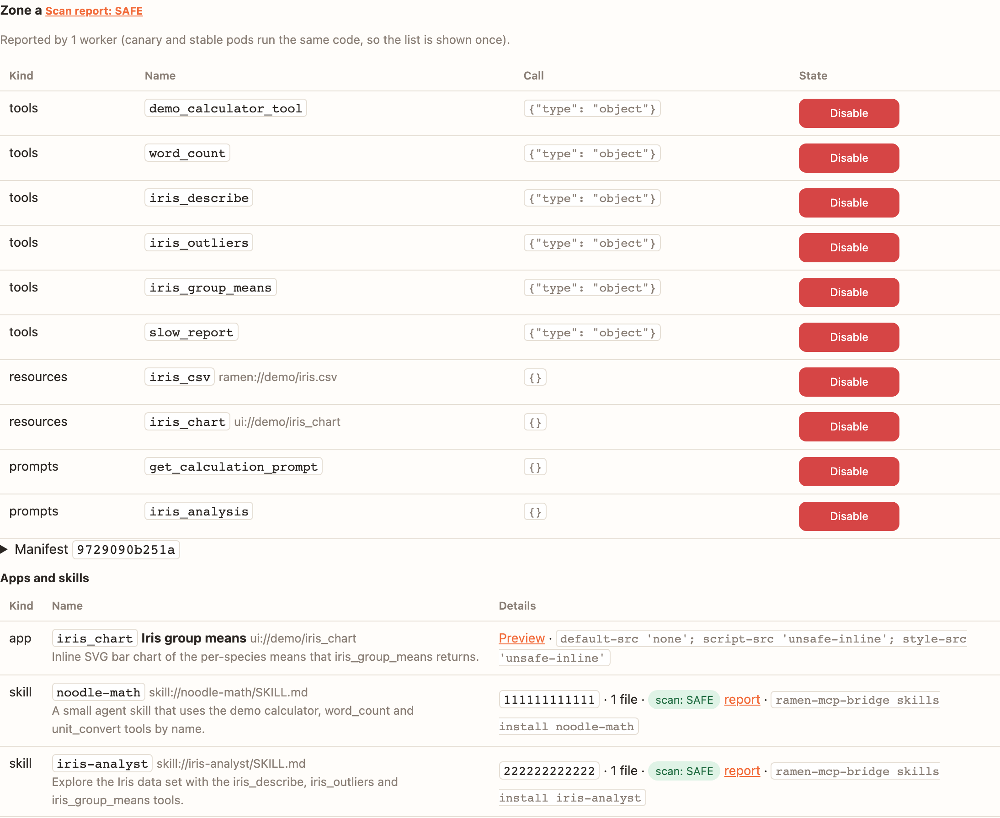{ .ramen-shot }
</figure>

## 7. Accept the LLM configs, then make a key

The demo repo ships `mcp/llm-config/`, so every person accepts its files once per version before the console hands
out a token or a key — the admin who mints a group key too. Open **/groups/demo/configs** (the console sends you
there when it is needed), read the files and accept.

<figure markdown>
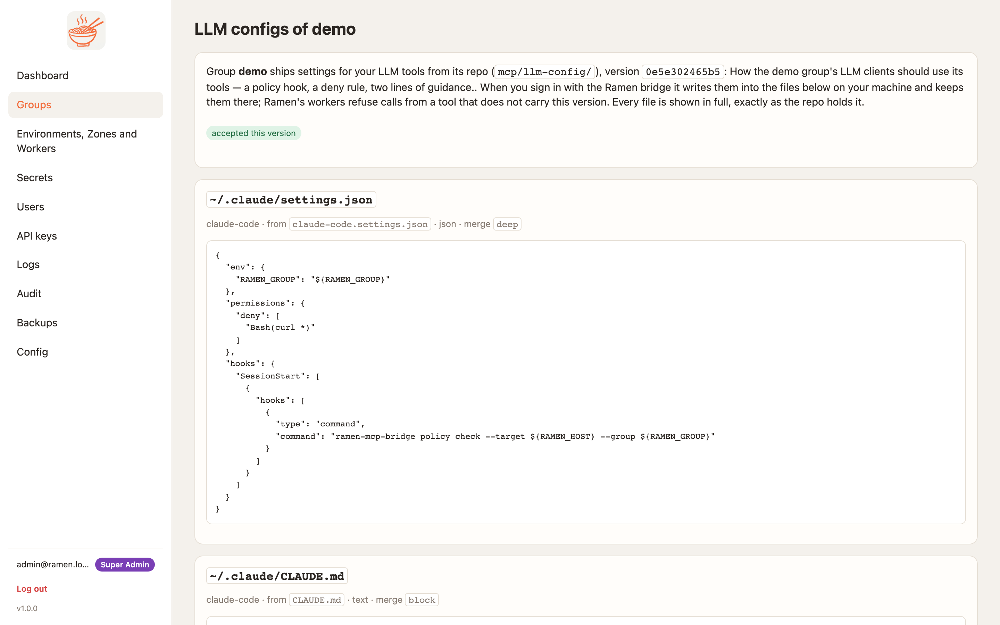{ .ramen-shot }
<figcaption>The group's LLM configs, shown verbatim with where each lands on a member's machine.</figcaption>
</figure>

Then **Group → MCP auth keys → Generate key**. The key is shown once. The console pushes it to the group's running
workers at once (1.0.0, D92), so no deploy is needed.

## 8. Call a tool

Because the group requires its configs, every call carries the version (bridge 1.0.0 does this by itself). Read it
from the public policy and call:

```sh
CONSOLE=https://<console address>; EDGE=$CONSOLE   # local stack: CONSOLE=https://localhost:8443, EDGE=https://localhost:8080 (curl --cacert deploy/local/.certs/ca/ca.crt)
V=$(curl -s "$CONSOLE/.well-known/ramen-policy?group=demo&zone=a" | python3 -c 'import sys,json;print(json.load(sys.stdin)["configs"]["version"])')
curl -s $EDGE/mcp -H "Authorization: Bearer $RAMEN_MCP_KEY" -H 'Content-Type: application/json' \
  -H 'Accept: application/json' -H 'ramen-group: demo' -H 'ramen-zone: a' \
  -d '{"jsonrpc":"2.0","id":1,"method":"tools/call","params":{"name":"demo_calculator_tool",
       "arguments":{"var1":2,"var2":3,"func":"add"},"_meta":{"io.ramen/configs":{"version":"'"$V"'"}}}}'
```

Without the version the worker answers `-32028 configs required`. `scripts/cloud_smoke.sh` runs the whole path
(accept, key, deploy, call) and prints PASS or FAIL per step.

For people, the group page's **How MCP users sign in** card prints the exact commands for this install — Claude Code
over HTTP with OAuth, or the bridge (`ramen-mcp-bridge`) for Cursor, VS Code and Claude Desktop, which signs in,
keeps the policy bundle, writes the accepted configs and carries every version on every call
([Connect a client with OAuth](wiki/connect-oauth.md)).

<figure markdown>
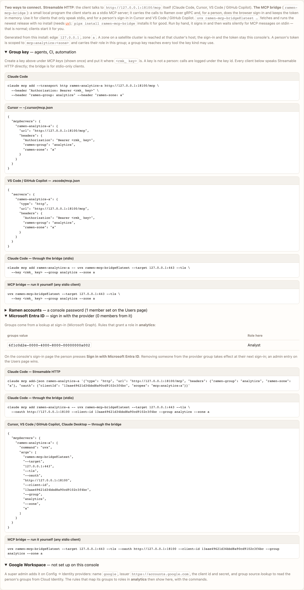{ .ramen-shot }
</figure>

## 9. See it in Phoenix

With `otel.collector=phoenix`, port-forward the UI (`kubectl -n ramen-system port-forward svc/phoenix 6006:6006`, then
https://localhost:6006 — the same install CA as promptfoo; sign in as `admin@localhost` with the same engines password)
and open project `demo`: one trace per Ramen call, `ramen.user` on every span, and the client's own telemetry next to it
when the bridge wrote the OTel settings.

<figure markdown>
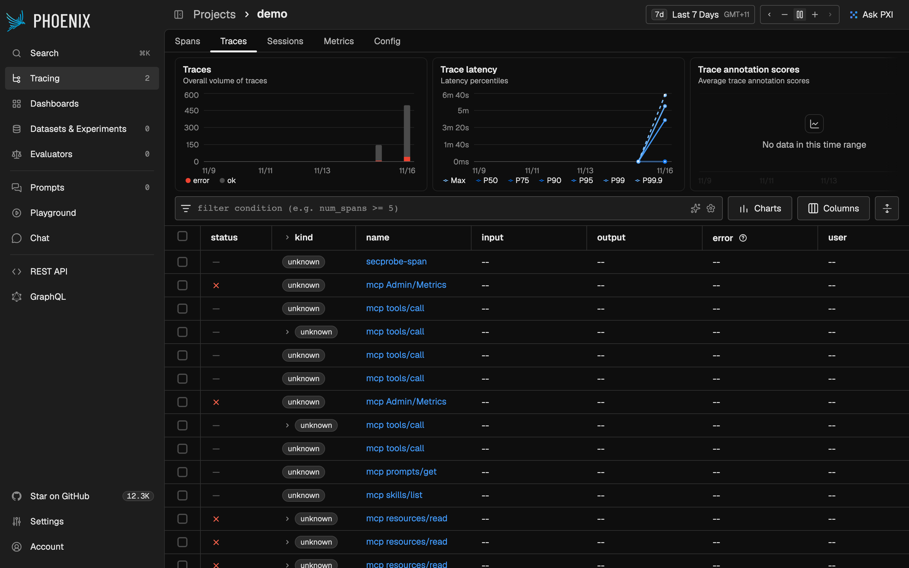{ .ramen-shot }
<figcaption>Arize Phoenix, project <code>demo</code> (live GKE run).</figcaption>
</figure>

## Next

Your own repo: copy the demo's layout ([MCP features](wiki/mcp-features.md), [The MCP repo](wiki/mcp-repo.md)).
More zones and regions: [Groups, zones and regions](wiki/groups-zones.md). Who may do what: [Roles](roles.md).
