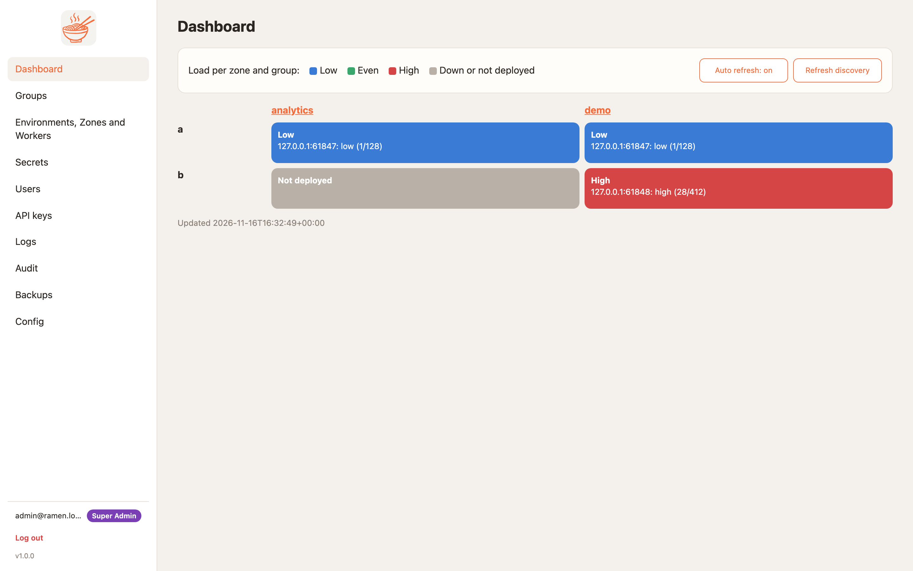
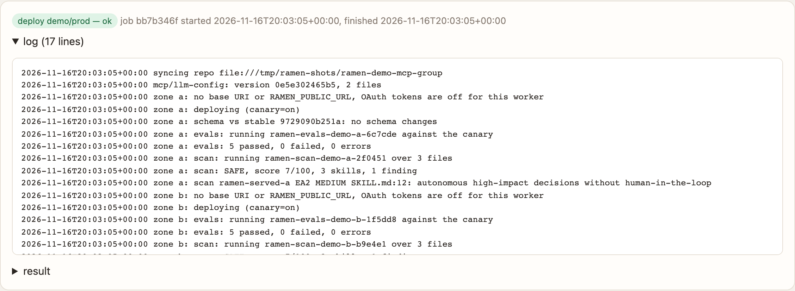

# Get started

Three short walks: run Ramen on your laptop, connect a repo of tools, and connect a client. Each step shows the
page you will see; the wiki goes deeper.

!!! tip "Quick links: deploy to a cloud"

    Each deploy guide is self-contained — Terraform (or CloudFormation on AWS), the chart, the first group.

    | Cloud | Deploy guide | What it grants and opens |
    |---|---|---|
    | **Google Cloud** (GKE Autopilot) | [Deploy on GCP](wiki/deploy-gcp.md) | [IAM and network on GCP](wiki/iam-network-gcp.md) |
    | **AWS** (EKS) | [Deploy on AWS](wiki/deploy-aws.md) | [IAM and network on AWS](wiki/iam-network-aws.md) |
    | **Azure** (AKS) | [Deploy on Azure](wiki/deploy-azure.md) | [IAM and network on Azure](wiki/iam-network-azure.md) |

    Then: [Deploy your first group](first-group.md) · [Trust the install CA and enforce HTTPS](wiki/trust-ca.md) ·
    [Groups, zones and regions](wiki/groups-zones.md).

You need Docker with compose v2, `git`, `make` and `uv`. The first start pulls the release's two images from
Docker Hub, about a minute; `make up BUILD=1` builds them from source instead, three to five minutes.

## 1. Start Ramen locally

```sh
git clone https://github.com/bkraad47/ramen && cd ramen
make up
```

That starts a Firestore emulator, the console and one worker. Open **https://localhost:8443** and accept the
self-signed certificate. Sign in with `admin@ramen.local` and the password `make up` generated into
`deploy/local/.env` (`grep RAMEN_ADMIN_PASSWORD deploy/local/.env`). Every secret in that file is generated on your
machine; nothing in the repository is a usable password or key.

<figure markdown>
{ .ramen-shot width=720 }
<figcaption>The sign-in page. The password is the generated one in deploy/local/.env; `make env` rotates a stale one.</figcaption>
</figure>

Before the first deploy of the demo, add an LLM key on **Config → LLM providers** (OpenAI, Anthropic, Azure OpenAI,
… with at least one allowed model). The demo's guardrails judge `iris_report` and `iris_outliers` with that model
and its evals use it; without a provider the deploy stops with `no LLM provider: set one on the group or ask a super
admin`. The key stays on the console: workers reach the model through the console's LLM proxy. For a try-out without
a key, deploy the demo's `v0.8.0` tag instead (no LLM rails, no LLM configs): `RAMEN_DEMO_REF=v0.8.0 make demo`.

Then prove the whole path with one command:

```sh
make demo
```

It creates the zone `local`, the group `demo` from the demo repo and the environment `dev`, generates a key, runs
a canary deploy and calls the calculator tool. The last line reads:

```
PASS: demo_calculator_tool(2,3,add) -> 5
```

<figure markdown>
{ .ramen-shot }
<figcaption>The dashboard after the first deploy: one cell per zone and group, with its load.</figcaption>
</figure>

`make down` stops the stack and removes its volumes when you are finished.

## 2. Connect an MCP repo

A group is one git repo of tools. `make demo` already made the group `demo` from the demo repo, the smallest
complete one. This is how you add your own.

```
mcp/
  requirements.txt
  env.yaml
  tools/demo_calculator_tool/demo_calculator_tool.py
  tools/demo_calculator_tool/demo_calculator_tool.json
  resources/demo_readme/...
  prompts/get_calculation_prompt/...
```

Fork it, or copy the layout into your own repo. Then in the console, for **your** repo:

1. **Groups → Create group**. Name it, paste the repo URL and the ref (`main`). A private repo needs a secret named
   `GITHUB_TOKEN` on the group.
2. **Environments, Zones and Workers → New environment**: name it `dev`, ref `main`, tick your group. Then tick
   `dev` on the zone `local` in the Zones table and save; binding the zone deploys the group there at once.
3. Later deploys: **Deploy (canary)** on the group page. The job log reads sync, canary, reload, smoke, stable. The first run pip-installs
   `mcp/requirements.txt` and takes a minute or two.

<figure markdown>
{ .ramen-shot }
<figcaption>The group page: environments with their Deploy button, deploy jobs, the zones and what each one serves.</figcaption>
</figure>

<figure markdown>
{ .ramen-shot }
<figcaption>A deploy job. A package that fails to load is named here and the deploy stops at the canary.</figcaption>
</figure>

Every later change is a push and another Deploy. [Deploy your first group](first-group.md) walks the same steps with
every page, the evals and scan results and the LLM configs. [How an MCP repo is structured](wiki/mcp-repo.md) explains the
JSON file next to each tool, resources, prompts and local testing.

## 3. Connect a client

A worker is a URL plus two headers. The credential decides whose name the call runs under: a **group key** for
agents and automation, or **your own sign-in** through OAuth.

### With a group key (Claude Code, Cursor, VS Code, curl)

On the group page, **MCP auth keys → Generate key**. The key is shown once. Deploy once more so the worker
learns it, then export it:

```sh
export RAMEN_MCP_KEY='rmk_...'
```

<figure markdown>
{ .ramen-shot }
<figcaption>A key is shown once. Keep it in an environment variable, not in a config file.</figcaption>
</figure>

The local worker serves TLS with the stack's own CA (D86: every hop is TLS, locally too), written to
`deploy/local/.certs/ca/ca.crt` by `make up`. Clients must trust it: Node-based ones (Claude Code, Cursor, VS Code)
read `NODE_EXTRA_CA_CERTS`, `curl` takes `--cacert`, the bridge `--ca`.

Claude Code:

```sh
export NODE_EXTRA_CA_CERTS=$PWD/deploy/local/.certs/ca/ca.crt   # before starting the client
claude mcp add --transport http ramen-demo https://localhost:8080/mcp \
  --header "Authorization: Bearer $RAMEN_MCP_KEY" --header "ramen-group: demo" --header "ramen-zone: local"
```

Cursor (`~/.cursor/mcp.json`) takes this entry; VS Code / GitHub Copilot (`.vscode/mcp.json`) the same under
`"servers"` with `"type": "http"`:

```json
{"mcpServers": {"ramen-demo": {"url": "https://localhost:8080/mcp",
  "headers": {"Authorization": "Bearer ${RAMEN_MCP_KEY}", "ramen-group": "demo", "ramen-zone": "local"}}}}
```

Restart the client and `demo_calculator_tool` appears under the server. Ask it to add 2 and 3. The same call from
a shell:

```sh
curl -s --cacert deploy/local/.certs/ca/ca.crt https://localhost:8080/mcp -H "Authorization: Bearer $RAMEN_MCP_KEY" -H 'Content-Type: application/json' \
  -H 'ramen-group: demo' -H 'ramen-zone: local' \
  -d '{"jsonrpc":"2.0","id":1,"method":"tools/call","params":{"name":"demo_calculator_tool","arguments":{"var1":2,"var2":3,"func":"add"}}}'
```

The demo repo ships `mcp/llm-config/`, so the workers refuse a call that does not carry the accepted configs
version (`-32028 configs required`): add `"_meta": {"io.ramen/configs": {"version": "<v>"}}` to `params`, with `<v>` from
`/.well-known/ramen-policy?group=demo&zone=<zone>` ([Deploy your first group → Call a tool](first-group.md#8-call-a-tool)). The bridge
(1.0.0, the bridge for Ramen 1.0.0) does this by itself.

### As yourself (Claude Code, with OAuth)

No shared key. Your account is a Ramen password account or, once a super admin has added a provider on the Config
page, Microsoft Entra ID or Google ([Entra ID and Workspace](wiki/sso.md)). A super admin registers the client on
**Config → OAuth clients** with the redirect URI `http://localhost/callback` and gives you the client id. Your
account needs a role in the group; *MCP User* is enough. Then, against the local stack:

```sh
claude mcp add-json ramen-demo '{"type":"http","url":"https://localhost:8080/mcp",
  "headers":{"ramen-group":"demo","ramen-zone":"local"},
  "oauth":{"clientId":"<client id>","scopes":"mcp:demo:local"}}'
```

Run `/mcp` in Claude Code, pick *ramen-demo* and sign in. The browser opens the console's login page, then a
consent page. Approve once. Every call now runs under your name. In a cloud the same two lines use your console's
address and a cloud zone, and nothing else changes.

<figure markdown>
{ .ramen-shot }
<figcaption>The consent page. It names the client, the group and the zone it asks for.</figcaption>
</figure>

### Clients that only speak stdio: the bridge

```sh
uvx ramen-mcp-bridge@latest --target localhost:8080 --ca deploy/local/.certs/ca/ca.crt --key "$RAMEN_MCP_KEY" --group demo --zone local
# or, registered in Claude Code:
claude mcp add ramen-demo-stdio -- uvx ramen-mcp-bridge@latest --target localhost:8080 --ca $PWD/deploy/local/.certs/ca/ca.crt \
  --key "$RAMEN_MCP_KEY" --group demo --zone local
```

`uvx …@latest` runs the newest release without installing it (`pip install ramen-mcp-bridge` also works). Ramen
1.0.0's policy versions (LLM configs, guardrails, evals, scans) need bridge 1.0.0; an older bridge's gated
calls are refused (`-32028` against the demo group). In any
other client, put the command in an `mcpServers` entry as `command: "uvx"` and `args`.

Against a cloud console the bridge takes `--target <edge>:443 --tls`, and `--oauth https://<edge> --client-id <id>`
instead of `--key` to sign a person in. That is how Cursor, VS Code and Claude Desktop sign a person in:
[Connect a client with OAuth](wiki/connect-oauth.md#what-the-person-does). In a cloud, the group page's **How MCP
users sign in** card prints every command for your install.

## Where next

- [Deploy on GCP](wiki/deploy-gcp.md), [AWS](wiki/deploy-aws.md) or [Azure](wiki/deploy-azure.md) — and what each
  install grants and opens: [IAM and network on GCP](wiki/iam-network-gcp.md), [AWS](wiki/iam-network-aws.md),
  [Azure](wiki/iam-network-azure.md). The console pages are the same; only the addresses change. Then set a max per zone and let Ramen
  [autoscale](wiki/autoscaling.md).
- [Guardrails](wiki/guardrails.md): the demo repo ships NeMo rails on `word_count` from its 0.7.5 release.
- [Connect with OAuth](wiki/connect-oauth.md) and [connect with a password account](wiki/connect-password.md)
  in detail.
- [Users and access](wiki/users-access.md), [secrets](wiki/secrets.md), [throttling](wiki/throttling.md).
- [Agent skills](wiki/skills.md): hand the install, key rotation, backups and scaling to a coding agent
  (Claude Code, Cursor, any Agent Skills client), with a read-only validator after each.
