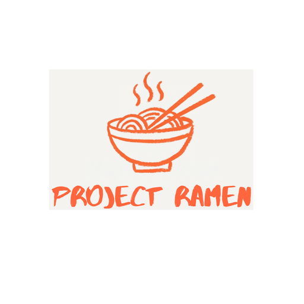

{ width=360 }

<table class="ramen-badge-table">
<tr>
<td></td>
<td></td>
<td></td>
<td></td>
<td></td>
<td></td>
</tr>
</table>

Ramen is a multizone, highly available MCP server for GCP, AWS and Azure Kubernetes. Your team keeps **a git repo of
tools, resources and prompts in plain Python**. Ramen turns it into a fleet of MCP workers behind a cloud load
balancer, with canary deploys, secrets, a role per group, an OAuth front door for Claude Code and the bridge, and a log line
that says who called what. Underneath it is gRPC, JSON-RPC 2.0 and a Rust node. **You code in Python.**

### [ramen](https://github.com/bkraad47/ramen)
The server: console, Rust node, Python runtime, Helm charts and Terraform for GCP, AWS and Azure. Releases are tagged
and built by CI.

### [ramen-mcp-bridge](https://github.com/bkraad47/ramen-mcp-bridge)
`pip install ramen-mcp-bridge`. A stdio MCP server for clients that cannot speak HTTP. Carries a group key or
signs you in through the console. [On PyPI](https://pypi.org/project/ramen-mcp-bridge/).

### [ramen-demo-mcp](https://github.com/bkraad47/ramen-demo-mcp-group)
The demo group repo every guide deploys: three tools, a resource, a prompt, an `env.yaml`, golden cases and NeMo rails. Point a group at
it and press Deploy.

[Get started :material-arrow-right:](get-started.md){ .md-button .md-button--primary } [How it works](how-it-works.md){ .md-button }

## Why Ramen

- **One deployment per team, not one server per tool.** A worker loads every tool of the group. Thirty tools
  run on one Deployment per zone with a canary, behind one load balancer.
- **Built on how organizations work.** A group is a team. It owns a repo, a bucket, its secrets and its members.
  People hold a role per group: Group Admin, Viewer, MCP User, or a role you define. Entra ID or Google Workspace
  groups can decide the roles at sign-in, and what an admin sets by hand stays.
- **Guardrails where the tool runs.** Opt a tool into NeMo Guardrails rails, or a policy file of your own, checked
  in the worker before the call and after the result. A blocked call is a readable tool error; the access log names
  the rail.
- **Build once, deploy on three clouds.** Terraform and Helm for GKE, EKS and AKS, each verified live in 0.7.5 with
  a publicly trusted certificate on GKE and AKS. The same console, routes and guards on all three.
- **It scales itself.** Ramen adds workers under load and removes them when it is quiet, between 1 and a max that
  group admins set per zone. No cloud autoscaler config, every step in the audit log.
- **Canary by default.** Every deploy rolls one canary pod, smoke-tests it, then rolls the stable pods. A failure
  leaves the old version serving.
- **Clients connect as themselves.** Claude Code over HTTP, and Cursor, VS Code or Claude Desktop through the bridge,
  sign a person in through the console (a Ramen password, Entra ID or Google) and get a token for one group and zone.
  Agents and CI use a group key. The group page prints the exact commands.
- **Secrets never show.** Values live in Secret Manager, Secrets Manager, Key Vault or the Fernet-encrypted store and reach
  tool code only as environment variables on deploy.
- **The edge is locked.** The cloud edges listen on 443 only, IP rules apply per zone at the node and at the cloud
  edge, Redis throttles by address and by token, and every console action leaves an audit line.
- **Multizone from day one.** Group, environment, zone, worker. The load balancer routes on two headers, so one
  client config reaches any zone.
- **Rust where it counts.** The Rust node owns auth, limits and the transport. Your Python runs in a separate
  process it can restart at any time.

**What is verified.** 0.7.5 ran live on GKE, EKS and AKS, with the same 33 checks, Entra ID sign-in with group
lookup and autoscaling load tests on each, and CI proves both transports on Linux and Windows; the single record,
including what is tested only, is [Transport → What is verified](wiki/transport.md#what-is-verified-and-what-is-not).
Everything in detail is in the [wiki](wiki/index.md).
