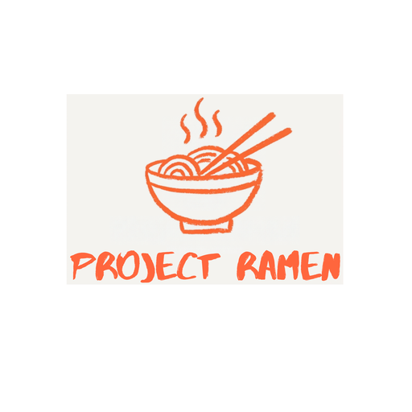
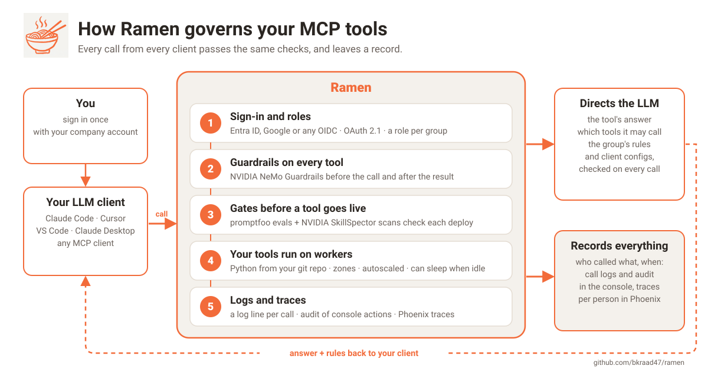

{ width=360 }

<table class="ramen-badge-table">
<tr>
<td></td>
<td></td>
<td></td>
<td></td>
<td></td>
<td></td>
</tr>
</table>

**Governed MCP for teams.** Ramen is a self-hosted MCP platform that enforces your organisation's security and
structure on every tool call — the sanctioned home for your team's tools instead of shadow MCP servers on laptops.
Your team keeps **a git repo of tools, resources, prompts, apps and skills in plain Python**. Ramen signs people in
with a role per group, checks every call with [guardrails](wiki/guardrails.md) (NVIDIA NeMo Guardrails, static and
LLM-judged), gates every deploy with golden cases, [promptfoo evals](wiki/evals.md) and an
[NVIDIA SkillSpector scan](wiki/skillspector.md), and records every call — in the access log, the audit log and
[Arize Phoenix](wiki/telemetry.md). It runs on a laptop or across zones on GKE, EKS and AKS, and speaks MCP
2026-07-28. **You code in Python.**

<figure markdown>
{ .ramen-shot }
</figure>

<section class="ramen-family" aria-label="The Ramen project" markdown>

<strong>One project, three repositories</strong> — the server you install, the bridge
your people run, and a group repo to copy.

:material-server-network: Ramen · the server
<h3 class="ramen-repo__name"><a href="https://github.com/bkraad47/ramen">ramen</a></h3>

What you install: the console, the Rust MCP node and the Python runtime, Helm charts and
Terraform for GCP, AWS and Azure. Releases are tagged and built by CI.

<a href="https://github.com/bkraad47/ramen">GitHub</a> · <a href="https://hub.docker.com/u/bkraad47">Docker Hub</a> · <a href="changelog/">Changelog</a>

:material-bridge: Ramen · the client bridge
<h3 class="ramen-repo__name"><a href="https://github.com/bkraad47/ramen-mcp-bridge">ramen-mcp-bridge</a></h3>

What your people run: <code>pip install ramen-mcp-bridge</code>, a stdio MCP server for
clients that cannot speak HTTP. Signs in through the console or carries a group key, keeps the group's policy and
writes its client configs. Bridge 1.0.0 is the bridge for Ramen 1.0.0: TLS by default, plaintext only with an
explicit <code>--insecure</code> for local development.

<a href="https://github.com/bkraad47/ramen-mcp-bridge">GitHub</a> · <a href="https://pypi.org/project/ramen-mcp-bridge/">PyPI</a> · <a href="wiki/connect-oauth/">Connect a client</a>

:material-bowl-mix-outline: Ramen · the demo group
<h3 class="ramen-repo__name"><a href="https://github.com/bkraad47/ramen-demo-mcp-group">ramen-demo-mcp</a></h3>

What you copy: the group repo every guide deploys — tools (one asks before it acts, one
runs as a task, Iris data tools), resources, prompts, an MCP App, skills, golden cases, NeMo rails, promptfoo evals and
LLM configs.

<a href="https://github.com/bkraad47/ramen-demo-mcp-group">GitHub</a> · <a href="wiki/mcp-features/">MCP features</a> · <a href="wiki/mcp-repo/">The MCP repo</a>

</section>

<nav class="ramen-paths" aria-label="Where to start" markdown>

<a class="ramen-path ramen-path--primary" href="get-started/" markdown="span">
1 · Try it
:material-rocket-launch-outline: Try the demo
From nothing to a governed MCP server on your laptop, step by step with a picture per step: guardrails, sign-in, traces, a client calling a tool.
Start the walkthrough :material-arrow-right:
</a>

<a class="ramen-path" href="first-group/" markdown="span">
2 · Deploy
:material-cloud-upload-outline: Deploy your first group
On GCP, AWS or Azure: a group, a zone, the deploy gates, evals in promptfoo, traces in Phoenix.
Walk through it :material-arrow-right:
</a>

<a class="ramen-path" href="how-it-works/" markdown="span">
3 · Understand
:material-sitemap-outline: How it works
Console, node and runtime; environments, zones and workers; what is enforced on every call.
Read the overview :material-arrow-right:
</a>

</nav>

## Why teams pick it

- **Sanctioned MCP, not shadow MCP.** Tools in a repo you review, on your cluster, answering only people who signed
  in with your identity provider and hold a role in the group.
- **No eval, no deploy.** A canary first; golden cases always, promptfoo evals and a SkillSpector scan when the engines
  are on, and a group admin can make either stop the deploy.
- **Guardrails per tool, not per chat.** Rails run inside the worker for every client, before the tool and after it.
- **Every tool call has a name.** A person's sign-in or a named key on every call; access log, audit log, Phoenix.
- **It directs the LLM.** The group's rules and client configs are versioned, accepted per person and checked on
  every call.
- **Scales for what you need now**, and **follows MCP's 2026 direction**: stateless requests, tasks, multi
  round-trip requests, MCP Apps and Skills over MCP.

## Built-in governance and dev tools

| Tool | What it does in Ramen | Where it runs |
|---|---|---|
| [NVIDIA NeMo Guardrails](https://github.com/NVIDIA-NeMo/Guardrails) | rails per tool, before the call and after the result | in every worker, on the laptop too |
| [promptfoo](https://github.com/promptfoo/promptfoo) | the repo's eval suite against the canary on every deploy | a Job in the cluster |
| [NVIDIA SkillSpector](https://github.com/NVIDIA/SkillSpector) | scans the repo's skills and the served tools on every deploy | a Job in the cluster |
| [Arize Phoenix](https://github.com/Arize-ai/phoenix) | traces, one project per group, the person on every span | next to the console, and on the laptop |

## Key features

### The protocol
- **MCP 2026-07-28** next to 2025-06-18 on one endpoint, per request: stateless requests, standard headers,
  `server/discover`, subscriptions ([Transport](wiki/transport.md)).
- **Tasks**, **multi round-trip requests** (elicitation, sampling, roots), progress, completion.
- **MCP Apps** (`ui://`) and **Skills over MCP** (`skills/list`, `skill://`) from folders in the repo.
- **Streamable HTTP and gRPC** on one port, one set of guards; a stdio **bridge** for every other client.

### Quality and safety gates
- **Canary deploys** with a schema compatibility gate and **golden cases**.
- **promptfoo evals** from the repo, run on every deploy, report or gate per group.
- **NVIDIA SkillSpector** scans of the repo's skills and the served tools, with a report page.
- **Guardrails** in the worker: NeMo rails, static or **LLM-backed**, or your own `policy.py`.

### Enforced on every sign-in
- **Client policies**: telemetry, evals, scans, LLM configs and guardrails carry versions every call must hold
  (`-32024`…`-32029`), on every sign-in path and every client.
- **LLM configs** from the repo, accepted per person and version, written to their tools by the bridge.
- **Telemetry by group and user**: one Phoenix project per group, `ramen.user` on every span, client telemetry
  through the console's OTLP ingest.
- **LLM judge proxy**: provider keys never leave the console.

### Run it
- **GCP, AWS and Azure** from Terraform and Helm; optional Phoenix, promptfoo and SkillSpector with one switch each.
- **Roles per group** (Super admin, Group admin, Viewer, MCP user, custom roles), Entra ID and Google Workspace.
- **Autoscaling** by Ramen on load and latency; **sleeping workers**; **Redis throttling**.
- **Per-group image builds** on deploy; **satellite clusters** for zones in other regions.
- **TLS on every hop** with a per-install CA; plaintext refused on cloud installs.

**What is verified.** The 1.0.0 release candidate ran live on GKE (with a satellite cluster), EKS and AKS: a demo
deploy with evals 6 passed and a SkillSpector SAFE verdict, a tool call through each load balancer, the full
verification suite and load tests with p95 under 1.5 s on all three, after two independent security passes on GKE; what
each covered and what is open: [Transport → What is verified](wiki/transport.md#what-is-verified-and-what-is-not) and the
[Threat model](threat-model.md#findings-and-their-status). Everything else is in the [wiki](wiki/index.md); to let a coding
agent deploy and run it, install the [agent skills](wiki/skills.md).

## Fork it, shape it, talk to us

Ramen is BSD-3-Clause and made to be forked: copy the
[demo group repo](https://github.com/bkraad47/ramen-demo-mcp-group) for your own tools, or fork Ramen and change it
for your organisation. Collaboration is welcome — questions, ideas and what you built go to
**[GitHub Discussions](https://github.com/bkraad47/ramen/discussions)**; how changes get in is in
[Contributing](contributing.md).
