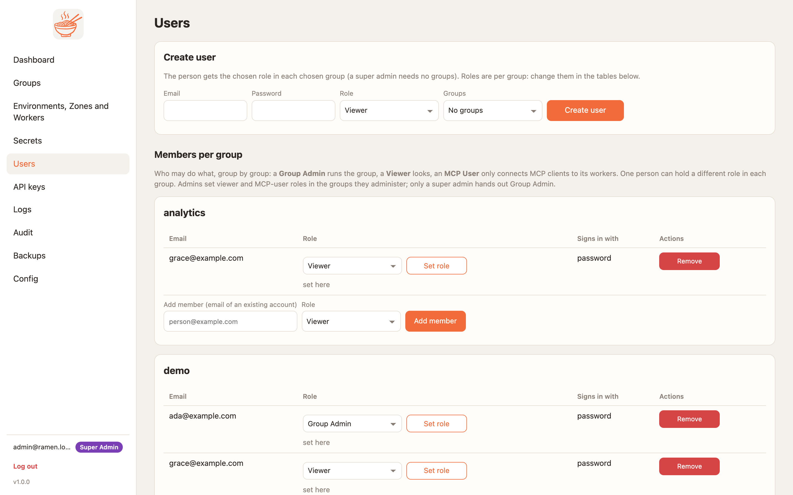
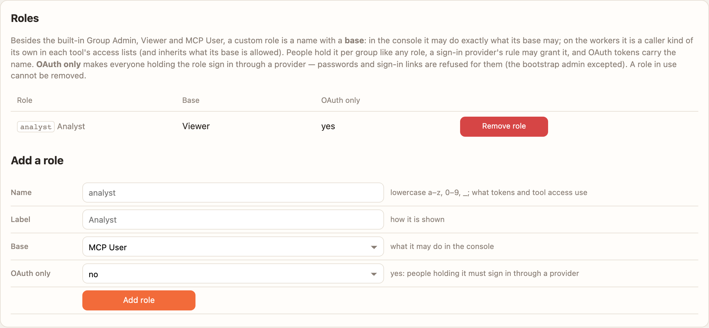

# Roles

A person holds a role **in each group**; super admins are global. One person can be a Group Admin of one group, a
Viewer of another and an MCP User of a third. Machines use keys instead of roles. This page is the summary; the full
rules, custom roles, identity-provider mapping and service-account approvals are on
[Users and access](wiki/users-access.md).

## Who is who

| Role | Scope | Typical holder |
|---|---|---|
| **Super admin** | the whole console | platform operators |
| **Group admin** | one group | the team that owns a repo |
| **Viewer** | one group | people who watch deploys and load |
| **MCP user** | one group | people who only connect an MCP client |
| **Custom role**, e.g. `analyst` | one group | a role a super admin defines on a base (Group Admin, Viewer or MCP User); it can do what its base can, can be **OAuth only**, and is a separate kind for per-tool access |
| **Group key** (`rmk_`) | one group's workers | agents, automation, CI calling tools |
| **API key** (`rmn_`, client type `devops`) | the console API, with a role and groups no wider than its creator's | CI deploys, scripts |

The built-in role names in the API are `super_admin`, `group_admin`, `viewer` and `mcp_user`. `analyst` is not built
in: it is the custom role (base Viewer) the docs, the screenshots and the test harness use as an example.

## What each may do

| | Super admin | Group admin | Viewer | MCP user | Group key |
|---|---|---|---|---|---|
| Users, groups, Config page (identity providers, roles, org LLM providers, telemetry, regions, clusters), API keys, backups, audit | yes | — | — | — | — |
| Worker sizes and the sizes a zone allows | yes | — | — | — | — |
| Environments, zones and workers page | everything | environments and zones wholly within their groups | — | — | — |
| Deploy, worker counts and max, sleep, IP rules, throttle, rebalance, tool access, blocked names | yes | yes | — | — | — |
| Secrets, MCP keys (mint, revoke) | yes | yes | key names only | — | — |
| Evals, Scans, Guardrails cards; the group's own LLM providers | yes | yes | — | — | — |
| Members of the group (below admin); request a cloud permission for a zone | yes | yes (cannot approve their own) | — | — | — |
| Group page: environments, deploy jobs and logs, packages, apps and skills, badges | yes | yes | yes | — | — |
| Scan report, app preview, worker logs | yes | yes | yes | — | — |
| LLM configs page and **Accept** | yes | yes | yes | yes | accepted by the admin who minted it |
| Sign in an MCP client (OAuth) for the group's zones | yes | yes | yes | yes | — |
| Call the group's tools, prompts, resources | per tool access | per tool access | per tool access | per tool access | per tool access (kind `key`) |
| Send client telemetry to `/otlp` | yes | yes | yes | yes | yes |

Notes:

- A member of another group is refused (`403`) on all of this; a person with no membership sees only their own account
  page. An `agent` API key (`rmk_`) is a worker credential and is refused by every console route; a `devops` key
  follows the role and groups it was minted with on the API.
- **Tool access** is per environment: for each tool, which kinds (roles, custom roles, keys) may list it and which may
  call it. A custom role matches an entry naming it or its base, so it never has less than its base. The node enforces
  it on both transports; workers learn changes on the next deploy.
- **Acceptance.** When the group repo carries `mcp/llm-config/`, every person accepts the current version (configs
  page or the OAuth consent page) before a token or key is handed out; a group key counts as accepted by the admin who
  minted it, so that admin must have accepted first ([LLM configs](wiki/llm-configs.md)).
- The access matrix above is asserted per role and route by `tests/conformance/test_security_matrix.py` locally and
  `tests/cloud/test_auth_matrix.py` on each cloud, from one table (`tests/src/ramen_tests/access_matrix.py`).

<figure markdown>
{ .ramen-shot }
<figcaption>Users: one member table per group with a role dropdown, then every account.</figcaption>
</figure>

<figure markdown>
{ .ramen-shot }
<figcaption>Config → Roles: a custom <code>analyst</code> role on the Viewer base, OAuth only.</figcaption>
</figure>

## Where a role comes from

An admin sets it on the Users page or through the API, or an identity provider's rule decides it at sign-in
(Entra ID or Google Workspace groups mapped to roles per group). Both are kept; where both name a group, the admin's
entry wins. Every role, group or password change ends the person's open sessions and refresh tokens at once.
[Entra ID and Google Workspace](wiki/sso.md).
