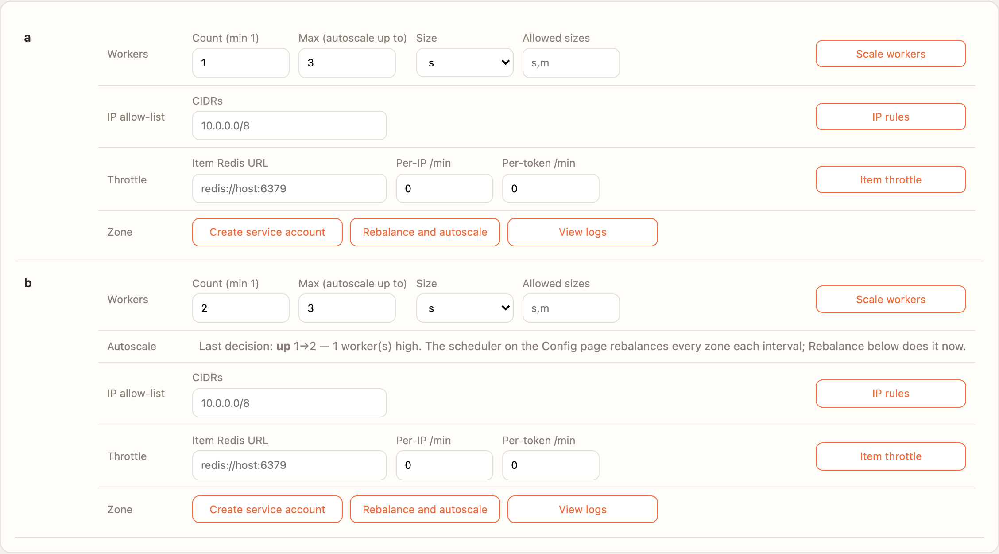
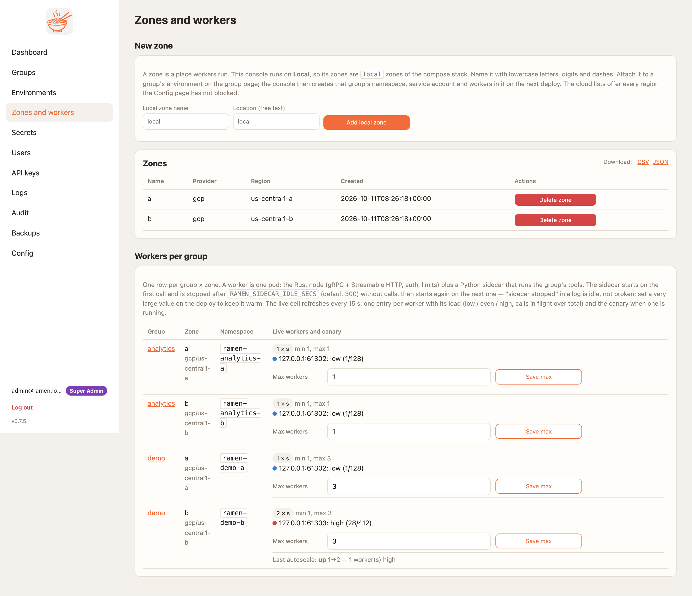

# Autoscaling: Ramen scales the workers, not the cloud

Since 0.7.5 the console decides how many workers a group runs in each zone, the same way on GKE, EKS and AKS. There is
no HorizontalPodAutoscaler: the adapters delete the `worker` HPA an older release made, and the worker chart's `hpa`
is off. The cloud's own cluster autoscaler still adds and removes *nodes* for the pods Ramen asks for
([CONTRACTS §21.7](../CONTRACTS.md)).

## The bounds

Each group × zone runs between **1** (always) and a **max**. Only a super admin or a group admin of that group sees
and sets the max; viewers and MCP users see the count only, and an API attempt is `403`.

- **Group page → Zone actions**: *Count (min 1)*, *Max (autoscale up to)*, then **Scale workers**. A count outside
  1..max is refused (`422`). Lowering the max under load brings the count down to it at once.
- **Zones and workers**: one row per group × zone with *Max workers* and **Save max**, and the last decision.
- API: `PUT /api/v1/groups/{g}/zones/{z}/workers {"max_count": 3}`.

A zone created before 0.7.5 starts with max = its current count, so nothing scales until an admin raises it.

<figure markdown>
{ .ramen-shot }
<figcaption>Zone actions on the group page: zone <code>b</code> went from 1 to 2 because a worker was high.</figcaption>
</figure>

<figure markdown>
{ .ramen-shot }
<figcaption>Zones and workers: live workers with their load, the max per group × zone, and the last decision.</figcaption>
</figure>

## Who runs it

A **rebalance** makes the decision. Two things trigger one:

- **Rebalance and autoscale** in a zone's actions (group admins and up), or `POST …/zones/{z}/rebalance`.
- The **Auto-rebalance scheduler** on the Config page (super admin; off by default, every 60 s when on). It visits
  every group × zone each interval, not only the skewed ones, so zones scale up and back down on their own. Turn it
  on, or nothing scales without a button press.

The load-balancer leg of rebalance (GCP capacity scaler, AWS target-group weights) runs as before.

## How it decides

Each worker's node reports its in-flight calls, the in-flight limit it runs with (`RAMEN_MAX_INFLIGHT`, default 32)
and its total call count. The console keeps the previous total per pod to work out calls per second.

| | When | Step |
|---|---|---|
| **Up** | any ready worker is *high* (over 80 % of its limit), or the zone's mean in-flight is 50 % or more, or calls per second per worker reach `RAMEN_AUTOSCALE_TARGET_RPS` (default 50) — and count < max | proportional: `ceil(ready × max(mean / 50 %, rate per worker / target))`, at least +1, at most the max |
| **Down** | every ready worker is *low* (under 30 %) for 3 rebalances in a row, one worker fewer would stay under the up thresholds, and count > 1 | always −1 |
| **Hold** | anything else, or a cooldown | — |

- **Cooldowns**: no step up within 30 s of the last change (`RAMEN_AUTOSCALE_UP_COOLDOWN_SECS`), no step down within
  120 s (`RAMEN_AUTOSCALE_COOLDOWN_SECS`). Up fast, down carefully.
- A worker that does not answer counts as *down*, never as low, so an outage never scales a zone in.
- **The canary counts as capacity.** A zone at count 1 runs two pods (stable and canary), so the step is slightly
  conservative.
- Worker readiness and liveness probes use a 5 s timeout and liveness allows 6 misses: with the 1 s default, GKE
  restarted CPU-saturated workers in the middle of a load test.
- Bursts shorter than two scheduler intervals do not register a rate; the in-flight signal still catches them.

## Staying up while nodes come and go

Ramen owns the worker count, so the cluster autoscaler may not evict a worker or the console to empty a node
(`cluster-autoscaler.kubernetes.io/safe-to-evict: "false"` on both). Ramen's own scale-down still frees nodes. The
console's rollout never drops below one ready pod (`maxUnavailable: 0`, `minReadySeconds: 90`) and an old console pod
drains for 40 s before it stops, because the GKE Gateway takes that long to detach it.

## Audit and logs

Every action is on the Audit page with the actor — a person, an API key or `scheduler` — the group and the zone:

| Action | Tags |
|---|---|
| `workers.autoscale` | `action:up|down`, `from:`, `to:`, `reason:` |
| `workers.max_count` | `from:`, `to:` |
| `workers.count` | a manual count |
| `workers.rebalance` | who pressed it |
| any of the above, refused | `error:forbidden` or `error:invalid` |

A *hold* is not audited (it would flood the log) but is kept as the last decision and shown on the group page. Each
scale change also logs a `ramen.autoscale` line on the console; a zone pinned at its max under load logs a warning,
which the [warning email digest](configuration.md#email) carries.

## Load tests

`scripts/load_test.py` drives 64 concurrent `tools/call` through the edge against one zone with max 3 and the
scheduler every 20 s, in five scenarios: a viewer refused, max 1 never scales, sustained load up to the max and back
to 1, a 45 s burst, and the max lowered under load. It also polls the console's `/readyz` and fails on anything but
200. Results from the last round (2026-10-11):

| Cloud | Up to 3 | Back to 1 | Calls ok | `429` (back-pressure) | 5xx |
|---|---|---|---|---|---|
| GKE | 178 s | 748 s | 25 909 | 117 | 0 |
| EKS | 184 s | 613 s | 14 975 | 1 193 | 0 |
| AKS | 137 s | 601 s | 21 567 | 0 | 0 |

Every scenario passed on all three clouds. The `429`s are the node refusing calls beyond its in-flight limit until the
next worker is ready, which is the intended back-pressure. An earlier round with one-at-a-time steps and a single
120 s cooldown took 309 s to reach 3 on GKE with 57 % of calls refused; the proportional step and the 30 s up cooldown
brought that to 2 %. Times are from the start of the run. The kind-cluster proofs for this design are written but were
not run for 0.7.5.
