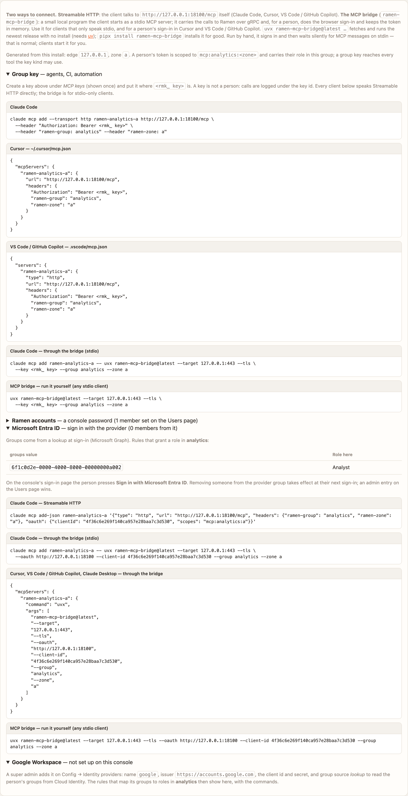
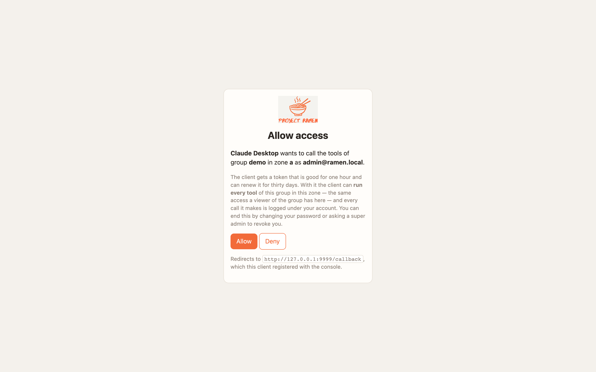

# Connect a client with OAuth

No shared key. The client sends you to the console, you sign in the way you always do, you approve the client
once for a group and a zone, and every call runs under your name. The console is the OAuth 2.1 authorization
server: PKCE, pre-registered public clients, no client secret, no dynamic registration.

## What an admin does once

1. **Config → OAuth clients → Register client**: a name and the redirect URI. Any loopback name and port is
   accepted, so `http://localhost/callback` covers Claude Code and the bridge (which is how Claude Desktop, Cursor and
   VS Code sign a person in). The client
   id appears in the table.
2. Give the person a role in the group on the Users page. **MCP User** is enough.

<figure markdown>
{ .ramen-shot }
<figcaption>The Config page, where OAuth clients are registered.</figcaption>
</figure>

## What the person does

The sign-in step is the same whatever the account: a Ramen password ([connect with a
password](connect-password.md)), Microsoft Entra ID or Google ([Entra ID and Workspace](sso.md)). The console's
login page shows a button per provider, and a role marked OAuth-only sends the person to the provider. Clients
differ only in how they reach Ramen:

- **Streamable HTTP**: the client talks to `https://<edge>/mcp` itself. Claude Code can, because it takes a
  pre-registered client id in its config.
- **The bridge** (`ramen-mcp-bridge`): a small stdio program the client starts; it does the browser sign-in, keeps
  the token and forwards each message over gRPC. Cursor, VS Code / GitHub Copilot and Claude Desktop find the OAuth
  flow on their own but expect dynamic client registration, which the console does not offer, so for a person's
  sign-in they go through the bridge. `uvx ramen-mcp-bridge@latest` runs the newest release without an install
  (needs [uv](https://docs.astral.sh/uv/)); `@latest` stops a cached uvx from running an old bridge.

Admins need not type these: the group page's **How MCP users sign in** card generates every command below for the
install's edge host, the group's zones and a registered client id, one section per identity provider.

<figure markdown>
{ .ramen-shot }
<figcaption>The generated card for a one-zone group: group key, Ramen accounts, and a section per identity provider.</figcaption>
</figure>

=== "Claude Code (HTTP)"
    ```sh
    claude mcp add-json ramen-demo-a '{"type":"http","url":"https://<edge>/mcp",
      "headers":{"ramen-group":"demo","ramen-zone":"a"},
      "oauth":{"clientId":"<client id>","scopes":"mcp:demo:a"}}'
    ```
    Then `/mcp` in Claude Code, pick *ramen-demo-a*, sign in. The browser opens the console's login page (or the
    provider's), then the consent page.

=== "Claude Code (bridge)"
    ```sh
    claude mcp add ramen-demo-a -- uvx ramen-mcp-bridge@latest --target <edge>:443 --tls \
      --oauth https://<edge> --client-id <client id> --group demo --zone a
    ```

=== "Cursor, Claude Desktop"
    `~/.cursor/mcp.json`, or `claude_desktop_config.json`:
    ```json
    {"mcpServers": {"ramen-demo-a": {"command": "uvx",
      "args": ["ramen-mcp-bridge@latest", "--target", "<edge>:443", "--tls", "--oauth", "https://<edge>",
               "--client-id", "<client id>", "--group", "demo", "--zone", "a"]}}}
    ```

=== "VS Code / GitHub Copilot"
    `.vscode/mcp.json`:
    ```json
    {"servers": {"ramen-demo-a": {"type": "stdio", "command": "uvx",
      "args": ["ramen-mcp-bridge@latest", "--target", "<edge>:443", "--tls", "--oauth", "https://<edge>",
               "--client-id", "<client id>", "--group", "demo", "--zone", "a"]}}}
    ```

=== "Any stdio client"
    ```sh
    uvx ramen-mcp-bridge@latest --target <edge>:443 --tls --oauth https://<edge> \
      --client-id <client id> --group demo --zone a
    ```
    Run by hand it signs in, then waits silently for MCP messages on stdin; that is normal.

**Where the bridge keeps the token (bridge 0.3.0).**

- In memory by default: nothing is written to disk, and the person signs in again when the client restarts.
- `--keychain` keeps it in the operating system's secret store (macOS Keychain, or a Secret Service such as GNOME
  Keyring through `secret-tool`); `--token-file <path>` keeps it in a 0600 file, for automation only.
- Tokens are forgotten 30 minutes after the last call (`--idle-timeout`, seconds, `0` disables).
- A sign-in needed while the client runs does not block: the MCP call answers error `-32001` with the link in
  `data.sign_in_url`, so the AI client can show it; the person opens it, approves, and the next call works.
  `--no-browser` prints the link instead of opening a browser.
- Behind a self-signed certificate add `--ca <pem>`; it verifies the console during sign-in as well as the worker.

Bridge 0.2.x kept the refresh token in `~/.config/ramen-mcp-bridge/`; 0.3.0 does so only when asked.

**With a group key instead** (agents, CI): no sign-in, the key in `Authorization: Bearer`. Over HTTP in every
client (`claude mcp add --transport http … --header "Authorization: Bearer <rmk_ key>"`, or a `url` + `headers`
entry for Cursor and VS Code), or through the bridge with `--key`. [Transport](transport.md#connecting) has each form.

<figure markdown>
{ .ramen-shot }
<figcaption>What a person sees once: the client, the group and the zone it asks for.</figcaption>
</figure>

## What the token is

An access token lives one hour and names the person, the group and the zone (`mcp:demo:a`). The worker verifies
it on its own, without calling the console. The refresh token lives thirty days, rotates on every use and dies
when the person's role, password or account changes. The token runs every tool of the group in that zone, the
same reach as a group key, with the person's name on every log line.

Since 0.7.2 the token also names the person's `role` in the group, which the worker uses for per-tool access
([Groups, zones and regions](groups-zones.md#tool-access-072)); since 0.7.5 that may be a
[custom role](users-access.md#custom-roles). The worker's access log shows `user:<id>` instead of a key id. The
Audit page has the client registration and every consent decision, and since 0.7.0 every token mint (`oauth.token`), refresh (`oauth.refresh`), a rotated-out
refresh token presented again (`oauth.refresh_reuse`, which revokes the family) and every refusal (`oauth.denied`
with its reason). The lifetimes are the console's `RAMEN_OAUTH_ACCESS_TTL` (seconds, default 3600) and
`RAMEN_OAUTH_REFRESH_TTL` (default 30 days), shown on the Config page.

### When the token expires mid-task

The worker refuses an expired token *before* the call reaches any tool code, with the same `401` and
`WWW-Authenticate: Bearer resource_metadata=...` challenge a request with no token gets, so an OAuth client (Claude
Code) refreshes and retries on its own, and the bridge does the same once for that one call. No browser appears
unless the refresh token itself is gone. The MCP session survives: session ids are bound to the person
(`user:<sub>`), not to one token, so the same `Mcp-Session-Id` keeps working with the refreshed token. A call that
started before expiry finishes (auth is checked on entry), and nothing runs twice: the only retry happens when the
`401` came back before dispatch. Refresh tokens are stored hashed and belong to one person and one group.
Verified with a 3-second token
in `tests/conformance` for 0.7.0 (see the [changelog](../changelog.md)).

## What can go wrong

| Symptom | Cause |
|---|---|
| The client never opens a browser | The worker's metadata URL is relative because neither the Config page's base URI nor `RAMEN_PUBLIC_URL` was set when it was deployed. The deploy log says "OAuth tokens are off for this worker". Set one and redeploy. |
| Tokens refused after the base URI changed | Workers take the new issuer on their next deploy. Deploy each environment |
| Behind a path prefix, the client finds no authorization server | The proxy is missing the root route `/.well-known/oauth-authorization-server/<prefix>` ([Configuration](configuration.md#behind-a-reverse-proxy-or-a-path-prefix)). The bridge takes the prefixed console address, `--oauth https://<host>/<prefix>` |
| `404` on the metadata request | The client did not send the `ramen-group` and `ramen-zone` headers, so the load balancer had no zone to route to |
| The consent page says you have no access | Your account has no role in that group |
| `401` after a while | The refresh token ended because your role or password changed. Sign in again |
