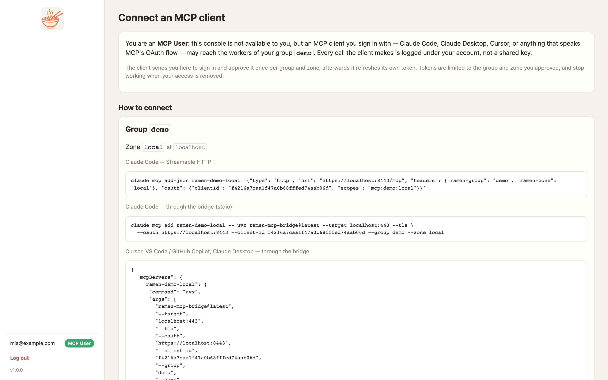

# Connect a client with a password account

A password account connects through exactly the same OAuth flow as any other sign-in, because the client never
sees the password. The authorize request lands on the console's login page, the person types their email and
password, and the login page returns them to the consent page. There is nothing to configure for it.

This page covers only the account. The client commands are in [Connect a client with OAuth](connect-oauth.md).

## The account

1. A super admin creates it on the Users page with an email and a password, or a group admin adds an existing
   account to their group. The role **MCP User** in the group is enough to connect a client.
2. The person signs in once at `https://<edge>/` to check their access. An MCP user sees a single page there: the
   groups they may connect to, and the exact client command for one of them. When a group's repo carries
   [LLM configs](llm-configs.md) (`mcp/llm-config/`), the sign-in lands first on `/groups/<g>/configs` — the files
   verbatim and an **Accept** button — and nothing of that group is served until they are accepted; a magic-link
   sign-in does the same. Each new version of the files asks again. A group whose repo carries
   [guardrails](guardrails.md) hands every sign-in path, this one included, the same `guardrails` policy: the
   bridge runs the rails locally and the workers refuse a call without the current version (`-32029`) when the
   group requires it.
3. There is no password form on that page. To change the initial password they use *Forgot password?* on the
   sign-in page (shown when the console can send mail), or an admin resets it on the Users page.

<figure markdown>
{ .ramen-shot }
<figcaption>What an MCP user sees after signing in: their groups' deployed zones and the commands to point a client at one, filled in for this install.</figcaption>
</figure>

## Then connect

Follow [What the person does](connect-oauth.md#what-the-person-does) with the client id an admin gives them. The
only visible difference is that the browser step shows the console's own login page rather than an identity
provider's. A group admin copies the commands, filled in for the install, from the group page's **How MCP users
sign in** card (section *Ramen accounts*).

A password account cannot connect this way if it holds a custom role marked **OAuth only** in any group: the login
step answers `403 This account signs in with <provider>` and the person must use the provider button
([Entra ID and Workspace](sso.md#5-roles-that-require-the-provider)). If password login is switched off on the
Config page, only identity-provider accounts can sign in.

Every call the client makes is logged as `user:<id>`, never as a key id. Removing the person from the group, or
disabling the account, ends their refresh tokens at once; an access token already issued lives out its hour.
