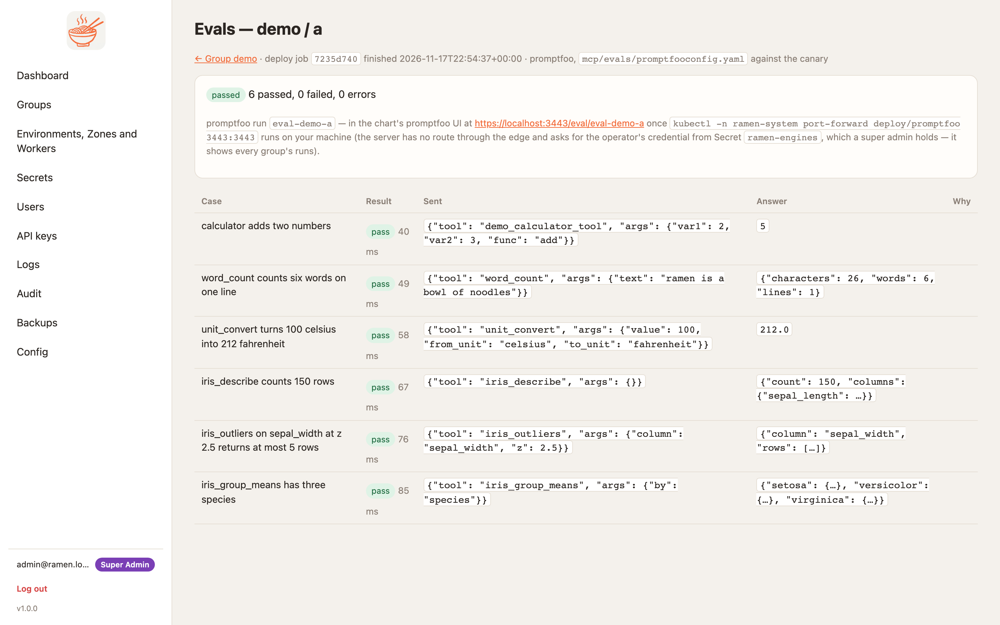

# Evals, LLM providers and client policy (1.0.0c)

Since 1.0.0c a group repo can carry a [promptfoo](https://www.promptfoo.dev/) eval suite that Ramen runs against
the canary on every deploy, next to the [golden cases](mcp-repo.md#golden-cases). The result is **reported first**
(counts on the deploy job, a badge on the group page) and becomes a **gate** only when a group admin turns it on.
Super admins keep the LLM API keys the evals may need on the Config page; the keys reach the eval run and nothing
else. The same release lets a group *require* that clients hold the current evals config: the worker refuses a call
that does not name its version, and the Ramen bridge keeps the config, and the telemetry settings, as a **policy
bundle** it checks on every start, and can write it into the editor's own configuration files.

Contract: [§29](../CONTRACTS.md). Everything here is off until a file exists in the repo or a switch is set. Phase 2
adds a second check on the same deploy, a [SkillSpector scan](skillspector.md) of the repo's skills and the served
tools, with more LLM providers on the same Config page.

## What runs, and when

A deploy of an environment, per zone, after the golden cases of that zone have passed:

1. The console reads `mcp/evals/promptfooconfig.yaml` from the synced repo. **No file → nothing runs**; the job
   result says `evals: absent`.
2. With the file and an evals engine (the chart's `evals.engine: promptfoo`, which sets `RAMEN_EVALS_IMAGE`), the
   console starts a Job `ramen-evals-<group>-<zone>-<rand>` in `ramen-system` — the pattern of the
   [image builder](worker-images.md) — that runs
   `promptfoo eval -c <config> -o /out/results.json --no-cache --no-progress-bar --no-table`
   with the config mounted from a ConfigMap. The results are read back from the pod log.
3. The console parses `stats.successes`, `stats.failures`, `stats.errors` and the failed tests' `description` and
   `failureReason` (at most 20 lines go into the job log) and records
   `job.result[<zone>].evals = {passed, failed, errors, url, run?}`. `url` is the console's page of the run (below),
   `run` promptfoo's id of it. Without an engine: `evals: {skipped: "no evals engine"}`, said once per deploy in the
   log.

### The run page

The group page's **evals** badge opens `/groups/<group>/evals/<job>/<zone>`, readable by every member of the group
(like the [scan report](skillspector.md)): the counts, then one row per case — pass, fail or error, what it sent (the
tool call), what came back, why it failed, how long it took (at most 200 cases, each text cut at 500 characters, every
value scrubbed like the job log). When the chart runs the promptfoo server, the page also names the run's id and its
address in promptfoo's own UI (below).

<figure markdown>
{ .ramen-shot }
<figcaption>The run page of one zone's deploy: the demo's six cases, what each sent and what came back (seeded console,
canned run; the live GKE run of the same suite is in <a href="#the-promptfoo-ui-trying-it-out">promptfoo's UI</a>).</figcaption>
</figure>

Exit codes follow promptfoo: 0 passed, 100 one or more failures, 1 an error (a config that does not parse, the
canary unreachable). The run is given `RAMEN_EVALS_TIMEOUT_SECS` (default 600) before it counts as an error.

### Gate or report

| Group setting (`evals`) | Failures or an error mean |
|---|---|
| `gate: false` (default) | A warning line in the job log and a red **evals: *n* failed** badge on the group page's last deploy. The deploy goes on. |
| `gate: true` | The deploy fails exactly like a failed golden case: the canary is scaled down, the stable workers are untouched, the job says which tests failed. |

Group admins set it under the group page's **Evals** card; the API is `PUT /api/v1/groups/{g}/evals {"gate": bool,
"required": bool}`. `required` is the client policy switch, below.

## The repo file

`mcp/evals/promptfooconfig.yaml` is a plain promptfoo config; nothing in it is Ramen-specific except the environment
it may read. The demo group's file calls the deployed tools through promptfoo's `mcp` provider and needs no LLM key:

```yaml title="mcp/evals/promptfooconfig.yaml"
providers:
  - id: mcp
    config:
      enabled: true
      server:
        url: "{{env.RAMEN_MCP_URL}}"
        headers:
          Authorization: "Bearer {{env.RAMEN_MCP_KEY}}"
          ramen-group: "{{env.RAMEN_GROUP}}"
          ramen-zone: "{{env.RAMEN_ZONE}}"
prompts:
  - "{{prompt}}"
tests:
  - description: calculator adds two numbers
    vars:
      prompt: '{"tool": "demo_calculator_tool", "args": {"var1": 2, "var2": 3, "func": "add"}}'
    assert:
      - type: contains
        value: "5"
```

The `mcp` provider takes the prompt as a JSON string naming the tool and its arguments. An LLM provider
(`anthropic:messages:…`, `openai:…`, `azure:…`) with `config.mcp` tools, or a graded assertion (`llm-rubric`,
`model-graded-closedqa`), works the same way once a key is set on the Config page. The console passes the file
through (≤ 64 KiB) with one change: `{{env.RAMEN_*}}` references are filled in before the run, because promptfoo
renders env references in prompts and vars but not inside a provider's `server.url` or headers. Provider keys stay
env vars promptfoo reads itself. A file promptfoo cannot read is an error of the run, not of the console; when the
run writes no results, the error carries promptfoo's last log lines.

### The environment Ramen injects

| Variable | Value |
|---|---|
| `RAMEN_MCP_URL` | the canary's in-cluster Streamable HTTP endpoint: `https://<group>.<zone>.worker.ramen.internal:8080/mcp` on a TLS install (D86, D92: the zone's own name, mapped to the canary pod's IP and the Job trusts the install CA), `http://<pod>:8080/mcp` without `RAMEN_REQUIRE_TLS` |
| `RAMEN_MCP_KEY` | the deploy's own evals key (`rek_…`, rotated every deploy): no client-policy gate; under [tool access](users-access.md) it is the caller kind **`evals`** ("Evals Job") — a tool whose rule leaves `evals` out is hidden from the run, and its cases error with `Tool <name> not found in any connected MCP server` |
| `RAMEN_GROUP`, `RAMEN_ENV`, `RAMEN_ZONE` | what is being deployed |
| `ANTHROPIC_API_KEY` | from Config → LLM providers, when set |
| `OPENAI_API_KEY`, `OPENAI_BASE_URL` | likewise (the base URL is optional) |
| `AZURE_API_KEY`, `AZURE_API_HOST` | likewise |
| `PROMPTFOO_REMOTE_API_BASE_URL`, `PROMPTFOO_REMOTE_APP_BASE_URL` | the chart's promptfoo server (`https://promptfoo.ramen-system:3000`, verified against the install CA), when it runs, so `--share` lands the run in its UI; and the UI's address for a person (`evals.uiUrl`) |

The run sees nothing else of the console: no store, no other group's secrets, no worker admin key. The key and the
provider keys are never written to a log, a job result or a client.

### Who the Job is, and what the file may run (1.0.0c hardening)

The Job runs as ServiceAccount `ramen-evals` (chart `evals.serviceAccount`), bound to no Role, with no API-server
token and a cloud identity that holds logging only (`evals.gsa` / `evals.roleArn` / `evals.clientId`, the terraform
outputs `evals_gsa` / `evals_role_arn` / `evals_client_id`) — never the image builder's. Before any zone deploys, the
console validates the file's `providers`: each must be `mcp`, an `http(s):` / `websocket:` endpoint, or a provider
family whose key is set on the Config page (`anthropic:…`, `openai:…` — with an `apiBaseUrl` only the configured
OpenAI or compatible base URL — `azure:…`, `vertex:…`, `bedrock:…`). `exec:`, `python:`, `javascript:` / `js:` / `file://`,
`golang:`, `webhook:`, `sequence:`, `promptfoo:` providers and any `extensions` or `transform` script fail the deploy
at the sync step, naming the entry. Assertions of type `javascript` / `python` are allowed: they run inside the Job,
whose identity can do nothing — but since D85 inline assertion code that reads the environment (`process.env`,
`os.environ`, `getenv`) is refused the same way, because the Job holds the provider keys. The Job pod reaches the canary, the promptfoo server and the internet; the `ramen-system`
[NetworkPolicies](configuration.md#network-policies-and-redis-100c) keep everything else out of its reach.

## LLM providers (Config page, super admins)

**Config → LLM providers** is one card with a row per provider. The evals' three by key: Anthropic (`api_key`),
OpenAI (`api_key`, an optional `base_url` for a compatible endpoint) and Azure OpenAI (`api_key`, `host`); Vertex AI,
Bedrock, Azure AI Foundry and an OpenAI-compatible server are on the same card
([SkillSpector](skillspector.md#llm-providers-part-2)), each with its allowed models. Keys are console secrets like the SMTP
password ([the vault](configuration.md#the-variables-that-matter)): the page and `GET /api/v1/config/llm-providers`
show *set* or *not set*, never a value. `PUT` merges one or more providers; an empty string clears a key. Every save
is audited as `config.llm_providers` with `provider:<name>` tags only.

## The promptfoo UI (trying it out)

`evals.engine: promptfoo` in the Helm chart also runs a single-replica promptfoo server (`ghcr.io/promptfoo/promptfoo`,
pinned; port 3000 behind a TLS front that asks for a credential; a PVC for its database, so runs survive restarts;
no edge route, like the chart's Jaeger or Phoenix — for try-out and test clusters). Every run is shared into it. Open
it from your machine:

```bash
kubectl -n ramen-system port-forward deploy/promptfoo 3443:3443
# then https://localhost:3443/eval/<run>  — <run> is the id the console's run page names
# the browser asks for a sign-in: user admin, and the password (a super admin with cluster access reads it):
kubectl -n ramen-system get secret ramen-engines -o jsonpath='{.data.password}' | base64 -d; echo
```

The front (since 1.0.0, D92) wants that credential on every connection — Basic `admin:<password>` or
`Authorization: Bearer <password>`; no path is open without it. The evals Jobs hold a second, **upload-only**
credential (`upload-password`, given to the Job by a Secret reference, never in its config): it may send promptfoo's
share upload — one request per connection — and nothing else, so a group's evals config cannot read another group's
runs with it. The Jobs also verify the server's certificate (`PROMPTFOO_INSECURE_SSL=false`; promptfoo's default
skips it). Local compose: `make up ENGINES=promptfoo`, user `admin`, `RAMEN_ENGINES_PASSWORD` from
`deploy/local/.env`.

The forward goes to the pod's TLS front, so promptfoo is HTTPS end to end like Phoenix: the certificate is signed by
the install CA — trust it once (`kubectl -n ramen-system get configmap ramen-ca -o jsonpath='{.data.ca\.crt}' >
ramen-ca.crt`, then add it to your keychain) or accept the browser's warning ([how to trust it](trust-ca.md)). promptfoo itself listens on
`127.0.0.1:3000` only (a preload the chart mounts pins its server to loopback), so its plaintext port is not
reachable from outside the pod, NetworkPolicy or not. The address the console prints is the chart's `evals.uiUrl`
(`RAMEN_EVALS_UI_URL`, default `https://localhost:3443`); set it if you put your own authenticated route in front.

Why the console does not proxy it: promptfoo's single-page app loads `/assets/…`, calls `/api/…` and routes from `/`,
with no base path to set, so it cannot live under a console path; it has no sign-in of its own (the TLS front is
Ramen's) and lists every group's runs. A run that "is not found" in it — promptfoo shows `404 Eval not found` whenever its `/api/eval/<id>/table`
request fails, not only for an unknown id — is a forward that dropped or a server other than the chart's.
`evals.image` alone (no server) runs the Jobs with `--no-write`: the run page and the job log, no promptfoo UI.

## Client policy: versions, the gate, the bridge

When the repo carries the file, the `/oauth/token` answer gains, next to `telemetry`
([what clients are told](telemetry.md#what-clients-are-told)):

```json
"evals": {"version": "3f9a1c2b7d10", "required": false, "config": "<the file's text>"}
```

`version` is the first 12 hex digits of a SHA-256 over the file and the group's `required` flag, so it moves when
either changes. Workers learn `RAMEN_EVALS_VERSION` and `RAMEN_EVALS_REQUIRED` on deploy and by the same config
push that carries a telemetry change. `GET /.well-known/ramen-policy?group=<g>&zone=<z>` is public and answers
`{"telemetry": {"version", "required"}, "evals": {"version", "required"}}` — versions and flags, never the config or
a key — so a client can check it holds the current policy before it signs in. Since 1.0.0c Phase 2.5 the same answer
and the same public document carry `guardrails` when the repo has `mcp/guardrails.yaml` — the rails as a policy, gated
with `-32029` and run locally by the bridge ([Guardrails](guardrails.md)).

**The worker gate** applies when the group sets `required: true`. A 2026-07-28 call to `tools/call`, `prompts/get`
or `resources/read` must carry `params._meta["io.ramen/evals"] = {"version": "<v>"}` (a 2025-06-18 body through
the bridge: `params.evals`). Missing → `-32026 evals config required` (HTTP 428, `data.version` names the current
one); another version → `-32026 evals config changed: sign in again`. It runs after the
[telemetry gate](telemetry.md#telemetry-through-ramen-100a) and before anything is dispatched; lists and
`server/discover` stay open; a worker that was never told a version accepts any. Access-log reasons `evals_required`
and `evals_stale`.

**The bridge (1.0.0, the bridge for Ramen 1.0.0)** turns the token answer's `telemetry` and `evals` into a **policy bundle** at
`~/.ramen/policy/<host>/<group>-<zone>.json` (mode 0600; telemetry header values stay in memory only) and keeps the
evals config at `~/.ramen/evals/<host>/<group>/promptfooconfig.yaml`, so the person can run the same suite locally.
Every forwarded call carries the evals version; on `-32026` it signs in again once, as it does on `-32025`. Started
without a bundle and unable to sign in, it exits non-zero with `Ramen policy missing: reconnect (sign in) — Ramen
cannot be used without it`.

**Client config files** (on by default, `--no-client-config` turns it off): at sign-in the bridge merges, idempotently
and marked `ramen`, into the editor's own configuration —

| Client | What is written |
|---|---|
| Claude Code | `~/.claude/settings.json` → a `hooks.SessionStart` entry running `ramen-mcp-bridge policy check --target <host> --group <g> --zone <z>`; a non-zero exit (stale or missing policy) shows the reconnect message |
| Cursor | `~/.cursor/rules/ramen-<g>-<z>.mdc` stating the policy: telemetry and evals required or not, the versions, how to sign in again |
| VS Code | the user `settings.json` → `mcp.servers.ramen-<g>-<z>` for the bridge |

A ledger `~/.ramen/clients.json` records every write. `ramen-mcp-bridge policy show` prints the bundle, `policy
check` compares it with `/.well-known/ramen-policy` (exit 0 current, non-zero stale or missing), `policy remove`
reverts every write the ledger lists. Existing settings are merged into, never clobbered.

### The honest limit

Ramen enforces the policy where Ramen is: the worker refuses a call without the current version, and the bridge
holds and checks the bundle for the host it serves. An LLM client that never goes through the bridge or never calls
a Ramen worker is out of reach; the editor files make the policy visible to it, they cannot force it. What runs
through Ramen is covered; the rest is a convention the files state.

## What is verified

- `tests/conformance/test_console_evals.py` — a real console with a fake evals runner and a group repo the test owns:
  absent / passed (the badge's URL is the run page, which a member opens) / failed with the gate off (warning, badge)
  and on (deploy error) / engine error; the LLM
  providers round trip without a key in any response; `evals` in the token answer and the policy endpoint; the
  `-32026` gate on both transports and eras, lifted by the next deploy.
- `tests/cloud/test_release_features.py` (`RAMEN_EVALS=1`) — on a cluster with `evals.engine: promptfoo`: a deploy of
  the demo repo reports `passed ≥ 1, failed 0, errors 0` (demo/dev's tool access narrows `word_count` to group_admin,
  analyst and `evals`), the
  job log names the run, the `url` is the run page an analyst opens with every case, the policy endpoint matches the
  token answer, the Config page names the providers, the UI and the port-forward.
- `scripts/cloud_smoke.sh` prints `evals: <n> passed, <n> failed` after the deploy when the result carries it.
- The console's and the bridge's own unit tests cover the parsing, the audit tags, the bundle on disk and the client
  files in a temporary home.
