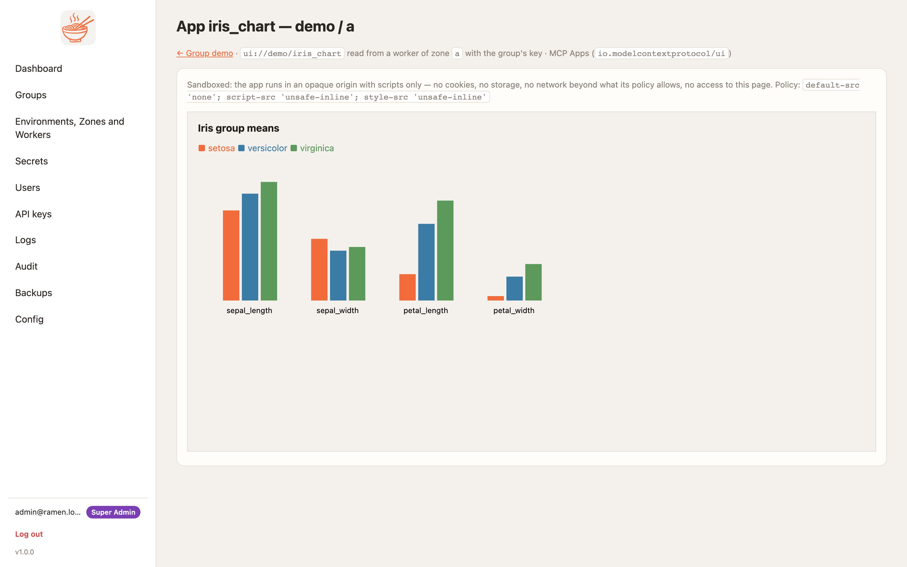
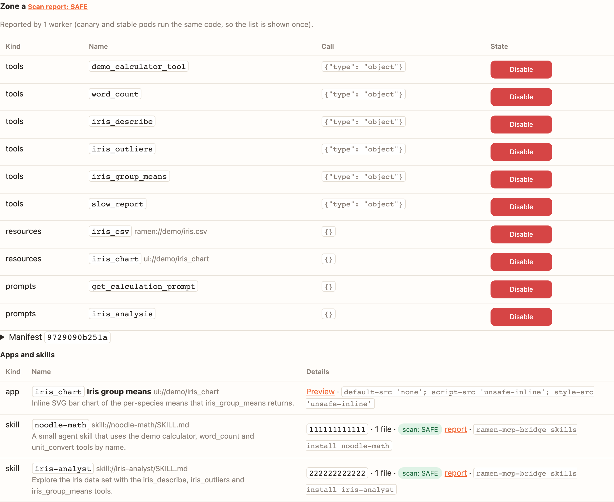

# MCP features, and how a group repo codes them

Everything a Ramen worker serves comes from one git repo per group. You write plain Python and JSON under `mcp/`;
the Rust node speaks the protocol (Streamable HTTP and gRPC, MCP 2026-07-28 and 2025-06-18 on one endpoint) and the
Python runtime runs your code. This page walks every capability, says what a client sees, and shows how the demo repo
[ramen-demo-mcp-group](https://github.com/bkraad47/ramen-demo-mcp-group) codes it. The file-by-file contract is
[The MCP repo](mcp-repo.md); the wire details are on [Transport](transport.md).

```
mcp/
  requirements.txt                      pip requirements (baked into the group's image on a cloud deploy)
  env.yaml                              environment for tool code; {{$group.SECRET}} references
  tools/<name>/<name>.py + <name>.json  tools
  resources/<name>/<name>.py + .json    resources and resource templates
  prompts/<name>/<name>.json            prompts: a SKILL.md + settings.json, or a Python callable
  apps/<name>/index.html + app.yaml     MCP Apps (ui://)
  skills/<name>/SKILL.md                Skills over MCP (skill://)
  tests.yaml                            golden cases, run on the canary of every deploy
  guardrails.yaml + guardrails/         per-tool rails (NeMo or your own policy.py)
  evals/promptfooconfig.yaml            promptfoo evals, run after the golden cases
  skillspector-baseline.yaml            reviewed SkillSpector findings (optional)
  llm-config/manifest.yaml + fragments  client configs every member accepts at sign-in
```

Rules that hold everywhere: the folder name, the JSON `name` and the file stem agree; the JSON `type` matches the
folder (`tool`, `resource`, `prompt`); every file above is optional. A deploy syncs the repo
to the group's bucket prefix, starts a canary, reloads, runs the golden cases, evals and scan, then rolls stable
([Deploy your first group](../first-group.md)).

## Which protocol features, at a glance

| Capability | Wire | Coded in the repo as | Era |
|---|---|---|---|
| Tools with input and output schemas | `tools/list`, `tools/call` | `tools/<name>/` JSON + Python | both |
| Resources, binary resources | `resources/list`, `resources/read` | `resources/<name>/`, a callable returning `str` or `bytes` | both |
| Resource templates | `resources/templates/list` | a `uri` containing `{var}` | both |
| Prompts | `prompts/list`, `prompts/get` | `SKILL.md` + `settings.json`, or `"callable"` | both |
| Completion | `completion/complete` | an `enum` on a prompt argument or template variable | both |
| Content blocks, progress | `content[]`, `notifications/progress` | `text()`, `image()`, `audio()`, `resource()`, `progress()` | both |
| Multi round-trip requests (elicitation, sampling, roots) | `resultType: input_required` + `requestState` | `raise InputRequired(...)` | 2026-07-28 |
| Tasks | `io.modelcontextprotocol/tasks`, `tasks/get\|update\|cancel` | `"task": true` | 2026-07-28 |
| Subscriptions | `subscriptions/listen` (SSE) | nothing: the worker sends `list_changed` after a reload | 2026-07-28 |
| Standard headers | `Mcp-Method`, `Mcp-Name`, `Mcp-Param-*` | `"header": "<Name>"` on a tool parameter | 2026-07-28 |
| Server discovery | `server/discover` | nothing: capabilities and extensions follow what loaded | 2026-07-28 |
| MCP Apps | `io.modelcontextprotocol/ui`, `ui://<group>/<name>` | `apps/<name>/index.html`, `"ui"` on a tool | 2026-07-28 |
| Skills over MCP | `io.modelcontextprotocol/skills`, `skills/list`, `skill://` | `skills/<name>/SKILL.md` | 2026-07-28 |

A 2025-06-18 client is answered as before on the same endpoint; a feature that needs the newer era tells it so with
a tool error rather than failing silently ([what an older client sees](mrtr.md#what-a-2025-06-18-client-sees)).

## Tools

A tool is a function plus a JSON file that describes it. The demo's calculator:

```json title="mcp/tools/demo_calculator_tool/demo_calculator_tool.json (abridged)"
{
  "type": "tool",
  "name": "demo_calculator_tool",
  "description": "Add, subtract, multiply or divide two numbers and return the result as a number. ...",
  "callable": "calculator_func",
  "input": {
    "var1": {"type": "number", "description": "first operand (left-hand side); any finite number"},
    "var2": {"type": "number", "description": "second operand (right-hand side); must be non-zero for divide"},
    "func": {"enum": ["add", "subtract", "multiply", "divide"], "description": "operation to apply as var1 <func> var2"}
  },
  "output": {"type": "number", "description": "var1 <func> var2"},
  "error": {"type": "string"}
}
```
```python title="mcp/tools/demo_calculator_tool/demo_calculator_tool.py"
import calculator_utils as cu          # mcp/tools/demo_calculator_tool/utils/ is on sys.path

def calculator_func(var1: float, var2: float, func: str) -> float:
    ops = {"add": cu.add, "subtract": cu.sub, "multiply": cu.mul, "divide": cu.div}
    if func not in ops:
        raise ValueError(f"unknown func {func!r}; expected one of {sorted(ops)}")
    return ops[func](var1, var2)
```

`input` becomes the MCP `inputSchema`; `output` becomes `outputSchema` and the worker validates every result
against it. An exception is a tool error (`isError: true`) with the message, never a stack trace. Return any JSON
value: an object becomes `structuredContent` as well as text (the demo's `word_count`, the Iris tools).

The Iris tools show a data tool with pandas (`mcp/requirements.txt` pins it; a cloud deployment with the builder bakes
it into the group's worker image, see [Worker images](worker-images.md)):

```json title="mcp/tools/iris_group_means/iris_group_means.json (abridged)"
{"type": "tool", "name": "iris_group_means", "callable": "group_means", "ui": "iris_chart",
 "input": {"by": {"enum": ["species"], "description": "the column to group by; only species is categorical"}},
 "output": {"type": "object", "properties": {"by": {"type": "string"}, "counts": {"type": "object"},
            "groups": {"type": "object"}}, "required": ["by", "counts", "groups"]}}
```

Since 0.7.2 the group page decides per environment which roles or keys may **list** and **call** each tool
([tool access](groups-zones.md#tool-access-072)); the node enforces it, so a hidden tool is simply absent from
`tools/list` and a call is `Unknown tool` (2025-06-18: `tool not found`).

## Resources and templates

```json title="mcp/resources/iris_csv/iris_csv.json"
{"type": "resource", "name": "iris_csv", "uri": "ramen://demo/iris.csv", "mime_type": "text/csv",
 "description": "The public-domain Iris data set ...", "callable": "read_csv", "input": {},
 "output": {"type": "string"}, "error": {"type": "string"}}
```
```python title="mcp/resources/iris_csv/iris_csv.py"
from pathlib import Path

def read_csv() -> str:
    return (Path(__file__).resolve().parent / "iris.csv").read_text(encoding="utf-8")
```

A callable that returns `bytes` is served as a base64 `blob`. A `uri` containing `{var}` is a **template**: listed by
`resources/templates/list`, matched on read, the variables passed as keyword strings and declared in `input`. The demo
repo has no template; the shape, from Ramen's conformance fixtures:

```json title="mcp/resources/bowl_recipe/bowl_recipe.json"
{"type": "resource", "name": "bowl_recipe", "callable": "read", "uri": "ramen://bowl/{flavour}/recipe",
 "mime_type": "text/plain", "input": {"flavour": {"enum": ["shoyu", "shio", "miso", "tonkotsu"]}}}
```

An `enum` on a template variable is what `completion/complete` suggests. Details:
[a resource template](mcp-repo.md#a-resource-template).

## Prompts

A prompt is either an agent-skills style `SKILL.md` with a `settings.json`, or a Python callable. The demo's
`iris_analysis` is the first kind:

```json title="mcp/prompts/iris_analysis/iris_analysis.json"
{"type": "prompt", "name": "iris_analysis",
 "description": "Guide an agent through the Iris data with the three iris_* tools ...",
 "input": {"question": {"type": "string", "description": "what the user wants to know about the Iris data"}},
 "skill": "SKILL.md", "settings": "settings.json"}
```
```json title="mcp/prompts/iris_analysis/settings.json (abridged)"
{"allowed_tools": ["iris_describe", "iris_outliers", "iris_group_means"], "max_tool_calls": 6,
 "boundaries": ["never fabricate numbers: every figure comes from a tool result", "Iris data only; no other data set"]}
```

A callable prompt names `"callable"` instead of `"skill"` and returns a string, a content block or a list of
`{"role", "content"}` messages ([a callable prompt](mcp-repo.md#a-callable-prompt)). A `{{$group.VAR}}` reference
is never resolved in a prompt argument, because the answer goes back to the client.

## Content blocks and progress

```python
from ramen_runtime import text, image, audio, resource, progress
```

A tool may return one block or a list (`text("…")`, `image(png_bytes, "image/png")`, `resource(uri, text=…)`).
`progress(n, total=…, message=…)` is a no-op unless the client sent a `progressToken` and accepts SSE. The demo's
`slow_report` reports progress once a second ([progress](mcp-repo.md#progress)).

## Multi round-trip requests: tools that ask

A 2026-07-28 tool can stop and ask the client for something, then run again from the top with the answer. There is no
session: the worker hands the client a signed `requestState` (HMAC bound to the caller, group, zone, tool and
arguments) and checks it on the retry. The demo's `confirm_delete_note`:

```python title="mcp/tools/confirm_delete_note/confirm_delete_note.py (abridged)"
from ramen_runtime import InputRequired, elicit, input_responses

CONFIRM = {"type": "object", "properties": {"confirm": {"type": "boolean", "title": "Delete it?"}},
           "required": ["confirm"]}

def confirm_delete(note: str) -> str:
    answer = input_responses().get("confirm")
    if answer is None:
        raise InputRequired({"confirm": elicit(f'Delete the note "{note}"? This cannot be undone.', CONFIRM)})
    confirmed = answer.get("action") == "accept" and (answer.get("content") or {}).get("confirm") is True
    ...
```

The other builders are `elicit_url(message, url)`, `sample(messages, max_tokens=…)` and `list_roots()`. A form that
asks for a field named like a credential (`password`, `token`, `api_key`, …) is refused; use `elicit_url`. Guardrail
pre-rails run on every round, post-rails on the final result. A golden case can drive both rounds:

```yaml title="mcp/tests.yaml (abridged)"
  - name: confirm_delete_note deletes when the user confirms
    tool: confirm_delete_note
    args: {note: todo}
    respond: {confirm: {action: accept, content: {confirm: true}}}
    expect: {text_contains: 'Deleted the note "todo"'}
```

Full flow and limits: [Multi round-trip requests](mrtr.md).

## Tasks

`"task": true` on a tool lets a client that declared the tasks extension get a task id at once and poll; any other
client waits for the answer as usual. The demo's `slow_report`:

```json title="mcp/tools/slow_report/slow_report.json (abridged)"
{"type": "tool", "name": "slow_report", "callable": "report", "task": true,
 "input": {"seconds": {"type": "integer", "description": "how long the report takes, in seconds"}}}
```
```python title="mcp/tools/slow_report/slow_report.py (abridged)"
import time
from ramen_runtime import progress

def report(seconds: int) -> str:
    seconds = max(0, min(int(seconds), 30))
    for done in range(seconds):
        progress(done, total=seconds, message=f"section {done + 1} of {seconds}")
        time.sleep(1)
    return f"Report ready after {seconds} s."
```

A task is bound to its caller, lives for `RAMEN_TASK_TTL_SECS` (3600) and is answered by any pod of the zone **when
the zone has a Redis**; without one a worker answers task tools synchronously and does not advertise the extension,
because a poll could reach the other pod. Details: [Tasks](tasks.md).

## Subscriptions and discovery

Nothing to code. A 2026-07-28 client may hold `subscriptions/listen` open (SSE) and gets
`notifications/{tools,prompts,resources}/list_changed` after a deploy changes what the zone serves.
`server/discover` answers the supported versions and capabilities, and lists an extension (`tasks`, `ui`, `skills`)
only while something loaded uses it. Lists carry `ttlMs` and `cacheScope: "private"` because they vary by caller.
See [Transport → server/discover](transport.md#serverdiscover) and [subscriptions](transport.md#subscriptions).

## Standard headers

On the 2026-07-28 HTTP wire every request carries `Mcp-Method` (and `Mcp-Name` for a named call), so a load balancer
can route on them. A tool parameter may also be mirrored into a header:

```json
"region": {"type": "string", "description": "mirrored as Mcp-Param-Region", "header": "Region"}
```

The worker refuses a call whose header disagrees with the body (`-32020`). Adding or renaming a `header` is a
breaking change for the deploy's schema gate. [A parameter mirrored in a header](mcp-repo.md#a-parameter-mirrored-in-a-header).

## MCP Apps

An app is one HTML page a host renders in a sandbox next to a tool's result. The worker serves it as the resource
`ui://<group>/<name>` (`mimeType: text/html;profile=mcp-app`), and a tool that names it with `"ui"` carries
`_meta["ui/resourceUri"]` in `tools/list` and on every result.

```yaml title="mcp/apps/iris_chart/app.yaml"
title: Iris group means
description: Inline SVG bar chart of the per-species means that iris_group_means returns.
```

`mcp/apps/iris_chart/index.html` is self-contained (inline script and styles, no network, so no `csp` allowlist): it
listens for the host's `ui/notifications/tool-result` message and draws the `groups` of the result as bars.
`iris_group_means` points at it with `"ui": "iris_chart"`. Limits: one `index.html` ≤ 512 KiB; `app.yaml` knows only
`title`, `description` and `csp` (`connectDomains`, `resourceDomains`); a tool whose `ui` names no loaded app fails
to load. SkillSpector reads the HTML as part of the group's skill text.

The console's group page lists each zone's apps and opens a **preview**: the page read from a worker of that zone and
shown in `<iframe sandbox="allow-scripts" credentialless>` under the app's own CSP — no cookies, no storage, no
access to the console page.

<figure markdown>
{ .ramen-shot }
<figcaption>The app preview on the group page: the page served as <code>ui://demo/iris_chart</code>, sandboxed. (The seeded screenshot console serves a static stand-in drawn from the Iris species means; the real app draws the same chart from the tool result a host posts it.)</figcaption>
</figure>

## Skills over MCP

A skill is a folder with a `SKILL.md` an agent can install locally. Over MCP it is the
`io.modelcontextprotocol/skills` extension: `skills/list` answers each skill's name, description, version (a hash of
its files) and file list, and `resources/read` of `skill://<name>/<path>` returns a file.

```markdown title="mcp/skills/iris-analyst/SKILL.md (abridged)"
---
name: iris-analyst
description: Explore the Iris data set with the demo group's iris_describe, iris_outliers and iris_group_means tools
  and report what they return, nothing more.
---
1. Start with `iris_describe` for the row count and per-column mean, std, min and max.
2. For "unusual" values call `iris_outliers` with the column and `z` 2.5 ...
4. Quote numbers exactly as the tools return them.
```

A skill is gated like a tool named `skills:<name>` (tool access and blocking apply). The bridge installs one with
`ramen-mcp-bridge skills install <name>` into `~/.claude/skills/<name>/`, after a SkillSpector scan when the group
requires it. Every deploy scans the repo's skills and a skill synthesized from what the zone serves
([SkillSpector scans](skillspector.md)).

<figure markdown>
{ .ramen-shot }
<figcaption>Group page → Packages per zone: the apps and skills a zone serves, each skill with the last scan's verdict.</figcaption>
</figure>

## Environment and secrets

```yaml title="mcp/env.yaml (abridged)"
DEMO_MODE: demo
IRIS_MAX_ROWS: "{{$demo.IRIS_MAX_ROWS}}"     # a group secret; unset = the tool's default of 50
```

The worker renders this file at load and exports each key to the runtime, so `os.environ["IRIS_MAX_ROWS"]` holds the
secret's value. Values are never logged; a name starting `RAMEN_` fails the deploy at sync (the judge credentials
cannot be overridden from a repo). Secrets can also be referenced inline as `{{$group.NAME}}` in tool arguments
([Secrets](secrets.md)).

## Golden cases

`mcp/tests.yaml` runs against the canary before stable takes the new code; one failing case stops the deploy.

```yaml
  - name: iris_group_means has three species
    tool: iris_group_means
    args: {by: species}
    expect: {subset: {structuredContent: {counts: {setosa: 50, versicolor: 50, virginica: 50}}}}
```

`expect` is `text_contains`, `subset`, `exact` or (2026-07-28) `input_required: [keys]`; `respond` drives a
two-round call. [Golden cases](mcp-repo.md#golden-cases).

## Guardrails

`mcp/guardrails.yaml` opts tools into rails that run inside the worker: **pre** on the arguments before the tool,
**post** on the result after the schema check. Static rails (the repo's own NeMo flows or a `policy.py`) cost no model
call; LLM rails ask the group's (or the org's) provider through the console's judge proxy.

```yaml title="mcp/guardrails.yaml (abridged)"
engine: nemo
config: mcp/guardrails
fail: closed
timeout_s: 30
tools:
  word_count: {pre: true, post: true}           # the repo's deterministic flows
  iris_outliers: {post: [self_check_output]}    # static flow first, then an LLM rail
  iris_report:
    pre: [self_check_input, jailbreak_detection, {topical: {topics: [iris, statistics]}}]
    post: [hallucination]
```

A blocked call is a tool error `guardrail blocked: <stage>: <message>` with `_meta.ramen.guardrail` naming the rail.
LLM rails available: `self_check_input`, `self_check_output`, `jailbreak_detection`, `topical`, `fact_checking`,
`hallucination`, `sensitive_data` (needs presidio, not in the image: fails closed). Judged arguments travel inside
escaped `<<<ARGS … ARGS>>>` blocks and a static `judge_format` rail refuses arguments carrying judge-control lines;
LLM rails reduce prompt injection, they cannot eliminate it. With `guardrails.required` on the group page, every
client must carry the rails' version (`-32029`), and the bridge also runs the rails locally. Full page:
[Guardrails](guardrails.md).

## Evals

`mcp/evals/promptfooconfig.yaml` is a promptfoo config the console runs as a Job against the canary after the golden
cases. The demo calls its tools directly through promptfoo's `mcp` provider, so it needs no LLM key:

```yaml title="mcp/evals/promptfooconfig.yaml (abridged)"
providers:
  - id: mcp
    config:
      enabled: true
      server:
        url: "{{env.RAMEN_MCP_URL}}"
        headers:
          Authorization: "Bearer {{env.RAMEN_MCP_KEY}}"
          ramen-group: "{{env.RAMEN_GROUP}}"
          ramen-zone: "{{env.RAMEN_ZONE}}"
prompts: ["{{prompt}}"]
tests:
  - description: iris_group_means has three species
    vars: {prompt: '{"tool": "iris_group_means", "args": {"by": "species"}}'}
    assert:
      - {type: contains-all, value: ["setosa", "versicolor", "virginica"]}
```

`RAMEN_MCP_KEY` is a per-deploy evals key, not a group key. Providers other than `mcp`, `http(s)`, `websocket` and
the configured LLM providers (`exec:`, `python:`, `file://`, …) fail the deploy at sync; inline assertions may not
read the environment. The result is a badge on the group page (`evals: 5 passed`), linked to the run in the chart's
promptfoo UI when it runs; **Gate** makes a failure stop the deploy. [Evals](evals.md).

## SkillSpector scans

Nothing to code beyond `mcp/skills/*`: with the scan engine on, every deploy scans the repo's skills plus a skill the
console writes from the canary's `tools/list` and `prompts/list`, records `SAFE` / `CAUTION` / `DO_NOT_INSTALL`
with a 0–100 score, and keeps the report on a page per zone. `mcp/skillspector-baseline.yaml` suppresses findings you
have reviewed. [SkillSpector scans](skillspector.md).

## LLM configs

`mcp/llm-config/` ships client configuration every member accepts at sign-in and the bridge writes on their machine:

```yaml title="mcp/llm-config/manifest.yaml (abridged)"
version: 1
description: How the demo group's LLM clients should use its tools — a policy hook, a deny rule, two lines of guidance.
targets:
  - {client: claude-code, file: claude-code.settings.json, path: ~/.claude/settings.json, format: json, merge: deep}
  - {client: claude-code, file: CLAUDE.md, path: ~/.claude/CLAUDE.md, format: text, merge: block}
  - {client: cursor, file: cursor.rules.mdc, path: "~/.cursor/rules/ramen-{group}.mdc", format: text, merge: replace}
```
```json title="mcp/llm-config/claude-code.settings.json"
{"env": {"RAMEN_GROUP": "${RAMEN_GROUP}"},
 "permissions": {"deny": ["Bash(curl *)"]},
 "hooks": {"SessionStart": [{"hooks": [{"type": "command",
   "command": "ramen-mcp-bridge policy check --target ${RAMEN_HOST} --group ${RAMEN_GROUP}"}]}]}}
```

The console validates the directory at sync (no `apiKeyHelper`, no hook that is not `ramen-mcp-bridge …`, no
`*_API_KEY*` / `*_TOKEN*` keys) and versions it; workers refuse calls without the accepted version (`-32028`).
[LLM configs from the group repo](llm-configs.md).

## Where each feature shows in the console

| Feature | Group page | Elsewhere |
|---|---|---|
| Tools, resources, prompts | Packages per zone, Manifest, Tool access | Logs (one line per call) |
| Apps, skills | Packages per zone → Apps and skills, app preview | — |
| Golden cases, evals, scan | Last deploy column badges, deploy job log, Evals / Scans cards | scan report page, promptfoo UI |
| Guardrails | Manifest → Guardrails, Guardrails card | access log reason, span attributes |
| LLM configs | version badge, acceptance per member | `/groups/<g>/configs`, OAuth consent page |
