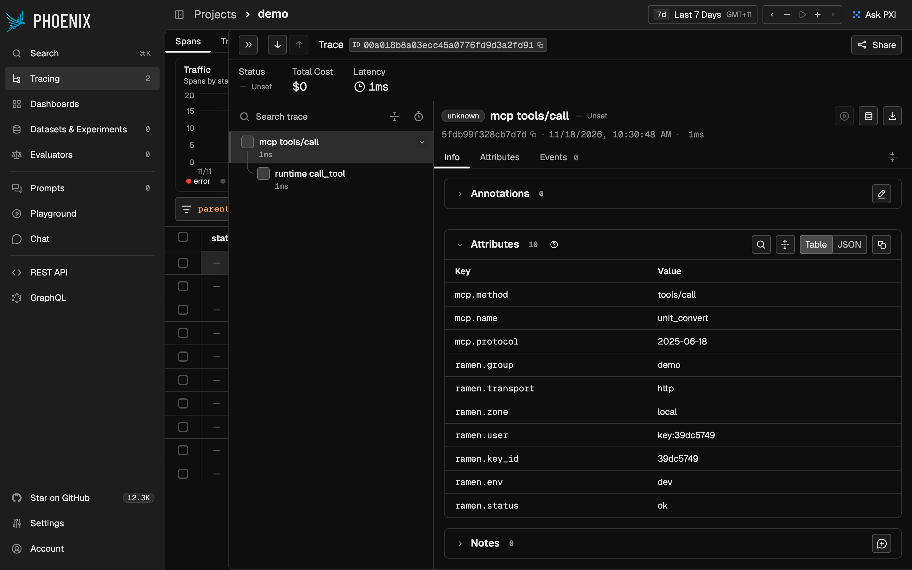

# Telemetry: OpenTelemetry export, and consent

Since 1.0 Ramen can export traces and two counters to an OpenTelemetry collector, tell connected agents where to
send their own telemetry, and — per group — serve tools only to callers who accepted that. All of it is off until
a super admin configures it.

## The settings

**Config page → Telemetry (OpenTelemetry)**, super admins only. API: `GET` and `PUT /api/v1/config/otel`.

| Field | Meaning |
|---|---|
| `enabled` | On or off. Turning it on without an endpoint is refused (`422`). |
| `endpoint` | The collector's OTLP/HTTP base URL, for example `https://jaeger.ramen-system:4318`; a cloud install (D86) refuses `http://`. Ramen posts to `<endpoint>/v1/traces` and `<endpoint>/v1/metrics`. |
| `headers` | Headers Ramen sends to the collector, typically its credential. |
| `client_endpoint` | The endpoint connected agents are told to use. Empty means the same as `endpoint`. |
| `client_headers` | The headers connected agents are told to send. Empty by default. |

Both header maps are write-only: an answer says only whether each is set and which header names it has. They are
stored encrypted and are left out of [backups](backups.md) like every secret. Agents are **never** given
`headers`; they are given `client_headers`, so treat those as known to every caller of the group and give them a
credential that can only write.

A change is audited as `config.otel`. The console uses the settings for its next deploy span at once. Since 1.0.0a
**saving pushes the settings to every deployed zone**: the console rewrites the zone's worker config (the same one
a deploy writes) and sends `Admin/Reload` to its workers (on Kubernetes the pods read the config as environment, so
both tracks are rolled — the stable workers and a canary left by a canary deploy), and the `PUT` answer carries the
outcome per zone, `pushed: {"demo/a": "ok", "demo/b": "<error>"}`, audited as `telemetry.push`; a canary that could
not be reached is named under `warning` while the zone stays `ok`. A zone that could not be reached keeps the old
settings until its next deploy.

### The config version (1.0.0a)

`telemetry_version` is the first 12 hex digits of SHA-256 over the canonical JSON of what clients are told —
`enabled`, `endpoint`, `client_endpoint`, `client_headers` (never Ramen's own `headers`). `GET /api/v1/config/otel`
and the Config page show it; every token answer carries it; workers get it as `RAMEN_TELEMETRY_VERSION`. A client
that reports with an older version is told to sign in again (below), which is how a change of endpoint or client
headers invalidates what every connected agent holds.

## What is exported

**By each worker's node**, for every MCP call that passed the credential check:

- One span named `mcp <method>` (for example `mcp tools/call`), kind `SERVER`, with these attributes and no others:

    | Attribute | Value |
    |---|---|
    | `mcp.method` | the JSON-RPC method |
    | `mcp.name` | the tool or prompt name, or the resource's URI, when the call names one |
    | `mcp.protocol` | the protocol version the call was served in |
    | `ramen.group`, `ramen.zone`, `ramen.env` | where it ran |
    | `ramen.transport` | `http` or `grpc` |
    | `ramen.status` | `ok`, `denied` or `error`, as in the access log |
    | `ramen.reason` | the access log's reason, when there is one |
    | `ramen.key_id` | the id of the MCP key, or `user:<subject>` for a person — never the credential |
    | `ramen.user` | the person's email (else the token's subject), or `key:<key id>` for an MCP key (1.0.0c) |
    | `ramen.guardrail.stage`, `ramen.guardrail.engine` | only when a [guardrail](guardrails.md) blocked the call |

    The span's status is `ERROR` only when `ramen.status` is `error`.

- A child span around the round trip to the Python runtime, kind `INTERNAL`, named `runtime call_tool`,
  `runtime get_prompt`, `runtime read_resource` or `runtime task_start`. A list call has none.
- The parent is the caller's W3C `traceparent` when the request carries a valid one (the HTTP header or gRPC
  metadata, else `params._meta`), so Ramen's spans join the agent's trace. Without one the span starts a new
  trace.
- Two cumulative counters, `ramen.mcp.calls` and `ramen.mcp.errors` (calls whose status is not `ok`), by
  `mcp.method`, `mcp.name` and `ramen.status`. After 2000 distinct series the name is folded into `(other)`.

The resource is `service.name` `ramen-node` with `service.version`, `service.namespace` `ramen/<group>`,
`openinference.project.name` `<group>`, `ramen.group` and `ramen.zone`. A sleeping zone's
[activator](sleeping-workers.md) exports a span of its own for a call it forwards.

### What a call looks like in Phoenix (1.0.0c)

Phoenix groups by `openinference.project.name`, so each group is **one project**. Inside it, every Ramen call is one
trace: the `mcp tools/call` (or `prompts/get`, `resources/read`, `tasks/*`) span with `ramen.user`, `ramen.group`,
`ramen.zone` and `ramen.env`; under it the `runtime <call>` span of the Python round trip; and, when the group
[requires telemetry](#telemetry-through-ramen-100a), one child span per event the client reported — named by the
event (the model, the tool or the MCP method), timed from its `ts` for `ms`, with `ramen.event.kind`,
`ramen.event.ok`, `openinference.span.kind` (`LLM`, `TOOL` or `CHAIN`) and the reasoning text (≤ 4 KiB) as
`ramen.reasoning`, plus the same `ramen.user` and `ramen.group`. Filter a project on `ramen.user` to see one person's
LLM, tool and MCP activity, call by call; the client's own telemetry that reaches the console's
[`/otlp` ingest](#client-telemetry-through-the-console-otlp) lands in the same project with the same `ramen.user`.

<figure markdown>
{ .ramen-shot }
<figcaption>Phoenix on the local stack (<code>make up ENGINES=phoenix</code>): project <code>demo</code>, a
<code>tools/call</code> span with its <code>runtime call_tool</code> child, <code>ramen.user</code> naming the group key.</figcaption>
</figure>

**By the console**, one span per deploy job, named `ramen.deploy`, resource `service.name` `ramen-console`:
`ramen.group`, `ramen.env`, `ramen.zones`, `ramen.outcome` (`ok` or `error`), `ramen.golden.passed`,
`ramen.golden.failed`, `ramen.compat` (`none`, `additive` or `breaking`) and `ramen.image` (the image reference, or
`base`).

A failed deploy's span also carries the job's error text (its first 500 characters) as the span status message.

**Never exported by a worker:** arguments, results, error messages from tool code, MCP keys, tokens, secrets, or
the request and response bodies a verbose log holds. There are no log records and no histograms; traces and the two
counters are all there is. The collector's credentials (`RAMEN_OTEL_HEADERS`, `RAMEN_OTEL_CLIENT`) are removed from the
environment tool code sees.

### A collector that is down never fails a call

Export is OTLP/HTTP with JSON bodies, off the call path: a finished span goes into a bounded queue (4096 entries;
beyond that it is dropped) and a background task posts a batch every 2 seconds or every 512 spans. When the
collector does not answer, or answers 5xx, 408 or 429 (it is restarting or overloaded), the batch is **kept** and sent
once it answers: up to 8192 spans for up to 2 minutes, oldest dropped first. The node logs `telemetry export failed;
kept for retry` (with `queued` and `lost`) at most once a minute, and `telemetry export recovered` when it is back. A
batch the collector refuses (another 4xx) is dropped, since it would refuse it again. The two counters are cumulative,
so the next post carries what a failed one missed. A CA switch restarts the chart's Phoenix for about 80 seconds
([Transport](transport.md#tls)); with this backlog no span of that window is lost.

The console's deploy span is tried again after 5, 10, 20, 30 and 30 seconds on the same failures; a failure is a
warning in its log, never a failed deploy. The console's OTLP ingest (`/otlp`) answers `502` while the collector is
away, and OTLP clients retry a 502.

## What clients are told

Ramen tells a connected agent where telemetry goes, in two places. Whether the agent sends anything is up to it.

- **The token answer.** When telemetry is enabled, `POST /oauth/token` (the code exchange and every refresh) adds

    ```json
    "telemetry": {"otlp_endpoint": "https://jaeger.ramen-system:4318", "headers": {},
                  "resource_attributes": {"ramen.group": "demo", "ramen.zone": "a"},
                  "version": "3f9c0a1b2d4e", "required": false}
    ```

    `version` is the [config version](#the-config-version-100a); `required` is the group's consent switch — when
    true, every gated call must carry a [telemetry report](#telemetry-through-ramen-100a).

- **Discovery.** `server/discover` carries the same object under `result._meta["io.ramen/telemetry"]`, for any
  authenticated 2026-07-28 caller, once the zone has been deployed with telemetry on.

`otlp_endpoint` is `client_endpoint`, or `endpoint` when that is empty; `headers` is `client_headers`.

## Telemetry through Ramen (1.0.0a)

When a group requires telemetry (`required: true`, the same switch as consent), each gated call — `tools/call`,
`prompts/get`, `resources/read` — from anyone but the console must carry `params._meta["io.ramen/telemetry"]`:
`{"version": "<telemetry_version>", "seq": <n>, "events": [{"ts", "kind": "mcp" | "llm" | "tool" | "other", "name",
"ms", "ok", "reasoning"?}, …]}` — everything the client did since its last report (its MCP calls to any server, its
model calls with the reasoning, its other tool calls; `events: []` is a valid report). The same object is accepted
on `telemetry/report` between calls. The worker turns each event into a `CLIENT` span named by the event under the
call's own span, with the caller's IP, user (`ramen.user`), key id, group, zone, environment and worker, the event's
kind and outcome (`ramen.event.kind`, `ramen.event.ok`), and the reasoning text (≤ 4 KiB); nothing
of it reaches the access log or the console. A call without a report is refused with `-32024 telemetry report
required` (HTTP 428; a 2025-06-18 client gets `-32003` and is told to use a client that reports); a report with
another version with `-32025 telemetry config changed: sign in again`, and the client signs in again to get the
current config. Limits: 200 events and 64 KiB per report. The Ramen bridge (1.0.0, the bridge for Ramen 1.0.0) does all of this for the host it serves:
it keeps the token answer's `telemetry` object encrypted in memory, records every call it forwards, offers the
model a `ramen_report` tool for its model and non-MCP tool calls, and signs in again on `-32025`.

## Client telemetry through the console (`/otlp`)

Since 1.0.0c Phase 3 a client's **own** telemetry — Claude Code's native OpenTelemetry metrics and logs, a Codex or
Gemini CLI session, anything that honours the OTel SDK environment — can reach the group's collector through the
console instead of needing the collector's address and credential on every machine. `POST <console>/otlp/v1/traces`
(`/metrics`, `/logs`) takes OTLP/HTTP, protobuf or JSON, gzip accepted, up to 4 MiB, with the person's token or an
MCP key as bearer. The console stamps `ramen.group`, `ramen.user` (email or `key:<name>`), `ramen.zone` when known,
`openinference.project.name = <group>` and `service.namespace = ramen/<group>` onto the resource and forwards the
request to the `endpoint` above with Ramen's headers — one upstream call per request, `502` with the upstream status
on an error, `204` while telemetry is off, `429` past 60 requests a minute per token. Nothing is stored on the console.

With `otel.collector: phoenix`, `openinference.project.name` is what Phoenix groups by: **one project per group**, so a
Claude Code session of group `demo` appears under project `demo` with `ramen.user` on every span.

The bridge points every client it configures at this endpoint: Claude Code's `settings.json` `env`, `~/.ramen/env.sh`
for the rest, Codex's `[otel]` table — see [LLM configs](llm-configs.md#what-the-bridge-writes-bridge-100). The Config
page's Telemetry section shows the ingest URL; `client_endpoint` stays for clients that already export directly.

## Consent

A group can require that a caller accepted the telemetry notice before its tools are served.

**The switch** is per group: **Group page → Telemetry consent → Require consent** (group admins and up; the card
shows while telemetry is enabled), or `PUT /api/v1/groups/{g} {"require_telemetry_consent": true}`. While telemetry
is off, turning it on is refused with `422`. It **takes effect on the group's next deploy**.

**What is gated:** `tools/call`, `prompts/get` and `resources/read`. Lists, `server/discover`,
`completion/complete`, `ping`, `tasks/*` and `subscriptions/listen` are not. A tool the caller may not see or call
is refused as it always was; nobody is asked to consent to a call they cannot make.

A caller is served in one of three ways.

**1. A person, on the sign-in consent page.** When the group requires consent, the page a person approves an
OAuth client on shows the notice with the collector's host and a required checkbox, *I accept that telemetry is
recorded for this group*. Allowing without the box is refused (`invalid_request`, "this group requires telemetry
consent: tick the box to allow, or deny"); denying ends the flow as before. The token then carries the acceptance,
and its holder is never asked again. A grant made before the group required consent cannot be refreshed into it:
the refresh answers `invalid_grant`, "group … requires telemetry consent; authorize the client again".

**2. An agent that can be asked.** A 2026-07-28 client that declared the `elicitation` capability gets, instead
of the result, an [input request](mrtr.md):

```json
{"resultType": "input_required",
 "inputRequests": {"ramen_telemetry_consent": {"method": "elicitation/create", "params": {"mode": "form",
   "message": "This Ramen group records telemetry about your calls (tool name, timing, outcome — never arguments or results) at jaeger.ramen-system:4318 and asks your agent to send its telemetry there. Accept to continue.",
   "requestedSchema": {"type": "object", "properties": {"accept": {"type": "boolean"}}, "required": ["accept"]}}}},
 "requestState": "…"}
```

The client repeats the call with the `requestState` and

```json
"inputResponses": {"ramen_telemetry_consent": {"action": "accept", "content": {"accept": true}}}
```

and the call runs. If the tool has input requests of its own, they follow in the next rounds as usual; the tool
never sees the consent round. Any other answer — `decline`, `cancel`, `accept: false` — is
`-32602 telemetry consent declined`, and an answer without the signed state is
`-32602 requestState integrity check failed`.

**3. Everyone else is refused.**

| Caller | Answer |
|---|---|
| 2026-07-28 client without `elicitation` | `-32021`, with `requiredCapabilities: {"elicitation": {}}` |
| 2025-06-18 client | `-32003 forbidden: this group requires telemetry consent; use a client that speaks MCP 2026-07-28 or sign in through OAuth` |

A 2025-06-18 call is served when its caller's consent is already on record from a 2026-07-28 client.

The console's own calls to a worker (golden cases, the package list) carry the zone's worker admin key and are
not asked.

### How long it is remembered, and where

An acceptance given through the prompt is recorded for **30 days**, per group and per caller: an MCP key, or a
person (so it outlives that person's token). The record lives in the first of these the zone has, the same choice
as the [task store](tasks.md#where-tasks-live-and-why-redis-matters):

1. the scope Redis, which the group's zones share,
2. the item Redis,
3. the pod's own memory.

**Without Redis consent is per pod.** Another pod of the zone asks again, and a pod that restarts has forgotten.
Give the group a Redis before requiring consent on a zone with more than one worker. If the store cannot be read
the caller is asked again; if it cannot be written the accepted call is still served and the caller is asked again
next time.

A person's acceptance on the consent page is not in this store: it is in the token.

### In the access log

`consent_required` is the reason on a call that was answered with the prompt or refused for lack of a way to ask;
`consent_declined` on a refusal by the caller. The call on which an acceptance was recorded carries
`consent: "granted"`.

## Trying it out: the chart's Jaeger or Phoenix

```sh
helm upgrade ramen deploy/helm/ramen -n ramen-system --reset-then-reuse-values --set otel.collector=jaeger    # or phoenix
```

`jaeger` adds a Jaeger all-in-one (`Deployment` and `Service` `jaeger`: OTLP/HTTP on 4318, the query API and UI
on 16686); `phoenix` adds [Arize Phoenix](https://github.com/Arize-ai/phoenix) (`Deployment` and `Service`
`phoenix`: the UI on 6006, SQLite on a PersistentVolumeClaim), whose UI reads LLM and tool spans as traces, sessions and token
costs. Phoenix takes OTLP protobuf only and has no metrics endpoint, while Ramen posts OTLP/JSON traces and
metrics, so the pod carries an OpenTelemetry Collector sidecar on 4318 that converts the traces and drops the
metrics. Point **Config → Telemetry** at `https://jaeger.ramen-system:4318` or `https://phoenix.ramen-system:4318` (TLS with the install CA since D86),
deploy a group, and look at the UI through a port-forward:

```sh
kubectl -n ramen-system port-forward svc/jaeger 16686     # https://localhost:16686 (the install CA, as Phoenix)
kubectl -n ramen-system port-forward svc/phoenix 6006     # https://localhost:6006 (the install CA: ConfigMap ramen-ca)
# the sign-in (D92): one password per install, generated by the chart, read by a super admin with cluster access
kubectl -n ramen-system get secret ramen-engines -o jsonpath='{.data.password}' | base64 -d; echo
```

Both ask for a sign-in (since 1.0.0, D92):

- **Phoenix** runs its own auth: sign in as `admin@localhost` with that password (Phoenix applies it while the
  account still holds Phoenix's default; one you changed in Phoenix stays yours). Its REST and GraphQL APIs take
  `Authorization: Bearer <phoenix-admin-secret>` (same Secret). The collector beside it posts the spans with that
  bearer, so nothing changes for the console or the workers.
- **Jaeger** has no auth of its own: its query UI/API listens inside the pod only, behind a TLS front that asks for
  user `admin` and the password (the browser's sign-in prompt; `curl -u admin:<password>` or
  `-H "Authorization: Bearer <password>"`).

OTLP on 4318 needs no credential: the NetworkPolicy admits only the console, the workers and the evals/scan Jobs, and
it takes spans, never gives any back. Local compose: the same, with `RAMEN_ENGINES_PASSWORD` from `deploy/local/.env`.

With a collector on, the chart hands the console `RAMEN_OTEL_UI_URL` and the Config page's Telemetry section
names the trace UI address (reachable through the port-forward only).

Neither has a route from any load balancer. Phoenix keeps its SQLite file on a 5Gi
PersistentVolumeClaim `phoenix` (`storage.className`, else the cluster's default storage class), so the span history survives a restart — an
upgrade, or the CA switch of a [certificate rotation](transport.md#tls), which restarts it — and the Deployment is
a rolling update with `maxSurge: 0` (one ReadWriteOnce volume: the old pod stops first). Change it with `otel.phoenix.persistence.size` / `.storageClass`;
`otel.phoenix.persistence.enabled=false` goes back to an emptyDir that a restart empties. On EKS the install's
EBS CSI driver add-on and the chart's `gp3` class provide it (`engines_set`; [Deploy on AWS](deploy-aws.md)). Jaeger keeps traces in memory: a restart empties it. Since 1.0.0c a NetworkPolicy keeps them to their callers: OTLP on 4318 from the console,
the workers' own export and the evals/scan Jobs; the UI (6006 / 16686) from the edge ranges only — never from a
worker namespace, so tool code reaches no UI or API — in practice the port-forward above ([Configuration](configuration.md#network-policies-and-redis-100c)). **They are for trying telemetry out and for the test runs, not for production**:
there, point the settings at your own collector. The default is `otel.collector: none`.

## Settings a worker receives

Written by the console on deploy and on every save of the settings (1.0.0a); never set by hand in the cloud.

| Variable | Meaning |
|---|---|
| `RAMEN_OTEL_ENDPOINT` | The collector base URL. Unset: nothing is exported. |
| `RAMEN_OTEL_HEADERS` | Ramen's headers for the collector, a JSON object of strings. |
| `RAMEN_OTEL_CLIENT` | The object handed to agents on `server/discover`, with `version` and `required`. |
| `RAMEN_TELEMETRY_VERSION` | The config version a report must name (1.0.0a). |
| `RAMEN_TELEMETRY_CONSENT` | `1` when the group requires consent. |
| `RAMEN_TELEMETRY_NOTICE` | The host the consent prompt names: the client endpoint's, else the endpoint's. |

## Limits

- Without Redis, consent is per pod (above).
- A sleeping zone's activator does not make the consent check; the worker makes it on the forwarded call.
- An unknown tool name is asked for consent before it is answered as unknown.
- Traces and two counters only.

## What is verified

By tests:

- `tests/conformance/test_otel.py`: a real node against a recording collector — the span and its attribute list
  on both transports, the runtime child span, the parent from `traceparent`, the guardrail attributes, the two
  counters, that no argument, result, key or token reaches the collector, that the runtime never sees the
  collector credential, and that a dead collector neither fails nor slows a call.
- `tests/conformance/test_telemetry_consent.py`: the prompt, accepting and refusing, the signed state (missing,
  tampered, another caller's, another request's, expired), what is remembered and for whom, `-32021` and `-32003`,
  a token with and without the acceptance, the worker admin key, the access-log reasons.
- `tests/conformance/test_console_sleep_otel.py`: the settings API and its write-only headers, backups, the token
  answer, the consent page and its checkbox, a refresh after the requirement was turned on, what a deploy hands
  the workers, the deploy span.
- `tests/kind/test_v1_sleep_build_otel.py` holds the cluster proofs (the spans of a call and of a deploy arriving
  in the chart's Jaeger, discovery, consent by prompt, by token and refused).

On GKE, EKS and AKS (1.0.0, 2026-11-13 to 2026-11-14), with the chart's Jaeger in each cluster: the spans of a
call and of a deploy arrived in Jaeger, consent was given by prompt (a group key) and by token (a signed-in
person), and a 2025-06-18 client was refused.

The kind numbers and the rest of the cloud run are on the
[Transport page](transport.md#what-is-verified-and-what-is-not). No test looks at the consent store on Redis
itself, and no automated test exports to an `https://` collector (only a failing TLS connection is tested). Export
over TLS was run live on GKE (1.0.0b33 to b36, D86): the workers posted to the chart's Phoenix at
`https://phoenix.ramen-system.svc.cluster.local:4318`, verified against the install CA, the spans arrived within
seconds, a plaintext `http://` post to the same port was dropped, and through the b36 CA rotation every span was kept (the
workers queued during Phoenix's restart and reported `lost: 0`).
