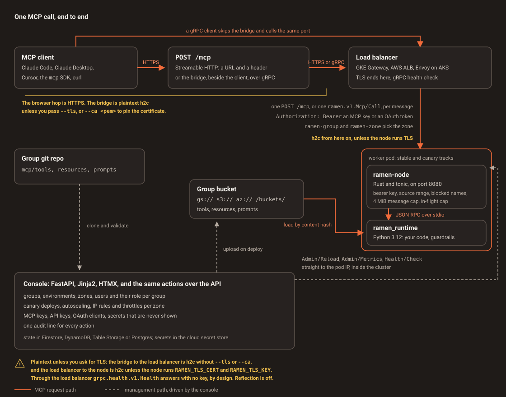

# Transport and what secures each hop

Since 0.5.0 a worker speaks two transports on one port, through one set of guards ([contract §16](../CONTRACTS.md)):

- **Streamable HTTP** — the front door. `POST /mcp` carries one JSON-RPC 2.0 message (MCP spec 2026-07-28;
  2025-06-18 still accepted, see [two protocol versions](#two-protocol-versions-on-one-endpoint)); the
  credential is `Authorization: Bearer`, an `rmk_` key or a console-issued OAuth token. A URL and a header, so
  phones, browsers and hosted agent platforms connect without installing anything.
- **gRPC** — `ramen.v1.Mcp/Call`, one message as `bytes body` ([§11](../CONTRACTS.md),
  [`mcp.proto`](https://github.com/bkraad47/ramen/blob/main/proto/ramen/v1/mcp.proto)). Kept for teams that want
  it internally, and what the stdio bridge speaks.

The messages your client and your tools see are standard MCP. The HTTP handler has no checks of its own: it turns
the request headers into the same metadata map and calls the same guard and dispatch functions as the gRPC service
([`node-rs/src/http.rs`](https://github.com/bkraad47/ramen/blob/main/node-rs/src/http.rs) →
[`grpc.rs::guard`](https://github.com/bkraad47/ramen/blob/main/node-rs/src/grpc.rs)). The conformance suite runs the
whole guard table on both transports so a check that drifts fails there first.

<figure class="ramen-diagram" markdown>

</figure>

## Why the node is Rust

A worker runs two processes with one job each.

- **`ramen-node` (Rust, [tonic](https://github.com/hyperium/tonic))**: the transport, key and source-range checks,
  the blocked-name filter, the concurrency bound, deadlines, health and the access log. A small, statically linked
  binary with no interpreter and no user code in its address space.
- **`ramen_runtime` (Python 3.12)**: `pip install`, proto and argument validation, secret substitution and the call.

They talk newline-delimited JSON-RPC on stdin/stdout ([contract §2](../CONTRACTS.md)): no socket, no port. The
runtime is spawned when needed and killed after `RAMEN_SIDECAR_IDLE_SECS` idle, so a crash, hang or leak in tool code
costs one respawn, not the pod that holds the keys.

## Hop by hop

| Hop | What it is | What protects it |
|---|---|---|
| Client → edge (HTTP) | `POST https://<edge>/mcp` | TLS at the load balancer; the credential in `Authorization: Bearer`; a browser `Origin` must be on the zone's allowlist (see [Origin](#origin)); a session id is signed and bound to the credential (see [Sessions](#sessions)). The local compose worker is plain `http://` on the laptop only |
| Client → bridge → edge (stdio) | a child process on the client's own machine, speaking gRPC over HTTP/2 to the edge | process boundary on the client; **plaintext h2c unless you ask for TLS** — `--tls`, or `--ca <pem>` to pin the server certificate. the credential is a group key (`--key`, `RAMEN_BRIDGE_KEY` or `RAMEN_MCP_KEY`) or the person's own sign-in (`--oauth`) |
| Edge → node | GKE Gateway, an AWS ALB, or Envoy Gateway on AKS → the zone's pods | TLS terminates at the load balancer; the LB → node hop is h2c unless the node runs its own TLS (`RAMEN_TLS_CERT` + `RAMEN_TLS_KEY`). Cloud Armor IP rules apply here on GCP — **one policy per group**, not per zone; on AWS a WAFv2 IP set and a web-ACL rule per group, applied on a real account since 0.5.6; on AKS an Envoy `SecurityPolicy` per zone route (0.7.5) |
| Edge → node, without a key | `grpc.health.v1.Health`, the OAuth resource metadata, and gRPC reflection where it is enabled | not key-checked or source-range-checked, by design; reflection is off on deployed workers ([the unauthenticated surface](#the-unauthenticated-surface)) |
| Anything else → the pod, directly | other pods, or the cluster network | the worker `NetworkPolicy` and the hardened container context ([what bounds direct access](#what-bounds-direct-access-to-a-pod)) |
| Node (every `Mcp/Call`) | the guard in front of your code | the bearer key in constant time ([the bearer key](#the-bearer-key)); source range against `RAMEN_ALLOWED_CIDRS`; blocked names filtered; 4 MiB message cap; `RAMEN_MAX_INFLIGHT` cap |
| Node → runtime | JSON-RPC on stdio inside the pod | no network surface; the runtime is a child process of the node |
| Runtime → bucket | read of the group's prefix, by content hash | the zone's own cloud identity, scoped to that group's bucket prefix and that group's secrets. The AWS equivalent is an IAM role with IRSA, applied on a real account since 0.5.6; on AKS a user-assigned managed identity with workload identity (0.7.5), which can read the whole `groups` container (see below) |
| Console → node | `Admin/Reload`, `Admin/Metrics`, `Health/Check` on the pod IP | cluster-internal, and plaintext h2c unless the console itself has `RAMEN_WORKER_TLS=1`; `Admin/*` additionally needs `x-ramen-admin-key` and `RAMEN_ADMIN_CIDRS`, and is not routed through the load balancer at all |

### The bearer key
`Mcp/Call` requires metadata `authorization: Bearer <key>`. The node compares the presented key against every
configured key in `RAMEN_MCP_KEYS` with a constant-time byte comparison, and folds over the whole key set without
an early exit on the first mismatch
([`node-rs/src/auth.rs`](https://github.com/bkraad47/ramen/blob/main/node-rs/src/auth.rs)). One caveat: the byte
compare is guarded by a plain length test, which is not constant time, so the *length* of a configured key can be
inferred from timing, though its bytes cannot. A miss is gRPC
`UNAUTHENTICATED`, and **an empty key set denies everyone** rather than letting everyone in. Error details never
echo key material.

Keys are generated per group in the console and written into the zone's config on deploy. Rotation is one
action (the deploy rewrites the zone's Secret and rolls both Deployments), but it is not *instant* revocation: the old pods keep accepting the old key set until they finish draining, and the deploy job waits up
to 180 s for that. Assume a revoked key still works for a few minutes.

The access log logs every call with a `key_id`, a short unsalted hash of the presented key. It is not key
material, but anyone who can read worker logs can hash a candidate key and see whether it appears. Worker logs are
sensitive.

### The source-range allowlist
`RAMEN_ALLOWED_CIDRS` is checked against the caller's address; outside it the call is `PERMISSION_DENIED`, and
IPv4-mapped IPv6 addresses are normalised before the match.

Behind a load balancer the peer *is* the load balancer, so the question is which address counts as the caller's.
`RAMEN_TRUST_PROXY_HOPS = n` answers it: take the **n-th `x-forwarded-for` entry counted from the right**. Proxies
*append* to that header, so its right-hand end is what they wrote and everything to the left is whatever the caller
sent. Skipping the `n - 1` right-hand entries your own proxies added lands on the address the outermost trusted
proxy observed, which a caller cannot pick.

Everything else falls back to the **peer address**: trust off (`n = 0`), no header, fewer than `n` entries, or an
entry at that position that will not parse. Behind a load balancer the peer is the proxy, so a client-range
allowlist then denies: a wrong hop count costs availability, not confidentiality. It fails closed.

| Where | `RAMEN_TRUST_PROXY_HOPS` | why |
|---|---|---|
| GCP, behind the external load balancer | `2` | the load balancer appends the client, then itself |
| AWS, behind the ALB | `1` | the ALB appends the client |
| local, compose, or straight to a pod | `0` (the default) | there is no proxy — the peer *is* the client |

The worker chart and both console renderers set it per provider; you can override it, including to `0`. The
legacy `RAMEN_TRUST_PROXY=1` still works and means one hop, and an explicit `RAMEN_TRUST_PROXY_HOPS` wins over
it in both directions, so `HOPS=0` is an explicit off switch.

The allowlist decides which clients a reachable worker will answer; what stops something reaching a worker
directly is the [`NetworkPolicy`](#what-bounds-direct-access-to-a-pod).

**Unset, `RAMEN_ALLOWED_CIDRS` defaults to `0.0.0.0/0` and `::/0` — every source is allowed**, and the bearer
key is the only gate. Setting per-zone IP rules in the console is what populates it on deploy.

`RAMEN_ADMIN_CIDRS` defaults to any in the same way and the console never writes it, so `x-ramen-admin-key` is the
gate that always applies on `Admin/*`.

A deploy smoke-tests `tools/list` as an ordinary `Mcp/Call` from the console, and that call *is* subject to
`RAMEN_ALLOWED_CIDRS`. An IP lock must therefore include the console's own source range as the worker sees it, or
every later deploy fails at the smoke step with `PERMISSION_DENIED`. That is why the cloud IP-rules test skips itself
unless it is given that range to add to the lock.

### TLS
TLS terminates at the load balancer, the hop that crosses the internet. Everything behind it is cleartext HTTP/2
by default; that is what GKE's `appProtocol: kubernetes.io/h2c` means, and it is the path that
was verified on a live GKE Gateway in 0.3.2. If you want the last hop encrypted too, give the node
`RAMEN_TLS_CERT` and `RAMEN_TLS_KEY` and switch the Service to `HTTP2`; that mode has local tests but has not
been exercised in a cloud deployment. Since 0.5.1 the node terminates TLS itself and offers both `h2` and
`http/1.1` on ALPN — tonic's own acceptor offers only `h2`, which refused every Streamable HTTP client at the
handshake (CI caught it after 0.5.0; the laptop had skipped the case for want of `openssl`).

**Turning on node TLS is two changes, not one.** The console dials worker pods with an insecure channel unless it
is *also* given `RAMEN_WORKER_TLS=1` (plus `RAMEN_WORKER_CA`, or `RAMEN_WORKER_CERT` / `RAMEN_WORKER_KEY` for a
client certificate). Give the node TLS without the console side and the console keeps speaking cleartext to a TLS
port, so every `Admin/Reload` — and therefore every deploy — fails.

`ramen-mcp-bridge` is plaintext unless you pass `--tls` or `--ca`. Two details catch people out:

- **`--insecure` overrides `--tls` and `--ca`** instead of conflicting with them. A leftover `--insecure` in an
  `mcpServers` entry downgrades the connection silently, with no warning and no error.
- **`--ca <pem>` replaces the trust store**; it does not pin a certificate in the strict sense. The connection
  still verifies the hostname and anchors trust in that PEM. GKE (Google-managed, since 0.5.5) and AKS
  (Let's Encrypt, 0.7.5) serve a publicly trusted certificate, so `--tls` alone works there; the AWS guide's
  self-signed certificate needs `--ca`, or `--tls` fails with `CERTIFICATE_VERIFY_FAILED` — the mistake that cost a
  run in the 0.3.2 cloud verification. From bridge 0.2.2 the same `--ca` also verifies the console during `--oauth`
  sign-in; 0.2.1 and older used the system trust store there.

### Blocked names
Names in `RAMEN_BLOCKED` are filtered out of `tools/list`, `resources/list` and `prompts/list` and answered with
JSON-RPC `-32601` when called — by name, and for resources by URI as well as by resolved name. Blocking is set in
the console per environment and per zone, so a model connected to one zone cannot see or call what that zone has
switched off.

### Sessions
`initialize` over HTTP returns an `Mcp-Session-Id` of the form `<nonce>.<expiry>.<mac>`, where the MAC is
HMAC-SHA256 over the nonce, the expiry and the id of the credential that made the call, keyed with the zone's
`RAMEN_SESSION_SECRET`. Nothing is stored: any pod in the zone verifies an id, so there is no affinity to configure
and a rollout keeps sessions alive. Presented under another credential, past expiry (30 min by default) or altered,
the id is `404` — the spec's signal to re-initialize — never `401`, so a stolen id reveals nothing and cannot be
replayed with a different key. The console writes the secret into every zone's deploy Secret; a group cannot set it
from its own deploy file. Without it the node generates one per process and says so in its log, and sessions then
die with the pod.

Since 0.7.2 a session id also carries the first twelve hex characters of the manifest hash it was opened on. After a
deploy changes the tool set, the worker's next answer to that session is an event stream (when the client accepts
`text/event-stream`, as the official SDKs and Claude Code do) that begins with `notifications/tools/list_changed`,
once per session and per rollout, so the client re-lists. The worker keeps serving the current version; nothing is
pinned to the old one, and behind a load balancer each pod announces once. Session ids from 0.7.1 are still accepted;
during the upgrade to 0.7.2 an old pod answers a new id with `404` and the client re-initializes.

### Origin
A request that carries a browser `Origin` header is refused with `403` unless the origin is on
`RAMEN_ALLOWED_ORIGINS`. That list is **empty by default**, so a page on another site cannot use a victim's
browser to reach a worker through DNS rebinding. Non-browser clients send no `Origin` and are unaffected. A group may
open its own web origins from its deploy file; `*` is for a laptop.

### OAuth tokens
When `RAMEN_OAUTH_ISSUER` names the console, a worker also accepts an HS256 access token the console minted for one
signed-in user: signature (key derived from the same zone secret), `exp`, issuer, audience and scope
(`mcp:<group>:<zone>`) must all check out, and the access log then names the user rather than a key id. Tokens live
one hour and are not individually revocable; refresh tokens are, through the user's session epoch. The worker
publishes `/.well-known/oauth-protected-resource` and answers a missing credential with
`WWW-Authenticate: Bearer resource_metadata=…`, which is how an OAuth-capable client finds the console. Two
practical notes: the metadata URL is absolute only when the deploy set `RAMEN_PUBLIC_URL` on the worker (the console
does so from its [base URI](configuration.md#the-public-address-base-uri) or its own `RAMEN_PUBLIC_URL`; a pod
cannot know its public address on its own), and behind a load balancer that routes
on `ramen-group`/`ramen-zone` a client must send those headers on the metadata request too, or the balancer has no
zone to send it to. Details and what the console checks before minting: [the threat model](../threat-model.md).

### The unauthenticated surface
Three things run ahead of every guard — no key, no source-range check: `grpc.health.v1.Health`, deliberately, so
that load balancers and Kubernetes can probe it; `GET /.well-known/oauth-protected-resource`, which is public
metadata by design (RFC 9728) and names only the console's URL and the resource identifier; and gRPC **server
reflection** (`v1` and `v1alpha`), so that `grpcurl` works without a local copy of the proto.

Reflection is convenient on a laptop and a disclosure at an edge: anyone who reached it could list the services and
print their definitions, `ramen.v1.Admin` included, from a source range the MCP allowlist denies. So
`RAMEN_REFLECTION` is **on by default and switched off on deployed workers**: the worker chart and both console
renderers set `RAMEN_REFLECTION=0`, the reflection services are not registered and answer `UNIMPLEMENTED`, and an
anonymous caller at the load balancer can list nothing. Locally and in compose, where the port is not exposed to
anyone else, reflection stays on.

Health stays unauthenticated everywhere, by design. It reports readiness and nothing more: `SERVING` only after the
runtime has loaded the group's code.

### What bounds direct access to a pod
The worker `NetworkPolicy` (enabled by default) admits ingress to the node port only from the console's namespace
and from the load balancer's front-end and health-check ranges — the VPC CIDR on AWS. Together with the hardened
container context (non-root, `allowPrivilegeEscalation: false`, all capabilities dropped, `RuntimeDefault`
seccomp) it is what stops another pod, or the internet, reaching the node directly, and what makes the
unauthenticated surface tolerable. It is also what
closed the direct-access item of the 0.3.0 security audit.

### The deploy file is a configuration channel
The node's configuration comes from three places, in order: a `RAMEN_CONFIG` yaml, then the process environment,
then the deploy file the console writes into the group's bucket (`.ramen/env-<zone>`), re-read on every
`Admin/Reload`. That last source is a channel, not just data. It **can** set `RAMEN_MCP_KEYS` and `RAMEN_ALLOWED_CIDRS` — so write access to a group's bucket prefix is the
ability to add an MCP key and to widen that zone's address allowlist — along with the block list, the in-flight
and timeout limits, the idle timer and the log file. It deliberately **cannot** set the bucket, the port, the
Python interpreter, the group or zone identity, the admin key, or the proxy-trust setting, so the same write access
cannot repoint a worker at another group's code, take over its admin
surface, or change how it decides a caller's address.

### Per-zone cloud identity
Attaching a zone creates its own cloud identity, bound to the zone's Kubernetes service account: on GCP a service
account with `objectViewer` limited to that group's bucket prefix and `secretAccessor` limited to that group's
secrets, through Workload Identity. Two zones of two groups on the same cluster therefore cannot read each other's
code or secrets even if the network is misconfigured. The AWS equivalent is an IAM role with IRSA, applied on a real
account since 0.5.6. On Azure (0.7.5) it is a user-assigned managed identity with a federated credential and a
Key Vault role on each of the group's secrets; Azure cannot scope a blob role to a path, so that identity may read the
whole `groups` container, and the per-group boundary for code is the console's sync.

The separation is about *contents*. One edge: the IAM condition that scopes the storage role
matches the group's object prefix **or the bucket resource itself**, because that is what a bucket listing is
checked against. A group's worker identity can therefore enumerate object names across the shared groups bucket,
including other groups' paths. It cannot read those objects — only see that they exist.

### Transport errors versus protocol errors
gRPC status codes describe the edge, JSON-RPC errors describe your code. A bad key is `UNAUTHENTICATED`, a blocked
source range is `PERMISSION_DENIED`, an oversized message is `OUT_OF_RANGE`, too many in-flight calls is
`RESOURCE_EXHAUSTED`; a blocked or unknown tool is JSON-RPC `-32601` and an exception in your tool is
`isError: true`. A client can always tell "the edge rejected me" from "the tool said no". Those JSON-RPC codes are
the 2025-06-18 ones; a 2026-07-28 client gets the [codes of its own version](#errors-on-2026-07-28).

The in-flight semaphore is sized when the pod starts and `Admin/Reload` does not resize it: a deploy may set
`RAMEN_MAX_INFLIGHT`, but the new value takes effect only when the pod restarts.

## Two protocol versions on one endpoint

Since 1.0 a worker serves MCP **2026-07-28** and **2025-06-18** side by side, on the same `POST /mcp` and the same
`Mcp/Call`. There is no switch: each request is served in the version it names, through the same guards.

**Which version a request gets.** A request is 2026-07-28 when either is true:

- its `MCP-Protocol-Version` HTTP header is anything other than `2025-06-18`, `2025-03-26` or `2024-11-05`;
- its body has `params._meta["io.modelcontextprotocol/protocolVersion"]`.

Everything else, including a request with neither, is served as 2025-06-18, as in 0.8. On gRPC there is no header
to read, so the body alone decides.

### A 2026-07-28 request

No `initialize`, no session. Every request carries what the handshake used to establish:

```sh
curl -s https://<edge>/mcp \
  -H 'Authorization: Bearer <rmk_ key>' -H 'ramen-group: demo' -H 'ramen-zone: a' \
  -H 'Content-Type: application/json' -H 'Accept: application/json' \
  -H 'MCP-Protocol-Version: 2026-07-28' -H 'Mcp-Method: tools/call' -H 'Mcp-Name: demo_calculator_tool' \
  -d '{"jsonrpc":"2.0","id":1,"method":"tools/call","params":{
        "name":"demo_calculator_tool","arguments":{"var1":40,"var2":2,"func":"add"},
        "_meta":{"io.modelcontextprotocol/protocolVersion":"2026-07-28",
                 "io.modelcontextprotocol/clientCapabilities":{}}}}'
```

`_meta` must carry the version and `clientCapabilities` (an object, `{}` is fine);
`io.modelcontextprotocol/clientInfo` is optional. `Mcp-Session-Id` is ignored and never returned. The methods are
`server/discover`, `tools/list`, `tools/call`, `resources/list`, `resources/templates/list`, `resources/read`,
`prompts/list`, `prompts/get`, `completion/complete`, `tasks/get`, `tasks/update`, `tasks/cancel` and, on HTTP,
`subscriptions/listen`. A `notifications/*` message is accepted (`202`) and ignored.

Every result carries `resultType` (`complete`, `input_required` or `task`) and
`_meta["io.modelcontextprotocol/serverInfo"]` (`{"name": "ramen-node", "version": …}`). The list methods and
`server/discover` add `ttlMs` (`RAMEN_LIST_TTL_MS`, default 60000) and `cacheScope: "private"`, because a list
depends on who asks; `resources/read` carries `ttlMs: 0`.

### Errors on 2026-07-28

The node checks a 2026-07-28 request in this order, after the credential and before the throttle. Each failure is a
JSON-RPC error with the request's `id`:

| Check | Error | HTTP |
|---|---|---|
| `_meta` missing, or without `protocolVersion` or an object `clientCapabilities` | `-32602` | 400 |
| `MCP-Protocol-Version` header missing, or different from the version in `_meta` (HTTP only) | `-32020` | 400 |
| The version is not `2026-07-28` | `-32022`, `data: {"supported": [...], "requested": "<v>"}` | 400 |
| `Mcp-Method`, `Mcp-Name` or an `Mcp-Param-*` header missing, undecodable or different from the body (HTTP only) | `-32020` | 400 |
| `initialize`, `ping`, `logging/setLevel`, `resources/subscribe`, `resources/unsubscribe`, or any unknown method | `-32601` | 404 |

After those, in the call itself:

| Situation | Error | HTTP |
|---|---|---|
| Unknown, blocked or hidden tool | `-32602 Unknown tool: <name>` | 200 |
| A tool the caller may list but not call | `-32602 forbidden: <name> is not callable for <kind>` | 200 |
| Unknown or blocked prompt | `-32602 Unknown prompt: <name>` | 200 |
| Resource not found or blocked | `-32602 Resource not found`, `data: {"uri": …}` | 200 |
| The tool needs a client capability that this request did not declare | `-32021`, `data: {"requiredCapabilities": …}` | 400 |
| A `requestState` that fails its check ([multi round-trip requests](mrtr.md)) | `-32602 requestState integrity check failed` | 200 |
| Unknown, expired or someone else's task ([tasks](tasks.md)) | `-32602 Unknown task` | 200 |
| The runtime has not loaded | `-32603` | 200 |

No code from `-32000` to `-32019` is sent to a 2026-07-28 client. The transport denials are unchanged on both
versions: `401`, `403`, `413`, `429`, `503`. An exception in a tool is still a result with `isError: true`, not an
error. The access-log reasons (`blocked_name`, `tool_hidden`, `tool_denied`) are the same on both versions, and
two are new: `header_mismatch` and `state_invalid`.

### Standard headers

On HTTP a 2026-07-28 request repeats what it is in headers, so a load balancer can route or limit without reading
the body:

- `Mcp-Method` is required and must equal the JSON-RPC `method`.
- `Mcp-Name` is required on `tools/call` and `prompts/get` (the `name`), `resources/read` (the `uri`) and
  `tasks/get`, `tasks/update`, `tasks/cancel` (the `taskId`).
- `Mcp-Param-<Name>` mirrors a tool argument whose parameter declares `"header": "<Name>"`
  ([The MCP repo](mcp-repo.md#a-parameter-mirrored-in-a-header)). When the argument is present and not null the
  header is required and must match: strings exactly, integers by value, booleans as `true` or `false`. When the
  argument is absent or null no header is expected. An `Mcp-Param-*` header the tool does not declare is ignored.
- A value that cannot travel in a header is sent as `=?base64?<base64 of the UTF-8 text>?=`; the node decodes it
  before comparing.

**The body is what runs.** A header that disagrees with it is refused with `-32020` and logged with reason
`header_mismatch`; the node never acts on the header instead. `Mcp-Param-*` is compared only for a tool the caller
may see, so a mismatch cannot reveal a hidden tool.

`traceparent`, `tracestate` and `baggage`, from the HTTP header or else from the same key in `_meta`, are copied
onto the call's access-log line as `trace` when `traceparent` has the W3C shape. They are not passed to tool code.

A browser preflight (`OPTIONS /mcp`) allows `MCP-Protocol-Version`, `Mcp-Method`, `Mcp-Name`, the three trace
headers and each `Mcp-Param-*` header it asks for; responses expose `Mcp-Method` and `Mcp-Name`.

Example edge rules that route or limit on these headers, and what such a rule cannot do, are in
[`deploy/examples/mcp-headers/`](https://github.com/bkraad47/ramen/tree/main/deploy/examples/mcp-headers). They are
examples and have not been applied to a live cluster.

### `server/discover`

One call that replaces the handshake's answer:

```json
{"resultType": "complete",
 "supportedVersions": ["2026-07-28", "2025-06-18", "2025-03-26", "2024-11-05"],
 "capabilities": {"tools": {"listChanged": true}, "prompts": {"listChanged": true},
                  "resources": {"listChanged": true}, "completions": {},
                  "extensions": {"io.modelcontextprotocol/tasks": {}}},
 "ttlMs": 60000, "cacheScope": "private",
 "_meta": {"io.modelcontextprotocol/serverInfo": {"name": "ramen-node", "version": "1.0.0"}}}
```

`extensions` is present only when a loaded tool has `"task": true`. There is no `logging` capability and no
`resources.subscribe`.

`completion/complete` (both versions) returns the declared `enum` values of the named prompt argument or resource
template variable that start with what was typed, at most 100; with nothing declared, an empty list.

### Subscriptions

`subscriptions/listen` is a `POST /mcp` whose answer is an event stream (`text/event-stream`, with
`X-Accel-Buffering: no`). It is how a 2026-07-28 client hears about a deploy:

1. The first event is `notifications/subscriptions/acknowledged`. Its `params.notifications` names what the node
   will send, out of what was asked: `toolsListChanged`, `promptsListChanged`, `resourcesListChanged`, and
   `taskIds` when the client declared the tasks extension. `resourceSubscriptions` is never honoured. Every event
   on the stream carries `params._meta["io.modelcontextprotocol/subscriptionId"]`, which is the request's `id`.
2. After each load that changes the manifest hash: one `notifications/tools/list_changed`,
   `notifications/prompts/list_changed` and `notifications/resources/list_changed`, for each kind that was asked
   for. A reload of the same manifest sends nothing.
3. `notifications/tasks` when a watched task changes ([tasks](tasks.md)).
4. A comment line every 15 seconds keeps the connection open.
5. When the worker stops (SIGTERM), each stream gets a final `{"id": …, "result": {"resultType": "complete", …}}`
   and ends.

Asking for `taskIds` without declaring the tasks extension is `-32021`. A request without an `id` is `-32600`.

A stream holds no in-flight permit. A pod carries at most `RAMEN_MAX_SUBSCRIPTIONS` of them (default 64); the next
is `429`. **A stream is per pod**: it hears about the reload of the pod it is connected to, and behind a load
balancer that is one pod of the zone. A 2025-06-18 client keeps the rollout notice described under
[Sessions](#sessions).

### Progress

A `tools/call` or `prompts/get` that carries `_meta.progressToken` and whose `Accept` includes
`text/event-stream` is answered as an event stream: one `notifications/progress` per `progress()` call in the tool
([The MCP repo](mcp-repo.md#progress)), then the response. Without the token, or without `text/event-stream` in
`Accept`, progress is dropped and the answer is plain JSON. This works on both protocol versions.

### What gRPC does differently

`ramen.v1.Mcp/Call` serves both versions too, with these differences, all because there is one message in and one
message out and no HTTP headers:

- **The body alone selects the version.** There is no `MCP-Protocol-Version` check.
- **No standard-header checks.** `Mcp-Method`, `Mcp-Name` and `Mcp-Param-*` do not exist on gRPC.
- **No `subscriptions/listen`**: it answers `-32601`.
- **No progress**: `progress()` calls are dropped.

Everything else is the same code: the `_meta` check, the error codes, multi round-trip requests and tasks. The
stdio bridge forwards each message unchanged, so a 2026-07-28 client behind it is served as 2026-07-28.

## What is verified, and what is not

This section is the single record; [How it works](../how-it-works.md), the [threat model](../threat-model.md) and
the home page point here.

- **1.0.0, verified locally** on real node and runtime processes (no cloud run yet). What the local harness
  covers:
    - `tests/conformance/test_golden_regression.py`: every tool, resource and prompt of the fixture groups and the
      demo repo, recorded from a 0.8.0 node, answers a 2025-06-18 client the same in 1.0.0, and a 2026-07-28 client
      the same plus the new envelope.
    - `test_stateless_core.py`, `test_standard_headers.py`: version selection, the `_meta` checks and their order,
      the error table above, `server/discover`, the header rules, trace context, CORS.
    - `test_mrtr.py`, `test_mrtr_guardrails.py`: input requests, the signed state (tampered, expired, another
      caller, tool, arguments or method; accepted by a second pod of the zone and refused by another zone or group),
      what a 2025-06-18 client sees, progress, and the guardrail on every round.
    - `test_tasks.py`, `test_subscriptions.py`: the task lifecycle, caps, expiry, another caller's task, the
      stream's acknowledgement, filter, cap, keep-alive and the final result at shutdown.
    - `test_bridge_modern.py`: a 2026-07-28 message through the stdio bridge.
    - The Redis task store, against a real Redis: two workers sharing one store, a task started on one and read,
      answered and cancelled through the other (`test_tasks.py`; skipped when `RAMEN_TEST_REDIS_URL` is unset, as in CI).
    - The official conformance suite: [below](#the-official-conformance-suite).
    - Final local run (2026-11-13): node 126 tests, runtime 153 (99 % coverage), console 825 (97 %), the suites
      above 550 passed with 118 skipped (the skipped ones need a running console or cluster).
<!-- CLOUD-1.0.0 -->
- **Verified live in 0.8.0 on GKE, EKS and AKS** (2026-10-17, each torn down afterwards), on the build that carries the
  security review's fixes: `scripts/cloud_smoke.sh` (zone, group, key, canary deploy of the demo repo with its NeMo rails
  and golden cases, a call through the edge) on each; then `tests/cloud/test_release_features.py` with `tests/e2e` and the
  remote conformance modules — custom roles API (422/409), an OAuth-only role refusing the password, per-tool access by a
  custom kind and by its base, a person's console token over Streamable HTTP and the same person through the stdio bridge
  (`--oauth`, bridge 0.3.0), the guardrail block with `_meta.ramen.guardrail` on both, a hidden tool for the group key,
  refresh rotation, the access-log reasons — **63 passed on GKE, 63 on AKS, 64 on EKS, 0 failed** (skips: `Admin/*` is not
  routed through an edge by design; the mail-dir test runs on compose). `scripts/load_test.py` (64 concurrent calls, max 3):
  all six scenarios passed on each cloud — up to 3 in 137–253 s, back to 1 in 600–678 s, console `/readyz` answered every
  poll; the only non-200 answers were `429` from the node's in-flight cap, never a 5xx. Mail flows (invitation, password
  reset, magic link) end to end on the compose file backend. Microsoft Entra ID sign-in with the groups lookup on
  all three (`login.oauth … groups:lookup`, `idp_memberships {demo: group_admin}` from the admins group), removal from the
  group and a fresh sign-in → `analyst_sso`, and the same person through the stdio bridge (`--oauth`): tools listed,
  the injection blocked by the rails, `oauth.authorize`/`oauth.token` audited. Google Workspace groups: fake Cloud Identity only (no Workspace tenant).
- **Verified live in 0.7.5 on GKE, EKS and AKS** (each torn down afterwards): the 33-check run on each — a canary
  deploy of the demo repo with its NeMo rails and golden cases, custom roles and per-tool access by name and by base,
  a console token over Streamable HTTP and the same person through the stdio bridge (`--oauth`), the guardrail block
  with `_meta.ramen.guardrail` on both, and the access-log reasons `guardrail_pre` and `tool_hidden`. Microsoft Entra ID
  sign-in with the groups lookup on all three, including removal from a group and return; Google sign-in on GKE;
  Google Workspace groups against a fake only. Autoscaling load tests on all three (64 concurrent calls, max 3, no
  5xx), and console rollouts under a `/readyz` poll with no failed answer after the drain fix.
- **Verified live in 0.6.1 on both clouds** (GCP on Firestore, AWS on DynamoDB, two zones each, torn down the
  same day): everything in the 0.6.0 run again, plus the console's base URI host-only on both and with a path
  prefix on GKE (OAuth metadata, links, mail, worker metadata and a `tools/call` with a token through the prefix),
  a canary deploy of an unpullable image that left the stable track serving, and on AWS `POST /mcp` over HTTP/1.1
  and OAuth discovery through the load balancer, which answered `464` before the `HTTP1` target groups were added.
  The bridge's `--oauth` against the AWS self-signed console needed the 0.2.2 `--ca` fix.
- **Verified live in 0.6.0 on both clouds**, each with two zones of one group behind one load balancer: a canary
  deploy to both zones, `POST /mcp` through the edge on each, the per-token Redis throttle counting across zones,
  `mcp/env.yaml` rendered from a secret into the runtime's environment, the bridge with a group key and the bridge
  signing a person in with `--oauth`, and dropping a zone taking its namespace and its cloud identity with it.
  GCP ran on Firestore and then again on in-cluster Postgres; AWS ran on DynamoDB with Secrets Manager, and needed
  `RAMEN_PUBLIC_URL` set before its workers would accept console-minted tokens. Both were torn down the same day.
- **Verified live in 0.5.1 on one GKE Autopilot cluster through the Gateway load balancer**: `POST /mcp` with an
  `rmk_` key routed by `ramen-group`/`ramen-zone` to the zone's pods, the 401/403 answers and the session id
  through the balancer, the OAuth flow from the console's consent page to a `tools/call` with the token, refresh
  rotation and reuse revocation, and the worker's RFC 9728 challenge naming the console
  (`scripts/oauth_roundtrip.py`, `scripts/cloud_smoke.sh`). The harness ran 218 passed, 0 failed, 15 skipped with
  stated reasons. Two things the run taught: the
  Gateway takes minutes to program a new route (until then `/mcp` is a `404` from the console), and a console
  rollout answers `503` through the balancer for about a minute.
- **Verified in 0.5.0 on real node processes:** the whole guard table on both transports (key,
  source range, blocked names, 4 MiB and in-flight caps, protocol errors as JSON-RPC bodies, notifications), the
  HTTP-only checks (Origin, sessions bound to the credential and refused under another key, content negotiation,
  protocol version, the RFC 9728 metadata), a console-minted OAuth token accepted by the node, and the official
  `mcp` SDK's Streamable HTTP client end to end. All of it runs in CI on Linux and on a Windows runner that builds
  the node natively (`tests/conformance/test_transports_local.py`). Since 0.5.1 it also covers Streamable HTTP over
  node TLS, which CI found broken after 0.5.0 (see TLS above).
- **Verified live**, on one GKE Autopilot cluster in `us-central1` (0.3.2), with the whole harness green through
  the load balancer (126 passed, 0 failed):
    - header routing on `ramen-group` / `ramen-zone` over h2c, and gRPC health checks;
    - `Mcp/Call` with and without a key (`Unauthenticated` without); `Admin/*` not reachable through the load
      balancer; the bridge end to end through the official `mcp` SDK stdio client against `<edge>:443` with
      `--tls --ca`;
    - **driven from the console, against the real deployment**: blocking a tool and unblocking it again; setting
      an IP lock (the node answered `PERMISSION_DENIED` outside the range while health stayed reachable, with the
      Cloud Armor policy in place) and restoring it; canary deploy and rollback; rebalance; the per-zone service
      account with its bucket-prefix and per-secret IAM bindings and its Workload Identity binding; secrets; and
      logs.
    - Scope, stated plainly: **one** cluster, one zone, one group, on one day, and the project was deleted the
      same day. Later releases repeated the pattern (0.5.1, 0.5.6, 0.5.8, 0.5.95, 0.6.0), each on a project or
      account torn down the same day; nothing stays running between releases.
- **Verified by tests only**: node TLS, the `RAMEN_MAX_INFLIGHT` and size caps, and `x-forwarded-for` hop
  counting — including a test that a caller-supplied header cannot move the address the node checks, at each
  provider's hop count. Note what that does *not* say: the hop counts above (GCP 2, AWS 1) and
  `RAMEN_REFLECTION=0` landed **after** the 0.3.2 cloud run. Since then every cloud run has served real traffic
  through a load balancer at those hop counts without a source-range false denial, which exercises them
  incidentally; no run has yet tested a forged `x-forwarded-for` against a real edge.
- **Verified on AWS since 0.5.6**: the Terraform for EKS, DynamoDB, S3, Secrets Manager and the ALB with gRPC
  target groups has been applied to a real account in 0.5.6, 0.5.8 and 0.6.0, and the published bridge was
  server-tested against it in 0.5.8, which is how the certificate's name gap was found. Least exercised there:
  WAF rule convergence under change, and rebalance weights under load. [Deploy on AWS](deploy-aws.md) says what each run covered.
- **By design, not a defect**: the runtime executes your group's code in a process that holds that group's
  secrets in its environment. Tool code in a group can read that group's secrets directly. Isolation between
  groups is the pod, the namespace and the per-zone identity — not the Python process. See
  [the threat model](../threat-model.md).

### The official conformance suite

CI runs the official [`@modelcontextprotocol/conformance`](https://www.npmjs.com/package/@modelcontextprotocol/conformance)
suite, **version pinned at 0.2.0-alpha.12**, against a real worker serving `tests/fixtures/conformance_group`. The
suite cannot send a credential, so a small local proxy adds the key and the routing headers
(`tests/conformance_suite/`). It runs once per protocol version, each against a checked-in list of expected failures
(`baseline-<version>.yaml`) with a reason per entry. The suite fails the run on a failure that is not listed **and**
on a listed entry that starts passing, so the lists cannot go stale.

**2025-06-18** (`--spec-version 2025-06-18`, 27 scenarios): 49 checks passed, 7 did not. All seven are the baseline:

| Baseline entry | Why Ramen does not do this |
|---|---|
| `logging-set-level` | Ramen declares no `logging` capability; `logging/setLevel` is `-32601` |
| `tools-call-with-logging` | no log notifications are sent to clients; the tool returns a plain result |
| `tools-call-sampling` | no server-initiated sampling for a 2025-06-18 client; sampling is an input request on 2026-07-28 only |
| `tools-call-elicitation` | no server-initiated elicitation for a 2025-06-18 client; elicitation is an input request on 2026-07-28 only |
| `resources-subscribe` | `resources/subscribe` is not offered |
| `resources-unsubscribe` | `resources/unsubscribe` is not offered |
| `server-session-lifecycle:server-session-terminated-returns-404` | session ids are signed, not stored: `DELETE` answers, but a deleted id still verifies until it expires |

**2026-07-28** (`--requirements 2026-07-28`, 50 scenarios): 184 checks passed, 9 did not. Two are the baseline, both
"should" level warnings:

| Baseline entry | Why Ramen does not do this |
|---|---|
| `server-stateless:sep-2575-server-sends-tools-list-changed-on-subscription` | the suite triggers the change by calling a tool that alters the tool list; a Ramen tool cannot change the manifest. `list_changed` follows a deploy, which `test_subscriptions.py` covers |
| `server-stateless:sep-2575-server-sends-prompts-list-changed-on-subscription` | the same trigger for the prompt list |

The other seven are failures in scenarios that the suite's baseline check did not count in that run. They are real
differences, listed here so that "passes" is not read as more than it is:

| Check | What Ramen does |
|---|---|
| `json-schema-2020-12` (five checks: `$schema`, `$defs`, `allOf`, `if`/`then`/`else`, `$anchor` kept in `inputSchema`) | a tool's `inputSchema` is built from the flat `input` map of its JSON file (scalars and enums); those keywords cannot be declared |
| `tasks-lifecycle:sep-2663-tasks-get-status-failed` | a tool that raises ends its task `completed` with an `isError` result; `failed` is a lost worker, a runtime fault or a missing capability |
| `tasks-required-task-error:sep-2663-server-returns-missing-capability-when-required` | there is no task-required tool: a client that did not declare the extension gets the synchronous call |
| `tasks-mrtr-composition:sep-2663-mrtr-synchronous-before-task-creation` | a task tool does not ask for input before the task is created; it asks through the task |
| `tasks-mrtr-input:tasks-mrtr-partial-fulfillment` | failed in that run: the answered request was still listed by the next `tasks/get`. A `tasks/update` is queued for the pod that owns the task and applied on its next poll, not before the update returns |

Those numbers are from the local run of 2026-11-13.

## Connecting

Two ways in, and both reach the same pods through the same guards:

| | Streamable HTTP | The bridge (`ramen-mcp-bridge`) |
|---|---|---|
| What runs on the client | nothing: a URL and headers | a small stdio MCP server the client starts |
| Wire to the edge | HTTPS, `POST /mcp` | gRPC over TLS (`--tls`) to `<edge>:443` |
| Group key (`rmk_`) | `Authorization: Bearer` header | `--key`, or `RAMEN_MCP_KEY` |
| A person's sign-in (OAuth) | Claude Code (`oauth.clientId` in its config) | every stdio client: `--oauth https://<edge> --client-id <id>` |
| Use it for | Claude Code, Cursor, VS Code / GitHub Copilot, phones, hosted agents, `curl` | clients that only speak stdio, and a person's sign-in in Cursor, VS Code and Claude Desktop (no dynamic client registration in Ramen) |

The group page's **How MCP users sign in** card (admins) prints every form below, filled in for the install.

With a group key over HTTP:

```sh
claude mcp add --transport http ramen-demo-a https://<edge>/mcp \
  --header "Authorization: Bearer <rmk_ key>" --header "ramen-group: demo" --header "ramen-zone: a"
```

```json
{"mcpServers": {"ramen": {"url": "https://<edge>/mcp",
  "headers": {"Authorization": "Bearer ${RAMEN_MCP_KEY}", "ramen-group": "<g>", "ramen-zone": "<z>"}}}}
```

That is Cursor's `~/.cursor/mcp.json`; VS Code / GitHub Copilot's `.vscode/mcp.json` is the same entry under
`"servers"` with `"type": "http"`. Keep the key in `RAMEN_MCP_KEY` rather than in the file. Leave `Authorization` out
and an OAuth-capable client follows the worker's `401` to the console; [Connect with OAuth](connect-oauth.md) has the
person's side.

Through the bridge, with a key or as a person:

```sh
claude mcp add ramen-demo-a -- uvx ramen-mcp-bridge@latest --target <edge>:443 --tls --key <rmk_ key> --group demo --zone a
claude mcp add ramen-demo-a -- uvx ramen-mcp-bridge@latest --target <edge>:443 --tls \
  --oauth https://<edge> --client-id <client id> --group demo --zone a
```

`uvx …@latest` runs the newest bridge without installing it; `pip install ramen-mcp-bridge` installs it for good.
Every flag has an environment variable behind it (`RAMEN_BRIDGE_TARGET`, `RAMEN_BRIDGE_GROUP`, `RAMEN_BRIDGE_ZONE`,
`RAMEN_BRIDGE_TLS`, `RAMEN_BRIDGE_CA`, `RAMEN_BRIDGE_OAUTH`, `RAMEN_BRIDGE_CLIENT_ID`; the key from `RAMEN_MCP_KEY` or
`RAMEN_BRIDGE_KEY`). Never pass `--key` on a shared machine: a command line is visible to every other user through
`ps`; use the environment variable there. Where the bridge keeps a person's token, and how it asks for a sign-in:
[Connect with OAuth](connect-oauth.md#what-the-person-does).

The local compose stack is the other place to be careful. It publishes the worker on host port 8080 as plaintext
h2c with an open address allowlist, the MCP and admin keys `make env` generated into the git-ignored `.env`, and no
`RAMEN_ADMIN_CIDRS` — so on a developer laptop `Admin/Reload` is reachable by anything on the machine that can read
that file. That is fine for `make up` on a machine you control and is not a deployment posture. Locally the
bridge needs `--target localhost:8080 --insecure`.

Anything that speaks gRPC can skip the bridge and call `ramen.v1.Mcp/Call` directly. Locally, server reflection
is on, so `grpcurl` works without a local copy of the proto; against a deployed worker it is
[switched off](#the-unauthenticated-surface), so pass `-import-path proto -proto ramen/v1/mcp.proto` there. See
[Get started](../get-started.md) and [the MCP repo](mcp-repo.md).
